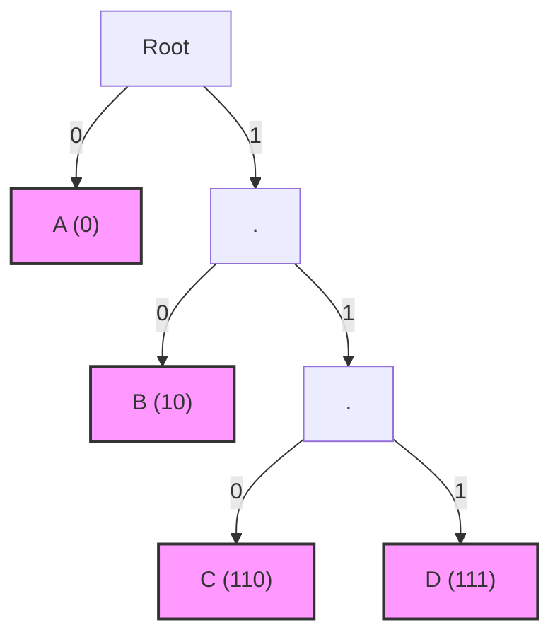

# 第 2 章：無前綴碼 (Prefix-Free Codes)

把長短不同的碼字連在一起後，解碼器怎麼知道哪裡是一個符號的結尾？本章用無前綴碼（Prefix-Free Codes）解決這個問題，再說明如何依符號機率安排碼長。

「碼字」是一個符號對應的位元串，「碼長」是這串位元的長度。先能解碼，再考慮平均碼長是否夠短。

## 2.1 唯一可解碼性 (Uniquely Decodable Codes)

本章討論無失真（Lossless）壓縮：接收端拿到連續的位元串後，必須能完整還原原本的符號序列。

如果沒有任何兩種不同的符號序列會被編碼為相同的位元流，我們就稱這個代碼是**唯一可解碼的** (Uniquely Decodable)。舉例來說，傳統的摩斯密碼 (Morse Code) 如果不加上停頓 (空白)，就不是唯一可解碼的，因為點和線的組合可能會產生歧義。

## 2.2 無前綴碼 (Prefix-Free Codes)

**無前綴碼**是唯一可解碼的一類編碼，也稱即時碼（Instantaneous Codes）。它讓解碼器在讀完一個碼字時，就能確定該輸出哪個符號。

**定義**：如果一個代碼中，沒有任何一個編碼是另一個編碼的前綴 (Prefix)，則該代碼稱為無前綴碼。

舉例來說，假設我們有以下的代碼表：
| 符號 | 編碼 |
|---|---|
| A | 0 |
| B | 10 |
| C | 110 |
| D | 111 |

這個代碼是無前綴碼，因為沒有任何一個編碼是其他編碼的開頭。例如，`0` 不是 `10`, `110`, `111` 的開頭；`10` 也不是 `110` 或 `111` 的開頭。

### 即時解碼與前綴樹 (Prefix-Free Tree)

無前綴碼的一個重要特性是可以「即時解碼」：解碼器只要逐位讀取位元，一旦發現符合的編碼，就可以立刻解碼，不需向後看 (Look-ahead)。

為了解碼更有效率，我們可以用**前綴樹 (Prefix-Free Tree)** 來表示無前綴碼。前綴樹是一棵二元樹，根節點出發，左分支代表 `0`，右分支代表 `1`。

**重要性質**：在無前綴碼對應的前綴樹中，所有的編碼必定落在**葉節點 (Leaf Nodes)** 上。

以下是前面代碼的前綴樹範例：

依照這棵樹解碼：

1. 從根節點開始。
2. 讀取下一個位元，如果是 `0` 往左走，是 `1` 往右走。
3. 如果到達葉節點，則輸出對應的符號，並回到根節點重新開始。
4. 重複上述步驟直到讀完所有位元。

例如，`010111` 依序走到 `0`、`10`、`111` 的葉節點，因此還原成 A、B、D。讀到 `1` 時還不能輸出，因為它可能是 B、C 或 D 的開頭；讀到 `10` 時則已經確定是 B。

## 2.3 如何設計良好的無前綴碼？

如果我們知道各個符號出現的機率，我們要如何分配編碼長度，才能讓平均編碼長度最短呢？

### 基本法則

1. **讓較常出現的符號使用較短碼字**：可以把碼長安排成當 $P(s_1) \geq P(s_2)$ 時，$l(s_1) \leq l(s_2)$。若較常見的符號反而較長，交換兩者碼字不會增加平均碼長；當機率與碼長都不相等時，才會嚴格縮短。
2. **夏農經驗法則 (Shannon's Thumb Rule)**：符號的最佳編碼長度大約是機率倒數的以 2 為底的對數：
   $$ l_{\text{optimal}}(s) \approx \log_2 \frac{1}{P(s)} $$

這個式子先給出目標長度；實際碼字仍須使用整數個位元。看兩種情況：

- **均勻分佈 (Uniform Distribution)**：如果有 $k$ 個機率相同的符號，每符號機率為 $1/k$，理想目標長度是 $\log_2(k)$。當 $k$ 是 2 的次方時，這個長度是整數，可直接使用固定長度編碼；否則不能讓每個符號都使用這個非整數長度。
- **二進制分佈 (Dyadic Distribution)**：如果所有符號的機率都是 $2^{-l_i}$ 的形式 (例如 1/2, 1/4, 1/8...)，那麼對應的編碼長度剛好是整數 $l_i$。

## 2.4 夏農編碼法 (Shannon Code Construction)

對於一般的機率分佈，$\log_2(1/P(s))$ 通常不是整數。一個合理且直觀的目標長度是將其無條件進位：
$$ l(s) = \lceil \log_2 \frac{1}{P(s)} \rceil $$

先將長度無條件進位，再按以下順序建構無前綴碼：

1. **計算長度**：對於每個符號 $s$，計算 $l(s) = \lceil \log_2(1/P(s)) \rceil$。
2. **排序**：將符號依照長度由小到大排序。
3. **貪婪指派 (Greedy Assignment)**：從長度最短的符號開始，在前綴樹中深度為 $l(s)$ 的位置尋找尚未被佔用、且不違反無前綴條件的葉節點進行指派。

### 夏農編碼法一定會成功嗎？

可以透過歸納法證明，由於機率總和為 1，即 $\sum P(s) = 1$，且 $2^{-l(s)} \leq P(s)$，我們有：
$$ \sum 2^{-l(s)} \leq 1 $$
這裡用了兩步：無條件進位使 $l(s)$ 不小於原本的對數值，因此 $2^{-l(s)} \leq P(s)$；再把所有符號加總，就不會超過機率總和 1。

接著使用 Kraft 不等式的逆定理：滿足這個條件的整數碼長，可以排成無前綴碼。按長度由短到長指派時，不會因為前面的碼字把可用位置占滿而失敗。下一章會用二元樹說明原因。

## 2.5 總結

1. **無前綴碼**保證唯一可解碼，且讀完一個碼字即可輸出，不必等待下一個碼字。
2. 透過**前綴樹**可以高效地解碼。
3. 最理想的編碼長度符合 $l(s) \approx \log_2(1/P(s))$。
4. **夏農編碼**藉由無條件進位給出了簡單的構造方式，保證這組長度分配總是能找到對應的無前綴碼。

繼續前，請用本章碼表解開 `110010`，再說明為何 `0` 和 `01` 不能同時放進一組無前綴碼。第一題應得到 C、A、B；第二題的問題是 `0` 已經是 `01` 的開頭。

## 資料來源

- [EE274：Kraft Inequality](https://stanforddatacompressionclass.github.io/notes/lossless_iid/kraft_ineq_and_optimality.html)：碼長條件與由短到長的建構。解碼練習沿用本章碼表。

---
## 相關作業與材料

本章節的實作與練習對應於 Stanford EE274 官方提供的作業與專案：
- **對應內容**：HW1: Prefix-Free Codes, Kraft Inequality, Entropy

> **注意**：為了遵守學術誠信與課程規範，本書不提供作業的解答代碼。強烈建議讀者親自前往 [EE274 課程筆記網站 (Homeworks 區塊)](https://stanforddatacompressionclass.github.io/notes/) 下載 starter code 並實作，以深化對演算法的理解。
