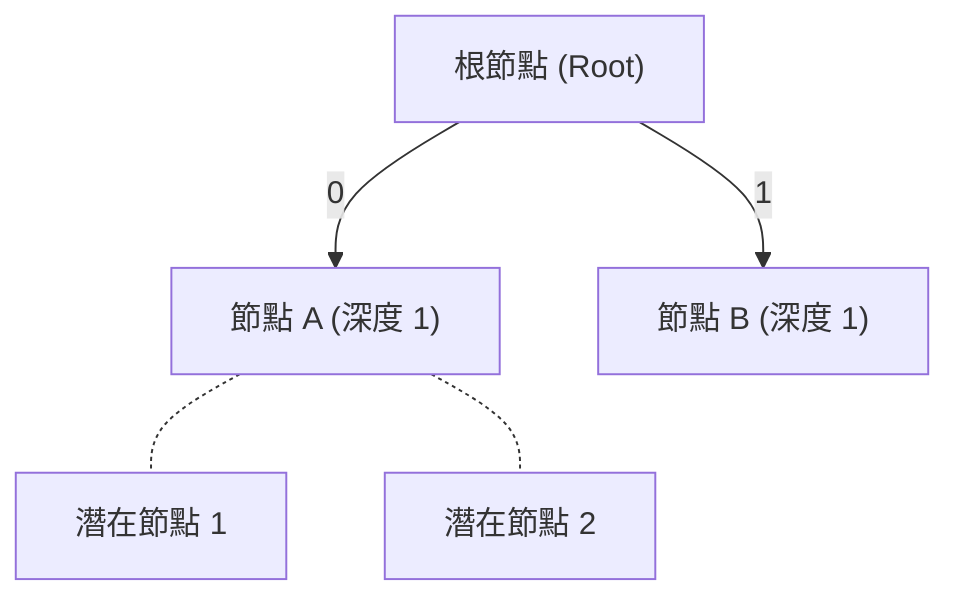

# 第 3 講：Kraft 不等式、熵與 SCL 簡介

本章接續[無前綴碼](02-prefix-free.md)，回答兩個問題：你選的碼長能不能排進一棵編碼樹？依資料的機率分佈，平均碼長最少是多少？前者用 Kraft 不等式判斷，後者用熵建立下界。

本章的「無損」與前章的「無失真」意思相同，都是解碼後完整還原資料。先讀第 2–4 節的推導；準備實作時，再使用下一節介紹的 SCL。

## 1. Stanford Compression Library (SCL) 簡介
史丹佛壓縮函式庫（Stanford Compression Library, SCL）是一個為學習與研究而設計的 Python 函式庫。許多真實世界的壓縮工具是用 C 語言等低階語言編寫，難以閱讀；SCL 的目標是提供清晰、易懂的實作。
SCL 提供了處理位元陣列（Bit Arrays）的工具，以及前綴樹解碼（Prefix-free decoding）的基本架構，讓你能專注於演算法的設計。

## 2. Kraft 不等式 (Kraft Inequality)

在上一講中我們學習了前綴碼（Prefix-free codes）以及如何透過二元樹來表示它們。**Kraft 不等式** 為前綴碼的碼長提供了一個數學上的充要條件。

### 定理：Kraft 不等式
假設一個二元樹的葉節點（對應到碼字）深度分別為 $l_1, l_2, \dots, l_k$，則這些深度滿足以下不等式：
$$ \sum_{i=1}^k 2^{-l_i} \leq 1 $$

### 證明直覺
令 $l_{max} = \max(l_i)$。我們可以將 Kraft 不等式兩邊同乘 $2^{l_{max}}$：
$$ \sum_{i=1}^k 2^{l_{max} - l_i} \leq 2^{l_{max}} $$
先把所有碼字換算成同一個深度占用的位置，再數總共有多少位置：
- $2^{l_{max}}$ 是深度為 $l_{max}$ 時，二元樹最多能擁有的節點總數。
- 每一個深度為 $l_i$ 的葉節點，若繼續往下延伸到 $l_{max}$，會涵蓋 $2^{l_{max} - l_i}$ 個潛在的葉節點。
- 因為是前綴碼，這些葉節點彼此的子樹不會重疊。因此，各個葉節點涵蓋的潛在子節點總數，不可能超過最大可能節點數 $2^{l_{max}}$。

**Kraft 不等式的逆定理**也成立：如果有一組整數 $l_1, l_2, \dots, l_k$ 滿足上述不等式，我們必定可以建構出一個對應此碼長的前綴碼。

沿用上一章的碼長 1、2、3、3，在深度 3 分別占用 4、2、1、1 個位置，合計 8 個，正好用滿。若想放三個長度都是 1 的碼字，就需要第一層有三個位置，但二元樹只有兩個；此時 Kraft 加總為 $3/2>1$，因此不可行。

## 3. 資訊理論基礎 (Information Theory Basics)

為了推導出最佳的碼長，我們需要引入克勞德·香農（Claude Shannon）在 1948 年提出的資訊理論中的重要概念。

### 3.1 熵 (Entropy)
對於一個離散隨機變數 $X$，其機率分佈為 $P = \{p_1, p_2, \dots, p_k\}$，**熵 $H(X)$** 定義為：
$$ H(X) = \sum_{i=1}^k p_i \log_2 \frac{1}{p_i} $$
熵的單位為「位元 (bits)」。

**熵的重要性質：**
1. **非負性**：$H(X) \geq 0$。
2. **最大值**：當 $X$ 為均勻分佈時，熵達到最大值 $\log_2 k$。如果變數是完全確定的（deterministic），熵為 0。
3. **獨立變數的聯合熵**：如果 $X_1$ 與 $X_2$ 是獨立隨機變數，則 $H(X_1, X_2) = H(X_1) + H(X_2)$。
4. **下界性質**：對於任意機率分佈 $q(X)$，必定有 $H(X) \leq \mathbb{E}_P \left[ \log_2 \frac{1}{q(X)} \right]$。

讀這個公式時，先算各符號的 $\log_2(1/p_i)$，再依出現機率 $p_i$ 加權平均。熵描述這個分佈的不確定性；下節會說明它如何限制平均碼長。這是平均值的下界，不是每一份檔案都能壓到的固定大小。

### 3.2 KL 散度 (KL-Divergence)
KL 散度比較兩個機率分佈 $p$ 與 $q$ 的差異。這裡 $p$ 是資料的實際分佈，$q$ 是拿來描述資料的另一個分佈：
$$ D_{KL}(p||q) = \sum_{i=1}^k p_i \log_2 \frac{p_i}{q_i} $$
其最重要的性質為 $D_{KL}(p||q) \geq 0$，且等號成立若且唯若 $p = q$。

它不是一般幾何距離：交換 $p$ 與 $q$，結果不一定相同。以下推導只用到它非負的性質。

## 4. 最佳無損壓縮 (Optimal Lossless Compression)

### 熵作為壓縮的下界
有了 Kraft 不等式，尋找最佳前綴碼的問題可以轉換為一個最佳化問題：
- **目標**：最小化預期碼長 $\sum_{i=1}^k p_i l_i$
- **限制條件**：$\sum_{i=1}^k 2^{-l_i} \leq 1$

我們可以構造一個虛擬的分佈 $q_i = 2^{-l_i}$（假設 Kraft 不等式恰好等於 1）。那麼預期碼長為：
$$ \sum_{i=1}^k p_i l_i = \sum_{i=1}^k p_i \log_2 \frac{1}{q_i} $$
根據熵的性質，我們知道：
$$ \sum_{i=1}^k p_i \log_2 \frac{1}{q_i} \geq \sum_{i=1}^k p_i \log_2 \frac{1}{p_i} = H(X) $$
上面先證明 Kraft 加總等於 1 的情況。若加總 $K=\sum_i 2^{-l_i}<1$，先令 $q_i=2^{-l_i}/K$，使 $q$ 成為總和為 1 的機率分佈。此時：

$$ \sum_i p_i l_i = \sum_i p_i \log_2 \frac{1}{q_i} - \log_2 K \geq H(X) $$

因為 $K\leq1$，所以 $-\log_2 K\geq0$，下界仍成立。這補齊了 **任何無前綴碼的預期碼長都不小於熵 $H(X)$** 的推導。所有可唯一解碼的符號碼也滿足 Kraft 不等式，因此有同樣的下界。

### 拇指法則 (Thumb Rule) 與 Shannon 編碼
要使平均碼長等於熵，需要 Kraft 加總為 1 且 $q_i=p_i$。也就是 $2^{-l_i}=p_i$，因此 $l_i=\log_2(1/p_i)$。這說明上一章的經驗法則從何而來；若算出的長度不是整數，還不能直接當作碼長。

**Shannon 編碼的表現**：
由於碼長必須為整數，Shannon 編碼將碼長設定為 $l_i = \lceil \log_2 \frac{1}{p_i} \rceil$。其預期碼長滿足：
$$ H(X) \leq \mathbb{E}[L] < H(X) + 1 $$
也就是說，Shannon 編碼可以保證與最佳極限（熵）的差距在 1 個位元之內。

### 區塊編碼 (Block Coding) 逼近極限
如果希望平均每個符號的差距更小，可以把 $n$ 個符號合成一個區塊，再一起編碼。**此處假設符號彼此獨立，而且分佈相同。** 因此區塊的熵為 $n\cdot H(X)$。對整個區塊使用 Shannon 編碼，預期碼長不小於 $n\cdot H(X)$，且小於 $n\cdot H(X)+1$。
平均到每個符號上，我們得到的碼長上限為：
$$ H(X) + \frac{1}{n} $$
當 $n$ 越大時，我們就能**無限逼近熵**。然而，區塊編碼會導致字母表大小呈指數增長，計算複雜度變高。在後續的講次中，我們將介紹如 Huffman 編碼、算術編碼等更有效率的演算法來解決這些問題。

## 用同一組數字串起本章

上一章四個符號的機率若是 $1/2,1/4,1/8,1/8$，對應碼長就是 1、2、3、3。它們滿足 Kraft 等號，平均碼長與熵都是 1.75 位元／符號。這是剛好達到下界的例子；不能據此推論所有分佈都能用逐符號的整數碼長達到熵。

下一步讀 [Huffman 編碼](04-huffman.md)，看如何直接建構最佳的無前綴符號碼。

## 資料來源

- [EE274：Kraft Inequality](https://stanforddatacompressionclass.github.io/notes/lossless_iid/kraft_ineq_and_optimality.html)：碼長與二元樹的關係。
- [EE274：Entropy and Neg-log likelihood thumb rule](https://stanforddatacompressionclass.github.io/notes/lossless_iid/entropy.html)：熵的下界、Shannon 編碼與區塊編碼。數值例子沿用前章碼表。

---
## 相關作業與材料

本章節的實作與練習對應於 Stanford EE274 官方提供的作業與專案：
- **對應內容**：HW1: Kraft Inequality, Entropy

> **注意**：為了遵守學術誠信與課程規範，本書不提供作業的解答代碼。強烈建議讀者親自前往 [EE274 課程筆記網站 (Homeworks 區塊)](https://stanforddatacompressionclass.github.io/notes/) 下載 starter code 並實作，以深化對演算法的理解。
