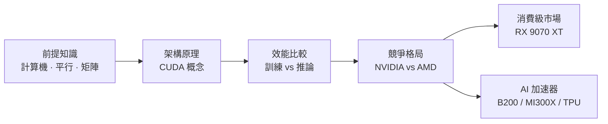

# GPU 完整學習指南

本書從架構原理出發，帶你理解 GPU 的運作方式，再逐步拆解各家廠商的競爭策略、消費級市場格局，以及 AI 加速器的取捨邏輯。

## 建議學習路徑

**完全新手**：先從[前提知識](prerequisites/overview.md)建立基礎，再進入架構原理。  
**有程式背景**：可從[GPU 基礎架構](architecture/gpu-fundamentals.md)入手，遇到不熟悉的概念再回頭查前提知識。

## 五大主題

| 主題 | 核心問題 |
|------|---------|
| [架構原理](architecture/gpu-fundamentals.md) | GPU 為什麼比 CPU 更擅長平行計算？ |
| [效能比較](performance/training-benchmarks.md) | 訓練與推論的瓶頸分別在哪裡？ |
| [競爭格局](competitive/nvidia-moat.md) | NVIDIA 的護城河究竟是硬體還是生態？ |
| [消費級市場](consumer/rx9070xt.md) | AMD 如何在 2025 年打破 NVIDIA 的定價壟斷？ |
| [AI 加速器](ai-accelerators/tradeoffs.md) | 不同加速器在不同任務上各有什麼優勢？ |

## 核心洞察

> 比較加速器時，硬體規格、模型支援、互連與軟體版本要一起看。不同模型、精度和測試條件的結果，不能合併成固定的品牌倍數。先用[加速器取捨總覽](ai-accelerators/tradeoffs.md)建立比較條件。

2026-10-28 已更新[B200／B300 系統比較](ai-accelerators/b200.md)、[自研晶片](ai-accelerators/custom-silicon.md)與選型框架；其他產品章保留其案例定位，不代表本輪已全面查新。
