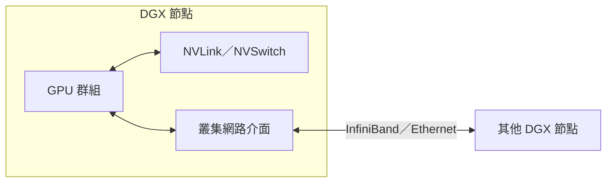

# NVIDIA B200 與 NVLink

B200 可用來理解 Blackwell 的系統設計，但它不是所有 Blackwell 產品的統一規格。比較時要先分清 GPU、DGX 整機與機架級系統；不同產品不能共用一張容量與功耗表。

本頁於 2026-10-28 核對 NVIDIA 的 DGX B200 與 DGX B300 產品頁。

## 以整機口徑比較

下表全是**整部 DGX 系統**的官方規格，不是單顆 GPU。

| 項目 | DGX B200 | DGX B300 |
|---|---|---|
| GPU | 8 顆 Blackwell GPU | 8 顆 Blackwell Ultra SXM GPU |
| GPU 記憶體總量 | 1,440 GB | 2.1 TB，沿用官方標示 |
| NVLink 總頻寬 | 14.4 TB/s aggregate | 14.4 TB/s aggregate |
| 主要叢集網路介面 | ConnectX-7，最高 400 Gb/s InfiniBand／Ethernet | ConnectX-8，最高 800 Gb/s InfiniBand／Ethernet |
| 產品狀態 | 官方列有整機規格 | 官方產品頁明示系統正在出貨 |

DGX B200 的總容量除以卡數，得到每顆平均 **180 GB**；這是上述整機規格的算術，不應沿用舊版沒有區分產品的 192 GB 表格。DGX B300 的 TB 標示也不在本頁擅自換成另一種容量口徑。

**總 GPU 記憶體不是單一程序自動可用的一塊連續記憶體。** 模型如何切分、KV cache 放在哪裡、框架如何分配，仍會影響能否執行。

## NVLink 與跨節點網路分開看

這是層級示意，不是實體配線圖。DGX 規格把 NVLink 互連與叢集網路分開列出；不能畫成多部 DGX 自然共用同一個 NVLink Switch 域，也不能因為 NVLink 頻寬高就說 tensor parallelism 的通訊成本可以忽略。

**工程判斷：** 通訊開銷還取決於訊息大小、同步頻率、平行切分與是否能和計算重疊。應量測實際拓樸下的 collective 與端到端時間。

## 低精度效能要讀註腳

NVIDIA 的 DGX B300 規格分開列出 sparse 與 dense 峰值。比較 FP4、FP8 或不同系統時，必須連同精度、稀疏條件、模型品質與 GPU 數量一起記錄。

因此本頁不保留「推論固定快於 H100 五倍」或「某家實驗室的主要採購目標」等沒有對應測試或採購揭露的結論。產品峰值不等於每個模型的服務吞吐。

## 資料來源

- [NVIDIA DGX B200](https://www.nvidia.com/en-us/data-center/dgx-b200/)：整機容量、NVLink 與網路規格。
- [NVIDIA DGX B300](https://www.nvidia.com/en-us/data-center/dgx-b300/)：Blackwell Ultra、整機規格、出貨狀態與精度註腳。
- 兩頁查核日均為 2026-10-28；本頁未自行量測硬體效能。

## 延伸閱讀

- [平行運算原理](../architecture/parallel-computing.md)
- [加速器取捨總覽](tradeoffs.md)