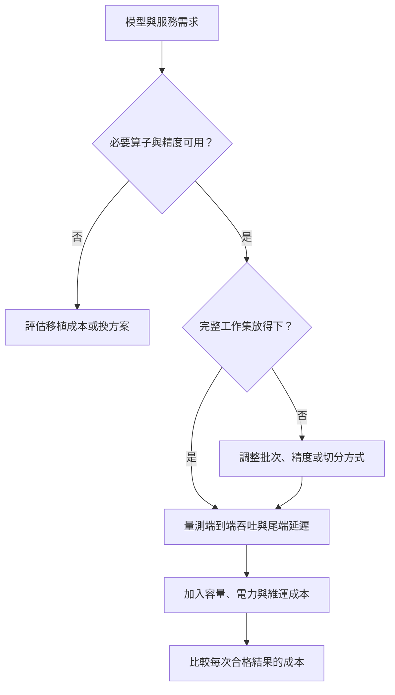

# 加速器取捨總覽

選加速器之前，先固定模型、精度、輸入與輸出長度、併發，以及可接受的延遲。以下是工程評估框架，不是即時採購排行榜。

## 先排除不能完成工作的方案

不能只用參數量判斷單卡是否放得下。權重以外還有 KV cache、暫存空間；訓練另外需要梯度與優化器狀態。記憶體足夠也不代表延遲達標。

## 本書案例怎麼用

| 案例 | 用來理解什麼 | 實際選型還要確認 |
|---|---|---|
| [B200 與 NVLink](b200.md) | 多 GPU 互連與系統層級的差別 | 具體系統、軟體版本、通訊拓樸與容量 |
| [MI300X](mi300x.md) | 記憶體與推論工作集 | 模型和算子在目標 ROCm 版本上的支援與實測 |
| [TPU v5p](tpu-v5p.md) | 雲端加速器與編譯堆疊 | 可取得的世代、區域與移植成本 |
| [AWS、微軟與 Meta 自研晶片](custom-silicon.md) | 公開雲端服務與內部部署的差異 | 不把展示、預告或內部平台當成可購買的產品 |

舊型號仍能解釋架構，但不能直接代表今天的最佳選擇。自研晶片的已查核世代與公告日期集中在上表連結的專頁。

## 峰值效能不能替代應用測試

比較時，先確認精度與是否使用稀疏計算，再看結果是否來自相同模型與品質門檻。不能把不同條件下的峰值排成「硬體最強」榜，也不能僅憑廠牌判定軟體最成熟。

MLPerf 的推論測試以工作負載、品質條件與情境組織結果。這種分開比較的方法，比只看單一 FLOPS 數字更適合作為測試設計的起點；公開成績仍不能取代自己的服務測量。

## 資料來源

- [MLCommons：MLPerf Inference Datacenter](https://mlcommons.org/benchmarks/inference-datacenter/)：推論情境、品質與效能評估；查核日 2026-10-28。
- 產品公告與日期見[自研晶片的資料來源](custom-silicon.md#資料來源)。

## 延伸閱讀

- [性價比分析](../performance/cost-analysis.md)：成本計算的討論。