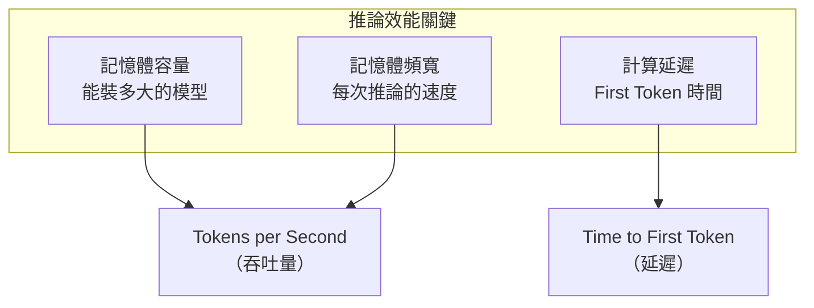

# 推論效能基準

推論和訓練的瓶頸截然不同：訓練是 Compute Bound，推論（小 Batch）是 **Memory Bound**。這個差異使 AMD MI300X 在推論場景具備競爭力。

## 推論效能的決定因素

## 大模型推論：記憶體容量為王

以一個假設有 700 億參數、每個權重占 2 bytes 的模型為教學算例，權重本身約需 140 GB（十進位）；這尚未包含 KV cache、暫存空間與框架配置。不能僅由顯示記憶體比這個數字大，就保證單卡可完成目標服務。

B200 的容量與系統口徑統一見[B200 與 NVLink](../ai-accelerators/b200.md)。實際卡數還須依精度、上下文長度、併發及分片方式量測，不以型號給固定答案。

## Tokens per Second 實測（LLaMA-3 70B, vLLM）

根據 Anyscale / Together AI 的公開測試（2024）：

- **MI300X**：~2,800 tok/s（Batch 64，FP8）
- **H100**：~2,100 tok/s（Batch 64，FP8）
- 差距來自 MI300X 更高的記憶體頻寬（5.3 TB/s vs 3.35 TB/s）

> 推論場景的競爭比訓練更接近，MI300X 在部分配置下**優於** H100。

## 量化對效能的影響

| 精度 | 模型大小 | 速度提升 | 品質損失 |
|------|---------|---------|---------|
| FP16 | 基準 | 1× | 無 |
| BF16 | 基準 | 1× | 極小 |
| INT8 | 50% | ~1.5× | 可接受 |
| FP8 | 50% | ~2× | 極小 |
| INT4（GPTQ） | 25% | ~3× | 依模型而定 |

## 延伸閱讀

- [AMD MI300X 推論優勢](../ai-accelerators/mi300x.md) — 詳細的推論場景分析
- [記憶體層次結構](../architecture/memory-hierarchy.md) — 為何記憶體容量影響推論架構
