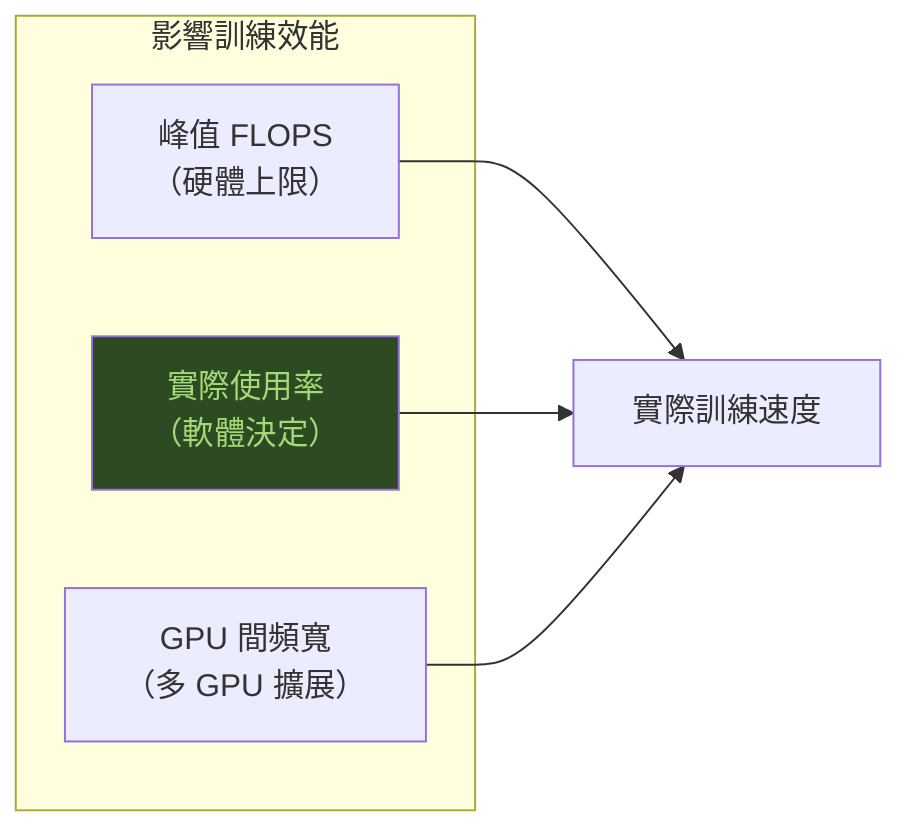

# 訓練效能基準

訓練效能受三個因素決定：FLOPS（計算能力）、記憶體頻寬、以及 GPU 間通訊頻寬。

## 主流 AI 訓練 GPU 規格對比（2024–2025）

| GPU | 架構 | FP8 TFLOPS（含 sparsity） | HBM 容量 | HBM 頻寬 | GPU 間互連 |
|-----|------|-----------|---------|---------|-------|
| NVIDIA H100 SXM | Hopper | 3,958 | 80 GB | 3.35 TB/s | NVLink 900 GB/s |
| NVIDIA H200 SXM | Hopper | 3,958 | 141 GB | 4.8 TB/s | NVLink 900 GB/s |
| NVIDIA B200 | Blackwell | 見具體系統規格 | 依 DGX B200 整機換算為每顆 180 GB | 見具體系統規格 | 見[整機與互連口徑](../ai-accelerators/b200.md) |
| AMD MI300X | CDNA 3 | 5,220 | 192 GB | 5.3 TB/s | Infinity Fabric ~896 GB/s |
| AMD MI325X | CDNA 3+ | 5,220 | 256 GB | 6.0 TB/s | Infinity Fabric ~896 GB/s |

## 訓練結果要對齊條件

本書未取得足以支持「H100 在 LLM 訓練固定快於 MI300X 某個倍數」的同條件測試，因此撤除原先歸因於 MLPerf 的倍數結論。比較時要列出模型、目標品質、精度、卡數、軟體版本與達標時間，不能只看峰值 FLOPS。

## 找出實際瓶頸

**工程判斷：** 應量測核心運算、記憶體存取、資料載入與跨卡通訊的時間，再判斷該改善哪一層。不能從一次測試失利直接推出整個廠牌的軟體能力較差。

## 延伸閱讀

- [NVIDIA 生態系護城河](../competitive/nvidia-moat.md) — 軟體成熟度的詳細分析
- [推論效能基準](inference-benchmarks.md) — 推論場景的競爭態勢截然不同
