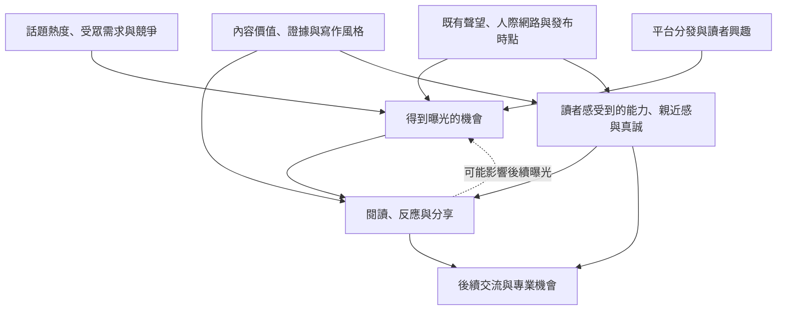

# 流量、內容與個人魅力：哪些關係有證據？

一篇貼文受歡迎，可能同時受題材、作者原有受眾、表達、發布時點與平台分發影響。**高讚數不能單獨告訴你是哪一項起作用。** 本章把這些關係拆開，幫你決定該練寫作、換題目，還是重新檢查目標讀者。

查讀日期：2026-10-03。本輪採公開研究與平台公告，沒有遍歷 LinkedIn 個人帳號。以下分清三種依據：原研究結果、跨平台推論、本書的實作建議。尚無一份已取得的研究能替半導體／LLM／Agent 工程師估出這些因素各占幾成。

## 先決定「流量好」代表什麼

| 結果 | 可以觀察什麼 | 單憑它仍不知道什麼 |
|---|---|---|
| 被看見 | 曝光、觸及；依平台當時可見欄位分開記 | 是否讀完、是否符合目標職位 |
| 引起反應 | 各類反應、留言、分享、可得的點擊數 | 是認同、祝賀、爭論，還是支持熟人 |
| 形成理解與信任 | 同行是否引用你的方法、提出具體問題或指出可用之處 | 沉默讀者怎麼想；這些也不是完整信任量表 |
| 出現專業機會 | 明確提到貼文的邀約、面談或合作詢問 | 是否完全由這篇促成，其他接觸也可能有貢獻 |

流量與專業機會應並列記錄。曝光少、但出現一段設備同行的具體討論，可能符合你的目標；曝光多而讀者與目標領域疏遠，也可以有價值，只是要另行判斷。相關指標見[成效與學習](09-measure-and-learn.md)。

## 一張關係圖：先找可能的解釋

下圖是本書的**待檢驗概念模型**，不是已估計的因果圖。箭頭表示研究與觀察時要檢查的可能路徑，沒有權重；實際上還存在回饋與其他未列因素。

例如知名作者既有較多受眾，也可能被預先視為可信。你看到的是同時改變的兩件事。照用他的短句或強勢語氣，並沒有同時取得相同的網路與信任基礎。

LinkedIn 在 2026 年 3 月的官方公告表示，分發會參考內容、會員職業資訊與互動歷史，也正減少低實質重複內容與互動誘餌。這支持「讀者相關性需要納入分析」；公告沒有公開各項權重，也沒有提供某種文風能增加多少曝光的實驗。[官方公告](https://news.linkedin.com/2026/ImprovingTheFeed)

## 證據目前支持到哪裡

### 1. 話題熱度：研究的是集體注意力，不能直接預測你的貼文

2019 年的跨領域研究分析 Twitter、搜尋、書籍等資料，發現許多熱門內容的注意力週期變短；研究者用有限注意力下的模仿、飽和與競爭模型解釋變化。Twitter 部分取全球熱門 hashtag，並非 LinkedIn 工程受眾，也不是個人專注力測驗。[原研究](https://www.nature.com/articles/s41467-019-09311-w)

本輪已讀該研究的摘要、引言、結果與討論，未重新分析資料或查讀全部補充材料。

**本書推論：**追熱門題材時，需求與競爭都值得觀察。全網熱度高，不代表你的目標同行缺少同類內容。對你較有辨識度的問題是：「這個事件改變了設備或軟體工作中的哪個決策？我有什麼材料能補充？」

不要用自己那篇的高讚數反過來定義「當時題材很熱」，再用熱度解釋高讚。熱度需要獨立、帶日期的線索，例如固定選定的產業刊物議題、官方發布事件，或人工查看的搜尋趨勢；搜尋熱度也不等於 LinkedIn 熱度。

### 2. 內容與情緒：點擊和分享可能受不同因素影響

Berger 與 Milkman 的 2012 年研究摘要指出，在三個月的《紐約時報》文章資料中，實用、意外、有趣及情緒特性與傳播有關，另以實驗研究情緒喚起。這次只讀到出版社可見摘要，未取得全文方法，不引用效應量，也不套成 LinkedIn 的正向文風規則。[出版社摘要](https://journals.sagepub.com/doi/10.1509/jmr.10.0353)

另一項 2023 年研究分析 Upworthy 隨機展示的新聞標題變體；篩選後包含 12,448 組實驗。作者以模型估計，平均長度的標題每增加一個負向詞，點擊率相對增加約 2.3%，**不是增加 2.3 個百分點**。隨機分配的是標題版本，詞彙特徵再由模型分析；結果也不代表負向語氣能增加工程信任。[原研究主要結果](https://www.nature.com/articles/s41562-023-01538-4)

Upworthy 研究本輪已讀摘要、研究設計、主要結果與討論段，未讀附錄或重跑原始資料。

兩者不能簡化成「正向有效」與「負向有效」的矛盾：樣本、行為與測量不同。寫作時可以呈現真實的困難、意外與發現，但目前沒有證據支持你應為了職涯成果刻意增加憤怒或焦慮。

### 3. 寫作風格：能改變入口，仍需檢查正文交付

上面的標題研究證明，分析內容成效時不能忽略表達。但它沒有測試本書的教學、復盤、探索式語氣哪一種最好，更沒有證明某種中文斷行方式提高 LinkedIn 排名。

本書把風格拆成可以改稿的項目：

| 風格項目 | 具體改動 | 可以檢查的結果 |
|---|---|---|
| 清楚程度 | 先寫問題、解釋必要術語 | 目標讀者能否重述主張 |
| 主張強度 | 從提問改成有條件的建議 | 讀者是否分得清結果與推論 |
| 敘事程度 | 加入真實的決策轉折 | 讀者是否理解為何改變做法 |
| 情緒強度 | 說明意外或挫折的具體原因 | 討論是否仍圍繞工程問題 |
| 個人露出 | 補上本人角色、取捨與學到的事 | 讀者是否看得出你的貢獻 |

以上是編輯與觀察方法，並非已驗證的排序權重。操作例子見[發文語氣](tone-and-voice.md)。

### 4. 社會證明：已有反應也會改變後續反應

2013 年一項社群新聞聚合站的隨機實驗發現，正向評分操弄會帶動後續正向評分；研究摘要報告最終評分平均提高 25%，且效果與題材及社會關係有關。本輪讀取原研究摘要，未讀全文；該數字不能移植成 LinkedIn 效果。[原研究摘要](https://pubmed.ncbi.nlm.nih.gov/23929980/)

因此，**受歡迎程度本身也可能參與後續評價**。該實驗操弄的是內容的可見評分，未測作者聲望。這能解釋為何讚數不能直接當作內容品質分數；它沒有證明某位作者的高讚來自這項機制，也沒有測量他的魅力。

分析名人作品時，至少把原有受眾、當時角色、媒體事件與內容放在一起看。同一作者跨期比較也要記錄職位、產品發布和受眾變化，不能把前後差異全算在文風上。

## 「個人魅力」要拆成讀者能回答的問題

本書將個人魅力視為讀者對作者的綜合感受，暫不給單一分數。下表是**研究與改稿的操作分類**，不是經心理計量驗證的量表；聲望、能力與親近感也不互相等同。

| 想了解的感受 | 請讀者判斷什麼 | 寫作者能提供的線索 |
|---|---|---|
| 能力與可信度 | 為何相信這個判斷？ | 可檢查的作品、推理、限制與修正 |
| 親近感 | 是否願意與這個人討論？ | 接住疑問、解釋術語、承認合理異議 |
| 真誠感 | 是否理解作者的立場與利害關係？ | 說清本人角色、商業關係與不確定性 |
| 辨識度 | 看完記得這位作者關心什麼？ | 持續處理一組相關問題、呈現自己的取捨 |
| 既有聲望 | 在閱讀前已經知道或信任他嗎？ | 職位、作品、人際關係等背景，另行記錄 |

「我喜歡他」不等於「我認為他在這題可靠」。熟悉的人也可能獲得祝賀，即使貼文沒有技術內容。反過來，對某個工程答案高度信任，也不表示讀者想追蹤作者的所有生活分享。

### 研究怎麼看「這個人讓我信任」

三項研究提供了不同層次的線索：

- **LinkedIn 檔案印象：**Edwards 等人（2015）的摘要報告，有照片的檔案獲得較高的社交吸引力與能力評價。本輪僅讀期刊摘要，未取得樣本數與完整分派細節；不能推成照片增加貼文觸及，或把外觀當成實際能力。[原研究](https://doi.org/10.29333/ojcmt/2528)
- **內容與作者共同參與信任：**Lou 與 Yuan（2019）以追蹤至少一位網紅的使用者問卷建立路徑模型，摘要報告資訊價值、可信賴感、吸引力與相似感，和品牌貼文信任存在正向關係。這是問卷模型，不能只憑箭頭或作者使用的影響字眼認定因果；也不能等同工程師的職涯結果。本輪讀到出版社搜尋可見摘要，直接頁面受限，未取得全文與樣本細節。[出版社摘要](https://www.tandfonline.com/doi/abs/10.1080/15252019.2018.1533501)
- **自我揭露有情境條件：**AlRabiah 等人的《Too much information》研究摘要報告，在網紅促銷情境，較深、較廣的私人揭露可能被認為不合宜，伴隨較低信任與購買意願。本輪僅取得大學典藏可見摘要，未讀全文，不推論中介機制已被完整證明。它至少提醒我們，不能假定揭露越多越好。[研究典藏摘要](https://eprints.soton.ac.uk/468289/)

**給你的編輯建議：**優先呈現與工作判斷有關的個人部分：當時為何猶豫、收到什麼回饋、如何修正。這能讓讀者看見一個具體的人，又保留文章的專業用途。是否因此提高親近感、信任或流量，仍需分開觀察；「真誠」不是保證成效的技巧。

## 這些因素如何一起作用：五個待驗證的組合

下表是由上述研究與書中案例提出的**工作假設**，用來選題和觀察，尚未取得 LinkedIn 工程師樣本來估計效果。

| 組合 | 值得觀察的可能性 | 會讓你改變判斷的情況 |
|---|---|---|
| 熱門題材＋一般摘要 | 有時事入口，但讀者未必記得作者 | 讀者持續回訪，明確表示摘要幫助其工作 |
| 熱門題材＋自身專業切角 | 能把事件連到特定職位的問題 | 回應全是泛泛討論，沒有人理解工程切角 |
| 小眾題材＋可重用方法 | 總量可能有限，但對特定同行有用 | 目標讀者也認為情境過窄或方法無法使用 |
| 強烈觀點＋薄弱證據 | 可能引來反應，可信度仍待檢查 | 有效交流與信任評價持續改善，且主張有補證 |
| 真實經歷＋明確決策＋可查材料 | 同時讓讀者看見本人與工作能力 | 故事被記住，但方法與本人貢獻被誤解 |

這些不是流量排名。它們提醒你：同一種高互動，可能來自不同讀者、不同動機，也可能留下不同的職業印象。

## 對設備、半導體、LLM 與 Agent 的具體用法

你的可辨識主線可以是「如何讓工程系統的失敗可觀察、可追查、可驗證」，再選擇是否接上當期事件。以下均為**題目設計示例**，不宣稱目前熱門，也不代表你已完成這些工作。

| 領域 | 題目入口 | 可以加入的專業材料 | 讓讀者看見你的地方 |
|---|---|---|---|
| 半導體／設備 | 某項公開技術發布，對檢查條件有何影響？ | 原始資料、機制圖、尚缺的驗證條件 | 為何你先問量測與邊界，而非只看規格 |
| 軟體 RD | 一個看似成功的 API 回應，呼叫端仍難追查 | 可公開或明確合成的狀態與識別碼示例 | 你如何比較除錯成本與介面複雜度 |
| LLM | 新模型發布後，文件問答該重測什麼？ | 實際測例；未執行則保留測試設計 | 哪些結果會讓你改變選型 |
| Agent | 工具呼叫成功，是否代表任務完成？ | 任務驗收條件、失敗路徑與操作紀錄 | 你把哪些判斷交給人、哪些交給系統 |

可以先寫自己的長期問題，再考慮是否有適合的事件入口。若要談當前熱度，發布前另查事件日期與原始來源；本章沒有做今日話題榜。

## 不靠大量爬取，也能逐步看懂自己的效果

### 第一步：把閱讀感受與平台結果分開

先拿同一份真實材料寫兩種版本，保持事實與主要模式一致，請少量目標讀者閱讀。版本順序可以交錯，先不告知你偏好哪一版，再問：

1. 這篇主張什麼？你相信到哪裡，理由是什麼？
2. 哪一句讓你想繼續讀，哪一段讓你失去興趣？
3. 作者的個人判斷或貢獻是什麼？
4. 你是否想追問、使用方法或聯絡作者？為什麼？

若要辨認既有聲望，可先隱去姓名與職稱看一次，再揭示真實背景討論感受變化。這只是形成假設的讀者訪談；同人重讀與順序會影響答案，不能把小樣本差異稱為魅力的因果效果。

### 第二步：在正常發文中保留可比較的紀錄

每篇用一張卡記錄，不需要自動抓取他人資料：

- **背景：**發布時間、當時職位、受眾／追蹤者基準（若可見）、是否有產品或職涯事件。
- **內容：**題材、讀者、主要模式、原創材料、證據範圍、語言與媒介。
- **熱度：**事前選定的外部線索、來源與日期；沒有就記未知。
- **風格：**主張直接程度、個人經歷、情緒與術語密度，用具體句子說明。
- **分發干擾：**是否有人轉貼、其他渠道導流或付費推廣。
- **結果：**固定觀察窗的曝光、反應、有效交流與可追溯詢問；沒有的欄位記缺值。

觀察窗可先約定發布後 7 天，後續機會另記 30 天；這是工作紀錄選擇，不是平台最佳時機。讚數與總反應分開，作者自己的回覆與外部留言也分開。算比率時保留分子、分母與期間，不能把曝光當不重複讀者。

### 第三步：比較相近的篇目，保留所有普通結果

先看同一作者、相近時期與題材的貼文，再比較風格。不要一次改題材、媒介、文長與語氣，然後把全部成長歸給其中一項。可逐對整理「原先假設、實際差異、還有哪些解釋」，樣本少就呈現每一篇，不急著訓練預測模型。

這類自然發文沒有隨機分配受眾，仍會受平台與時點干擾。即使反覆觀察到差異，宜先寫成「在這些篇目中一起出現」，再決定是否值得繼續嘗試。

### 第四步：用結果定位下一個問題

| 觀察到的情況 | 下一步優先檢查 |
|---|---|
| 曝光少，目標讀者測試卻理解且想討論 | 受眾是否適合、題目入口、分發與時點；暫不斷言文筆差 |
| 曝光高，卻少有相關交流 | 實際觸及誰、承諾與正文是否一致、問題是否可回答 |
| 反應高，方法很少被理解 | 是祝賀、情緒認同或爭議嗎？改看留言內容與讀者重述 |
| 反應普通，有具體專業詢問 | 記錄對方如何找到你、哪項材料有用，再觀察是否重複出現 |
| 某篇遠高於平常 | 查重大事件、外部轉貼與受眾變化，保留為特殊案例 |

## 現階段可以採取的方向

**讓時事提供問題入口，讓真實材料支撐判斷，讓個人取捨形成辨識度。** 這是本書給你的寫作建議，不是已驗證的流量公式。

目前能支持的結論是：表達、社會影響與注意力環境都值得納入分析；尚不能替你排列「題材、文筆、魅力各有多重要」。要更進一步，需要作者跨期材料、當時角色與受眾背景、可比較的觀察窗，以及直接詢問讀者感受的資料。

下一步可搭配[語氣練習](tone-and-voice.md)寫同題兩版，再用[研究方法](research-method.md)與[成效紀錄](09-measure-and-learn.md)追蹤。不要只收集成功貼文；普通結果最能幫你檢查原先的解釋。
