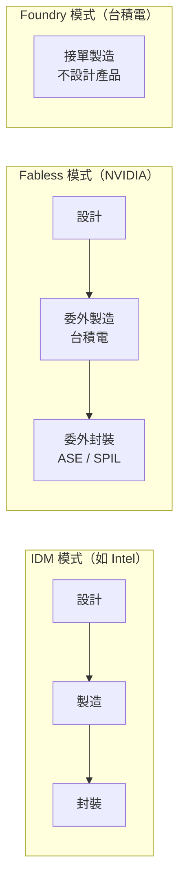
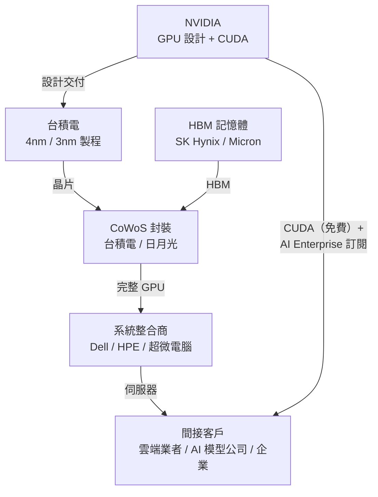

# 商業模式：Fabless 設計公司

## 什麼是 Fabless？

Fabless（無廠）指的是公司只負責 IC 設計，不自建晶圓廠。相對地，台積電是 **Foundry（晶圓代工廠）**，只負責製造，不設計自己的晶片。

## NVIDIA 的價值鏈位置

NVIDIA 掌握最高附加價值的兩端：**設計**（IP、架構）與**軟體生態**（CUDA）。製造這個資本密集環節完全外包。

## 定價權與毛利率

黃仁勳在 2024 年 3 月受訪時表示，Blackwell 每顆售價約 3 萬到 4 萬美元；他稍後在 GTC 對記者的說法有所保留。NVIDIA 不公布各部門的毛利率；公司整體 GAAP 毛利率 FY2025 為 75.0%、FY2026 為 71.1%，變動原因見[財務分析](financials.md)。

## 與台積電的相互依賴

| 面向 | NVIDIA 視角 | 台積電視角 |
|------|------------|----------|
| 關係性質 | 最大客戶之一，依賴 CoWoS 產能 | NVIDIA 是最重要的先進製程客戶之一 |
| 風險 | 台積電產能不足、地緣政治 | NVIDIA 若轉單（理論上），影響巨大 |
| 議價能力 | 依賴台積電的 CoWoS 封裝產能 | 晶圓代工市占約七成（見台積電一書〈地緣政治與全球化〉） |

## 客戶集中度風險

以客戶總部所在地認列，FY2026 美國客戶占總營收約 **69%**。直接與間接客戶的集中度見[財務分析](financials.md)〈客戶集中度風險〉。

## 資料來源

- 毛利率、地區營收：[NVIDIA FY2026 Form 10-K](https://www.sec.gov/Archives/edgar/data/1045810/000104581026000021/nvda-20260125.htm)
- B200 售價：[NBC 轉載 CNBC（2024-03）](https://nbcsandiego.com/news/business/money-report/nvidias-latest-ai-chip-will-cost-more-than-30000-ceo-says/3465447)
