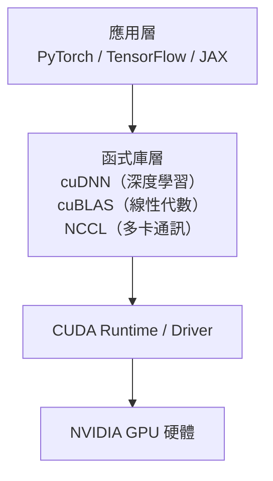

# CUDA 軟體生態

談 CUDA，常見的說法是：NVIDIA 用軟體築了一道護城河。

這個說法只看到 NVIDIA 一方。核心函式庫是 NVIDIA 寫的，但建在上面的模型、論文和工程師的技能，是使用者自己投進去的。**比較要緊的問題是：這些東西是誰、在什麼處境下投進去的？**

---

## 分層：開發者站在哪一層

CUDA（Compute Unified Device Architecture）是 NVIDIA 的平行運算平台與程式設計模型，讓開發者用類似 C/C++ 的語法對 GPU 程式設計。

多數開發者只寫最上面一層，從不直接寫 CUDA，但他們的程式碼仍然跑在下面三層上。

---

## 三個角色，三次投入

| 時間 | 角色 | 處境 | 做了什麼 |
|------|------|------|---------|
| 2006 年 11 月 | NVIDIA | 遊戲顯示卡廠，通用運算還沒有主力市場 | 隨 G80（GeForce 8800 GTX）發表 CUDA；8800 GTX 是第一張支援 CUDA 的消費級 GeForce |
| 2012 年 | 多倫多大學的研究團隊 | 要訓練一個單張顯示卡記憶體放不下的網路 | 用兩張 GTX 580 遊戲卡訓練 AlexNet，在 ILSVRC 2012 以 top-5 錯誤率 15.3% 勝出（第二名 26.2%） |
| 2014 年 | NVIDIA 與框架團隊 | 每出一種新處理器，研究者就得重寫核心 | NVIDIA 發表 cuDNN；整合進 Caffe 後，標準模型提速 36% |

<!-- mech: ecosystem_lockin -->
!!! note "詮釋"
    這片沼澤是三方一起積出來的。NVIDIA 先付了平台的錢；研究者用買得起的遊戲卡做出 AlexNet；框架團隊把 cuDNN 接進框架，讓後來的人不必碰 CUDA 也能受益。每一方都只在解決自己的問題，泥卻全積在 CUDA 上。**離開 CUDA，付的是重做別人十幾年投入的代價。**

---

## NVIDIA 自己累積的部分

函式庫層是 NVIDIA 直接投入的部分。CUDA-X 是這些函式庫的統稱，NVIDIA 官方的說法是「數百個」：

| 函式庫 | 用途 |
|--------|------|
| cuDNN | 深度神經網路基本運算 |
| cuBLAS | 線性代數 |
| NCCL | 多 GPU、多節點通訊 |
| TensorRT | 把訓練好的模型最佳化成針對 NVIDIA GPU 的推理引擎 |
| cuSPARSE、cuFFT | 稀疏矩陣、快速傅立葉轉換 |

硬體和軟體由同一家公司設計：2022 年 Hopper 架構加入 FP8 精度時，NVIDIA 同時推出對應的 Transformer Engine 軟體庫。

---

## 框架層的依賴

| 框架 | 和 CUDA 的關係 |
|------|---------------|
| PyTorch | NVIDIA GPU 上以 CUDA 為後端；2.0 起的編譯器以 Triton 產生核心 |
| TensorFlow | NVIDIA GPU 上以 CUDA 為後端；也支援 TPU |
| JAX | 支援 CUDA，也支援 TPU |
| Hugging Face Transformers | 透過底下的框架間接依賴 |

這層的依賴正在變化，見[市場競爭與護城河](competitive-moat.md)〈沼澤還在漲水嗎〉。誰付得起離開的代價，也見該章。

---

## 資料來源

- CUDA 與 G80：[Wikipedia：CUDA](https://en.wikipedia.org/wiki/CUDA)、[Wikipedia：GeForce 8 series](https://en.wikipedia.org/wiki/GeForce_8_series)
- AlexNet：[Krizhevsky et al., NeurIPS 2012](https://papers.nips.cc/paper/4824-imagenet-classification-with-deep-convolutional-neural-networks)
- cuDNN：[Chetlur et al., arXiv 1410.0759](https://arxiv.org/abs/1410.0759)
- CUDA-X：[NVIDIA](https://www.nvidia.com/en-us/technologies/cuda-x/)
- Hopper 與 Transformer Engine：[NVIDIA H100](https://www.nvidia.com/en-us/data-center/h100/)
