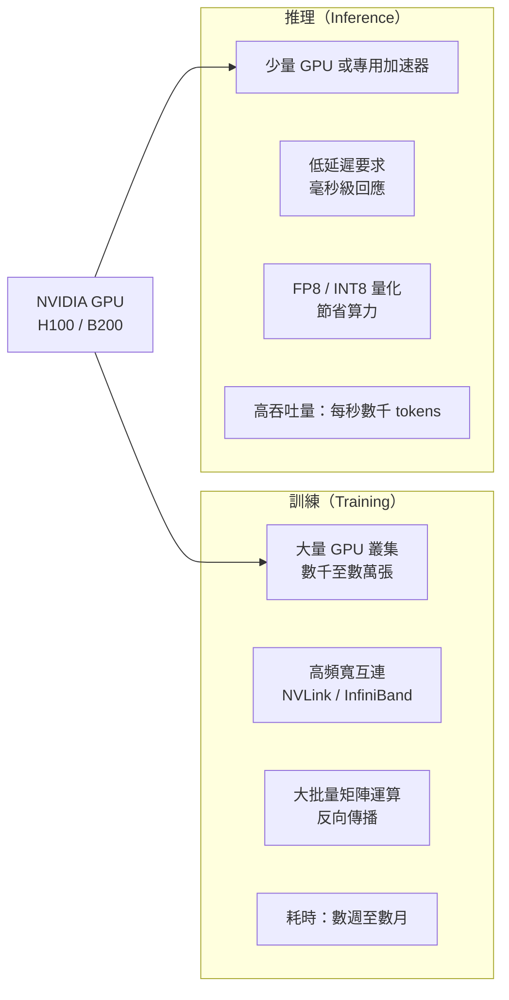
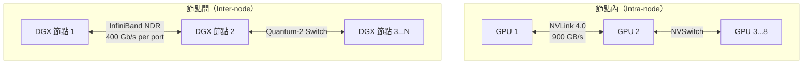
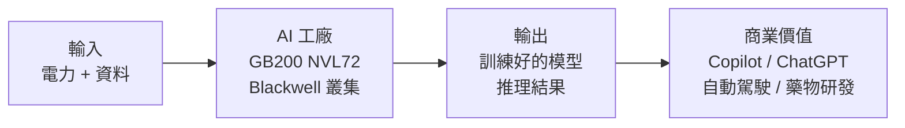

# 資料中心與 AI 應用

資料中心是 NVIDIA FY2026 年約 90% 營收的來源，也是理解這家公司最重要的視角。

## 資料中心 GPU 的兩大用途

訓練需要最強的 GPU（H100、B200），推理則有更多選擇（L40S、A10、H100 NVL 等較低規格產品）。各代 GPU 的規格演進見[架構演進](architecture-roadmap.md)。

## 雲端業者：買方，也自研晶片

10-K 把雲端業者列為「間接客戶」：它們多半透過組裝廠與系統整合商採購，個別金額 NVIDIA 只做估計，沒有具名（見[財務分析](financials.md)〈客戶集中度風險〉）。大型雲端業者同時都有自研的 AI 晶片：

| 雲端業者 | 自研 AI 晶片 |
|----------|-------------|
| Google | TPU |
| Amazon | Trainium、Inferentia |
| Microsoft | Maia |
| Meta | MTIA |

買方同時是潛在對手，這層關係見[市場競爭與護城河](competitive-moat.md)。

## NVLink 與 InfiniBand：連接 GPU 的網路

單顆 GPU 的算力有限，AI 訓練需要**數千顆 GPU 協同工作**。連接這些 GPU 的網路同樣關鍵。

NVIDIA 在 2020 年以 $69 億美元收購 Mellanox，獲得 InfiniBand 技術，讓它能提供從 GPU 到網路的完整 AI 基礎設施解決方案。FY2026 網路業務營收 314 億美元，約占資料中心營收的六分之一；Q4 單季約 110 億美元，約為一年前的 3.5 倍。

## AI 工廠概念

Jensen Huang 將新一代資料中心稱為「AI 工廠」：輸入電力和資料，輸出智慧（Intelligence）。這個框架解釋為什麼 NVIDIA 不只賣 GPU，還賣整套系統（DGX、HGX）和軟體（NeMo、Triton）。

## 推理市場的成長

NVIDIA 財務長在 2024 年 2 月估計，前一財年（FY2024）資料中心營收約 40% 用於推理；之後沒有更新的官方拆分。訓練是階段性的建置，推理則隨使用量持續消耗，這是推理需求被看好的理由；比重實際怎麼變，目前沒有官方數字。

## 資料來源

- 推理約 40%：[Maginative（Q4 FY2024 電話會議）](https://www.maginative.com/article/nvidia-hits-2-trillion-market-cap/)
- 資料中心與網路營收：[NVIDIA FY2026 Form 10-K](https://www.sec.gov/Archives/edgar/data/1045810/000104581026000021/nvda-20260125.htm)、[Computing（Q4 FY2026）](https://www.computing.co.uk/news-network/2026/nvidia-hits-record-quarterly-growth)
