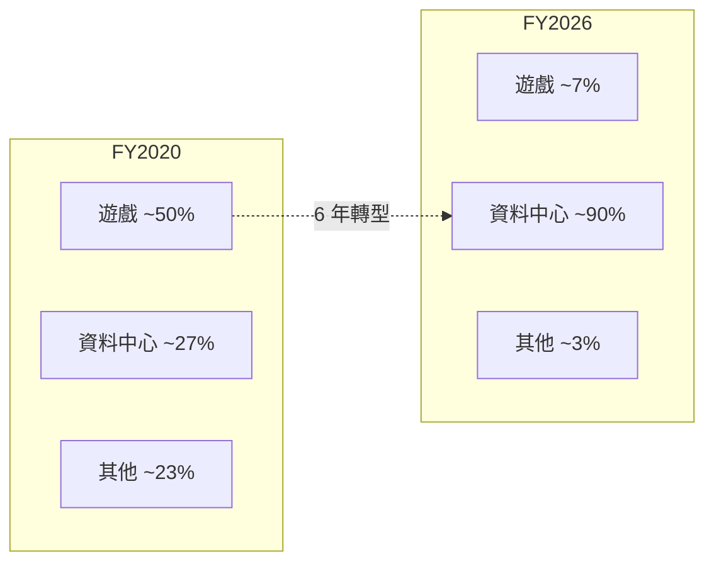

# 財務分析

## FY2026 年度財務概覽

NVIDIA 的財年（Fiscal Year）結束於每年 1 月底。FY2026 = 2025 年 2 月至 2026 年 1 月。

| 指標 | FY2026 | FY2025 | 年增率 |
|------|--------|--------|--------|
| 總營收 | $2,159 億美元 | $1,305 億美元 | +65% |
| 資料中心營收 | $1,937 億美元 | $1,152 億美元 | +68% |
| 遊戲 | $160 億美元 | $114 億美元 | +41% |
| 專業視覺化 | $32 億美元 | $19 億美元 | +70% |
| 汽車與機器人 | $23 億美元 | $17 億美元 | +39% |
| GAAP 毛利率 | 71.1% | 75.0% | −3.9 個百分點 |
| Q4 FY2026 單季營收 | $681 億美元 | — | 史上最高單季 |

## 毛利率的意義

FY2026 GAAP 毛利率 71.1%，比 FY2025 的 75.0% 低 3.9 個百分點。10-K 列出兩個原因：產品從 Hopper HGX 系統轉向 Blackwell 整櫃資料中心方案，以及 H20 存貨與採購承諾的 45 億美元費用。

毛利率高通常被讀成定價權，但它也有反向的一面：毛利越高，大型買方自研或導入第二供應商的誘因越大，見[市場競爭與護城河](competitive-moat.md)。商業模式的結構見[商業模式](business-model.md)。

## 營收結構轉變

這個轉變揭示了 NVIDIA 本質上已不再是遊戲 GPU 公司，而是 AI 基礎設施公司。

## 資本支出與 R&D

Fabless 商業模式的關鍵優勢之一是**低資本支出**：NVIDIA 不需要蓋晶圓廠，因此大部分現金流可以投入研發（R&D）和股票回購，而非資本投資。

相比之下，台積電每年需投入數百億美元的 CapEx 維持先進製程競爭力。

## 如何看待 NVIDIA 的估值

高成長公司常用的指標：

| 指標 | 說明 |
|------|------|
| P/E（本益比） | 股價 / 每股盈餘；高成長公司通常 P/E 偏高 |
| P/S（股價營收比） | 股價 / 每股營收；適合高毛利科技公司 |
| PEG（本益成長比） | P/E / 盈餘成長率；<1 通常被視為合理 |
| 自由現金流（FCF） | 更難造假的盈利指標 |

> 注意：高估值反映市場對未來成長的預期。若 AI 資本支出增速放緩，或出現強力競爭對手，估值修正風險顯著。

## 客戶集中度風險

依 FY2026 10-K，兩家直接客戶分別占總營收 22% 與 14%，主要來自運算與網路部門。直接客戶多半是 OEM、ODM、系統整合商與通路商；雲端業者、AI 模型公司等「間接客戶」透過它們採購。10-K 估計部分間接客戶各自占營收 10% 以上，但沒有列出名字。

## 資料來源

- FY2026、FY2025 部門營收、毛利率、客戶集中度：[NVIDIA FY2026 Form 10-K](https://www.sec.gov/Archives/edgar/data/1045810/000104581026000021/nvda-20260125.htm)
- FY2020 營收結構：[NVIDIA FY2020 Form 10-K](https://www.sec.gov/Archives/edgar/data/1045810/000104581020000010/nvda-2020x10k.htm)
- Q4 FY2026 單季營收：[Computing](https://www.computing.co.uk/news-network/2026/nvidia-hits-record-quarterly-growth)
