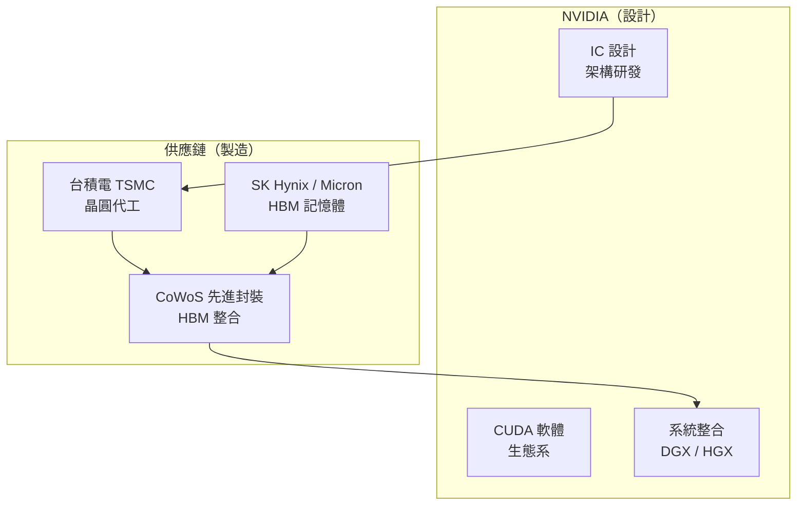

# 公司概覽

NVIDIA 創立於 1993 年，由 Jensen Huang（黃仁勳）、Chris Malachowsky 與 Curtis Priem 共同創辦。最初以遊戲 GPU 起家；到 FY2026，約九成營收來自資料中心。

## 公司定位

NVIDIA 是一家 **Fabless IC 設計公司**——自己設計晶片，但不擁有晶圓廠，全部委外製造。這個商業模式讓它能將資本集中在研發與軟體生態，而非動輒數千億的晶圓廠建置成本。

## 主要業務部門（FY2026）

| 部門 | 年營收 | 年增率 | 說明 |
|------|--------|--------|------|
| 資料中心 | ~$1,937 億美元 | +68% | AI 訓練與推理 GPU、網路 |
| 遊戲 | ~$160 億美元 | +41% | GeForce RTX 系列 |
| 專業視覺化 | ~$32 億美元 | +70% | Quadro / RTX 工作站 |
| 汽車與機器人 | ~$23 億美元 | +39% | 自駕與具身智慧 |

資料中心已佔總營收約 **90%**，NVIDIA 本質上已從遊戲 GPU 公司轉型為 AI 基礎設施公司。營收結構的轉變過程詳見[財務分析](financials.md)，Fabless 模式的運作詳見[商業模式](business-model.md)。

## 時間軸

## 與台積電的依賴關係

NVIDIA 的高階資料中心 GPU 由台積電以先進製程代工（10-K 列出的晶圓代工夥伴是台積電與三星）。這種深度依賴既是優勢（專注設計）也是風險（地緣政治、產能分配）。以客戶總部所在地認列，台灣客戶（主要是代工組裝的供應鏈夥伴）占 NVIDIA FY2026 總營收約 **19.6%**；最終客戶與出貨地可能不在台灣。

## 資料來源

- 部門營收、地區營收、代工夥伴、Rubin 時程：[NVIDIA FY2026 Form 10-K](https://www.sec.gov/Archives/edgar/data/1045810/000104581026000021/nvda-20260125.htm)
