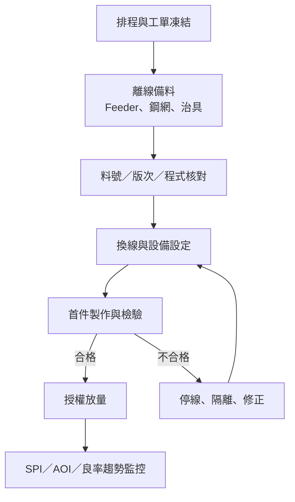
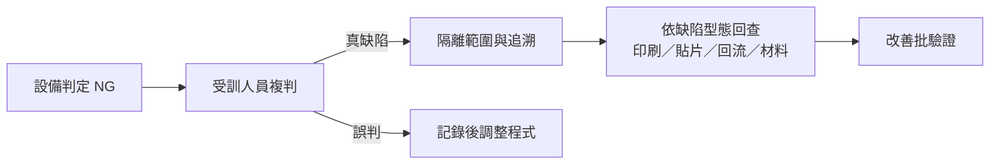

# 量產控制：Recipe、換線與追溯

量產前，要確認同一個工單使用的物料、程式與設備狀態都符合要求，並留下誰核准放行的紀錄。做出一件良品，還不足以證明後續批次都能穩定生產。

本章讓你整理換線與異常處理的檢查項目。Recipe 指一個產品所需的整組製程設定，包含印刷、貼片、回流與檢測，不只是爐溫。

## Recipe 不只是一組爐溫

| Recipe 層級 | 典型內容 | 主要負責角色 |
|---|---|---|
| 產品資料 | 物料清單（BOM）、座標、極性、板尺寸、版次 | 新產品導入（NPI）／製造工程 |
| 印刷 | 鋼網、刮刀速度與壓力、脫模、清網頻率 | SMT 製程工程師 |
| 貼片 | 供料器（Feeder）站位、吸嘴、視覺參數、貼裝順序 | 程式／製程工程師 |
| 回流 | 各溫區設定、鏈速、風量、氮氣條件 | 回流／SMT 製程工程師 |
| 檢測 | 錫膏檢測（SPI）與自動光學檢測（AOI）的程式、門檻、合格參考樣品、人工複判規則 | AOI／品質工程師 |

這些資料要一起管理版本。例如，貼片程式已更新，AOI 卻仍按舊版檢查，就會使用不同的判定基準。換了錫膏批次後，也要確認原有的實測溫度曲線（Profile）是否仍適用。

## 換線的最小閉環

換線要走完「核對、設定、首件檢查、授權量產、持續監控」。首件不合格時，回到設定與修正；不能直接進入量產。下圖把這一整輪稱為閉環。

操作員可以依核准文件換線與製作首件；是否能自行放量，取決於工廠定義的授權矩陣。新產品、重大參數變更、維修後復線與一般同族產品換線，不應使用完全相同的簽核強度。

## 回流 Profile 的管理邊界

爐體操作畫面（HMI）上的設定值，不等於產品實際承受的溫度。量產基準應保存：

- 測溫板／治具識別與熱電偶位置。
- 錫膏或材料規格版本。
- 升溫、恆溫、液相線以上時間（TAL）、峰值溫度與冷卻的實測結果；英文欄位常寫為 Ramp、Soak、TAL、Peak、Cooling。
- 爐體、產品方向、載板、鏈速與氮氣條件。
- 核准人、日期、適用產品族與重測觸發條件。

建議把「何時必須重測」寫進控制計畫，例如：爐體重大維修、加熱／風扇模組更換、產品熱容量顯著改變、載具改版、材料更換或長期趨勢漂移。不要只按固定日曆重測，也不要等出現大量焊接不良才重測。

## SPI、AOI 與人工複判

設備報 NG（不合格）後，先由受訓人員確認是真缺陷還是誤報。真缺陷要界定影響範圍並追查原因；誤報也要留下紀錄，再調整檢測程式。下圖的 RCA 指根因分析，也就是查出造成異常的原因。

AOI 程式調整必須同時管理 **漏檢** 與 **誤判**。只追求降低誤判，容易把真缺陷一起放過；只把門檻收緊，則會讓複判人力爆量。研華公開的 AOI 職缺也把程式建立、參數優化、缺陷分析、設備商協作與教育訓練列為同一角色的責任。[來源：研華 SMT AOI 工程師職務（104 工程師職涯平台）](https://www.104.com.tw/jobs/search/?area=6001000000&jobcat=2009002004&ro=0)

## 異常時先回答四個問題

1. **影響什麼？** 哪個料號、批次、時間窗、機台與線別。
2. **最後一次良品在哪裡？** 用首件、巡檢、SPI/AOI、測試與設備紀錄界定邊界。
3. **最近改了什麼？** 材料、程式、Feeder、鋼網、維修、軟體、環境或人員。
4. **誰能放行？** 操作員、線長、製程、設備與品質的權限要預先寫清楚。

Jabil 的 SMT 製造工程職務涵蓋新產品導入、回流曲線、設備程式、根因分析（RCA）、實驗設計（DOE）、矯正與預防措施（CAPA），以及對生產人員的技術支援。這些工作包含製程改善責任，不只操作或維修設備。[來源：Jabil Manufacturing Engineer II](https://careers.jabil.com/jobs.html?jobitem=j2444754-il-united-states-of-america-manufacturing-engineer-ii--1st-shift)

## 最少要保留的紀錄

- 工單、產品與程式版次。
- 物料批號、效期、烘烤／回溫與濕氣敏感元件（MSD）的管理狀態。
- 首件與放行結果。
- SPI/AOI/測試結果及複判。
- 警報、停機、維修、參數變更與復線資格確認。
- 不良隔離範圍、處置、RCA 與改善驗證。

保留期間與欄位應依客戶、產品風險與品質系統決定；沒有必要為所有產品保存完全相同粒度的資料。

下一次換線前，可用本章檢查一份工單：是否找得到對應物料、程式版本、首件結果與放行人？缺少哪一項，就先補齊哪一項的核對依據。

## 延伸閱讀

- [SMT 整線：從上板到檢測](01b-smt-line.md)
- [爐溫曲線設定](02-temp-profile.md)
- [缺陷分析方法](08-defect-analysis.md)
- [設備導入、保養與復線](11-equipment-lifecycle.md)

