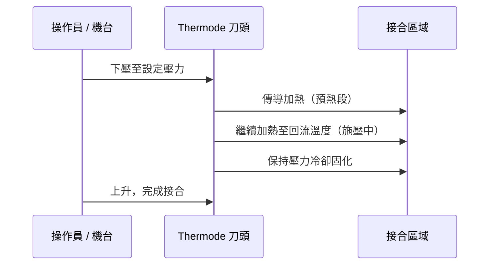
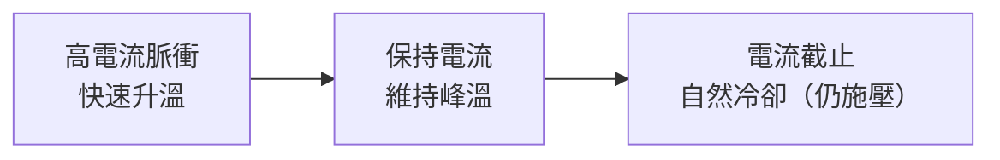

# 熱壓接合原理

熱壓接合用金屬加熱頭直接接觸工件，並施加壓力。這個加熱頭稱為**刀頭（Thermode）**；常見英文名稱還有 Hot Bar Bonding、Thermode Bonding 與 Pulse Heat Bonding。

先分清接合材料：使用焊錫時，要讓焊錫熔化，再在施壓下冷卻；使用 ACF（異向性導電膜）時，則靠加熱固化樹脂，並讓導電粒子受壓接觸端子。兩者不能套用同一份回流條件。[來源：AMADA WELD TECH](https://amadaweldtech.com/blog/choosing-the-right-technology-hot-bar-reflow-soldering-vs-acf-bonding/)

*FPC 面板去除邊框前的樣態——熱壓接合正是用來連接這類軟板與主板或玻璃端子。*

---

## 製程流程

下圖描述使用焊錫的熱壓回流流程。ACF 的步驟另見[ACF 製程](04-acf.md)。

---

## Thermode 刀頭

刀頭把熱與壓力傳到接合區。檢查時，除了看溫度設定，也要確認刀頭和工件是否接觸均勻、端子是否對齊，以及材料與治具如何帶走熱量。[來源：AMADA WELD TECH](https://amadaweldtech.com/blog/choosing-the-right-technology-hot-bar-reflow-soldering-vs-acf-bonding/)

### 設定前先確認溫度指的是哪裡

調機前，請把材料規格、量測位置與已核准的設定放在一起核對。不要只看到「接合溫度」就填入刀頭設定欄；先確認文件描述的是刀頭，還是接合區的條件。

| 要確認的項目 | 要找的資料 |
|---|---|
| 接合材料 | 焊錫或 ACF 的料號與規格版本 |
| 溫度的量測位置 | 感測器位置、測量方法與紀錄 |
| 接觸與散熱 | 刀頭平行度、治具、工件材料與厚度 |
| 放行依據 | 已核准的溫度、壓力、時間與品質結果 |

本頁不提供通用的刀頭溫度表；實際設定須對應材料與接合條件。如何讀材料文件，見[材料規格](09-materials.md)。

---

## 脈衝加熱（Pulse Heat）

大部分熱壓設備使用**脈衝電流加熱**（非持續通電），優點：

- 精確控制溫度上升斜率
- 降低過衝風險（Overshoot）
- 延長刀頭壽命

---

## 施壓的關鍵作用

壓力貫穿整個週期，主要作用：

1. **確保接觸熱阻低**：刀頭與工件緊密貼合，傳熱效率高。
2. **讓 ACF 導電粒子受壓接觸端子**：建立厚度方向（Z 向）的導通；不能把「壓破粒子」當成所有材料的目標（詳見 [ACF 製程](04-acf.md)）。
3. **防止接合層分離**：冷卻固化過程中維持尺寸穩定。

*凸點（Bump）對位示意——熱壓接合中，IC 凸點必須精確對準基板端子，再施加壓力導通，原理與 Flip Chip 類似。*

---

## 與熱風的根本差異

| 項目 | 熱風回流 | 熱壓接合 |
|------|---------|---------|
| 加熱方式 | 對流（非接觸） | 傳導（直接接觸） |
| 是否施壓 | 無 | 全程施壓 |
| 加熱範圍 | 整片 PCB | 局部接合區域 |
| 製程速度 | 連續輸送（快） | 逐點停留（慢） |
| 適合材料 | 錫膏 | 錫膏、ACF、熱固膠 |

---

## 誰負責熱壓機？

| 責任 | 角色 |
|---|---|
| 直接操作 | 受訓 Bonding operator 負責材料、治具、對位、上下料、首件與巡檢 |
| 製程 owner | ACF／Bonding 製程工程師擁有實際接合線的溫度、壓力、時間與對位視窗 |
| 設備 owner | 設備技術員／工程師負責 Thermode、荷重、平行度、溫控、相機與運動軸 |
| 品質放行 | 品質依外觀、壓痕、電性與必要的可靠度結果判定；影像對位不能取代電測 |

手動、半自動與全自動設備的人力不同，詳見 [ACF／熱壓量產線](05b-acf-line.md) 與 [機台團隊與人力配置](12-staffing.md)。

開始查異常前，先記下工件、材料批次、刀頭與治具、使用的設定版本，以及不合格結果。再依上表找負責人核對，避免只憑外觀就改壓力或溫度。

## 資料來源

- [AMADA WELD TECH：Hot Bar Reflow Soldering vs ACF Bonding](https://amadaweldtech.com/blog/choosing-the-right-technology-hot-bar-reflow-soldering-vs-acf-bonding/)：焊錫與 ACF 機制、熱壓的接觸與散熱條件。查閱日期：2026-10-28。本文檢查表為教學整理，不是廠商的機台設定程序。

---

## 延伸閱讀

- [ACF 導電膠製程](04-acf.md)
- [顯示器模組應用](05-display-modules.md)
