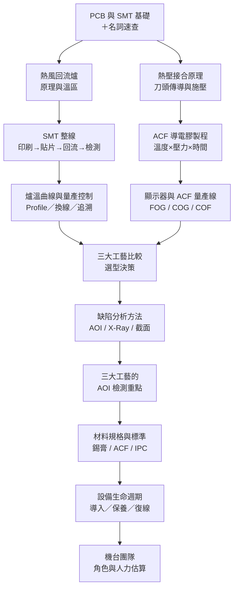

# 熱風・熱壓・熱板　電子接合完整指南

## 本書目標

這本書幫助剛接觸電子組裝的讀者，分清三種加熱接合方式，並看懂製程、設備與品質人員各要檢查什麼。讀完後，你應能說明：熱從哪裡進入接合區、哪些條件影響結果，以及異常應交給誰確認。

全書以三種工藝為主軸：

| 工藝 | 加熱方式 | 典型應用 |
|------|---------|---------|
| 熱風回流 | 強制對流 | SMT 量產主線 |
| 熱壓接合 | 傳導（刀頭接觸） | FPC、ACF、顯示器模組 |
| 熱板傳導 | 傳導（板面接觸） | 打樣、維修 |

SMT 是把元件裝到電路板表面的製程；FPC 是軟性電路板；ACF 是靠厚度方向導通的異向性導電膜。初次閱讀不必記住所有縮寫，可隨時查[名詞表](00-glossary.md)。

## 依目前問題找章節

| 你要解決的問題 | 先讀 | 讀完要能做什麼 |
|---|---|---|
| 三種加熱方式差在哪裡？ | [工藝比較](07-comparison.md) | 說明熱如何傳入工件，以及是否需要施壓 |
| 換產品後，哪些設定要一起確認？ | [量產控制](02b-production-control.md) | 核對物料、程式、實測曲線與放行紀錄 |
| 熱壓機的設定要看什麼？ | [熱壓接合](03-hot-bar.md) | 分清刀頭設定與接合結果，列出待確認條件 |
| 檢測報不良後，先查哪裡？ | [缺陷分析](08-defect-analysis.md)、[量產控制](02b-production-control.md) | 選擇觀察工具，界定受影響批次與最近變更 |

本書用來理解原理與準備檢查項目。實際調機前，仍須確認產品、材料規格與已核准的製程條件；書中不同材料的示例不能直接合成一份機台設定。

---

## 學習路徑

---

> 📷 **圖片來源**：本書圖片均來自 [Wikimedia Commons](https://commons.wikimedia.org/)，依各自的自由授權（CC BY / CC BY-SA / 公有領域等）使用。完整版權聲明見 [圖片來源頁](99-image-credits.md)。

1. **基礎與整線** — [熱風回流爐](01-hot-air.md)、[SMT 整線](01b-smt-line.md)、[爐溫曲線](02-temp-profile.md)、[量產控制](02b-production-control.md)
2. **熱壓與 ACF** — [熱壓接合](03-hot-bar.md)、[ACF 製程](04-acf.md)、[顯示器模組](05-display-modules.md)、[ACF 量產線](05b-acf-line.md)
3. **替代工藝與選型** — [熱板傳導](06-hot-plate.md)、[三大工藝比較](07-comparison.md)
4. **品質與材料** — [缺陷分析](08-defect-analysis.md)、[AOI 檢測重點](08b-aoi.md)、[材料規格](09-materials.md)
5. **量產營運與團隊** — [設備生命週期](11-equipment-lifecycle.md)、[機台人力配置](12-staffing.md)
6. **[學習資源](10-resources.md)** — 標準文件、設備商資料與進階路線

---

## 先備知識

不熟悉以下名詞？先從這裡開始：

- **[PCB 與 SMT 基礎概念](00-pcb-basics.md)** — 什麼是 PCB、FPC、BGA、SMT 生產線
- **[名詞解釋速查表](00-glossary.md)** — 本書所有術語一覽，隨時查詢
