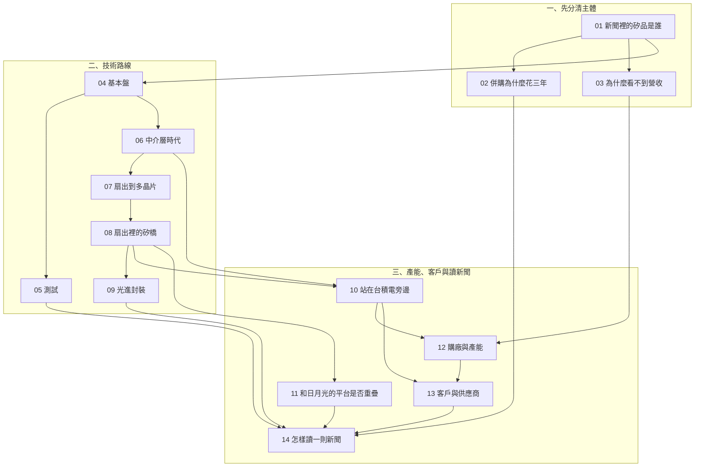

# 全書地圖

## 這本書在回答什麼

**矽品已經下市、不再單獨公布財報。新聞裡的「矽品」指誰，技術和產能又能被公開證據證實到哪一步？**

前三章先把主體和財務口徑釘住。中間六章按時間走技術，不把不同世代收成一個平台。後五章把這些尺拿到產能、客戶和新聞上。第 10 章是整本書最「證據不夠」的一章，用來示範不夠的時候怎麼停筆。

## 依賴關係

箭頭表示先備，不是時間順序。第 14 章假定前面各章的尺都已經在手上。

## 兩條閱讀路線

完整閱讀就是章序 01 → 14。趕時間時走下面兩條；名詞不夠再回圖上的先備章。

| 你想要什麼 | 路線 |
|---|---|
| 讀懂擴產、外包與客戶新聞 | [01](01-who-is-spil.md) → [03](03-invisible-financials.md) → [10](10-beside-tsmc.md) → [12](12-capacity-and-plants.md) → [13](13-customers-suppliers.md) → [14](14-reading-news.md) |
| 只走技術世代 | [04](04-mainstream-packaging.md) → [06](06-interposer-era.md) → [07](07-fanout-to-fomcm.md) → [08](08-fo-eb.md) → [09](09-cpo.md) → [11](11-sibling-platforms.md) |

## 證據七級

每一則主張先落在下面某一級。**只能往下標，不能往上升。** 論文寫「通過認證」，仍然是論文，不是客戶量產。等級定義與此書的寫作計畫相同。

| 等級 | 一句話 |
|---|---|
| 官方文件 | 向主管機關申報，或由主管機關發布的文件，例如 20-F、商務部公告、公開資訊觀測站原文。 |
| 雙方公告 | 交易或合作的兩邊都公開表態：各自發布，或由一方發布、另一方在同一份文件裡具名發言。 |
| 論文 | 有作者單位與 DOI 的研討會或期刊論文；沒核全文之前，摘要以外的數字不算已核。 |
| 公司自述 | 公司官網、新聞稿、法說或高層公開談話，只證明這家公司這樣說過。 |
| 媒體報導 | 媒體以自己的採訪或具名來源寫成的報導。 |
| 業界消息 | 媒體引述「業界」「據了解」等沒有名字的說法。 |
| 推論 | 把幾則消息接起來的判斷，不是一筆新的事實。 |

**申報文件裡要分兩種句子。** 20-F 或 MOPS 裡的交易、面積、持股、日期，標 `官方文件`。公司在同一份文件裡描述自己「能做什麼」（例如技術清單），仍只標 `公司自述`：申報不會替能力背書。轉載頁上的重訊，回公開資訊觀測站核對原文之前，也先標 `公司自述`。

出處與取用限制見[來源索引](appendix-sources.md)。查不到的項目見[待查事項](appendix-open-questions.md)。

## 三層主體不能混用

1. **矽品精密（SPIL）**：2018-04-30 起是投控百分之百持有的子公司，同年下市。購廠、廠區、論文作者單位，要先確認寫的是這一家。
2. **日月光半導體（ASE Inc.）**：另一家封測子公司。新聞寫「日月光」，可能是這一家，不是矽品。
3. **日月光投控（ASEH，3711）**：合併財報的主體。20-F 裡的部門營收、集團技術清單和集團資本支出，都不能直接改標成矽品。

三層的沿革與為何併在同一個控股公司下，日月光書已寫，見[法人篇](../../ase/html/02-group-and-business.html)。本書從第 [01](01-who-is-spil.md) 章只保留讀新聞用得上的那一張地圖。

## 本書不做什麼

不預測股價，不給買賣建議。財務章解釋的是口徑：為什麼矽品的營收會從公開資料裡消失，而不是它值多少錢。
