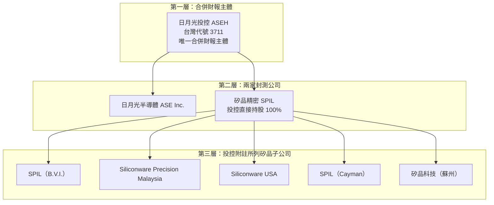

# 第 1 章：新聞裡的「矽品」是哪個主體？

## 開場問題

> 一則新聞寫「矽品買廠」，另一則寫「矽品營收」，舊文還會寫「矽品股」。這三句裡的矽品，是同一家現在還能買賣的公司嗎？錢和數字又是從哪個口袋算出來的？

本章只回答主體。封裝怎麼做、廠一間間怎麼擴，留給後面的章。日月光投控、日月光半導體、矽品精密要分開記。集團 20-F 若只寫「集團」的技術或產能，本章不把它算成矽品的能力。本章不討論股價，也不做估值。

## 主體

新聞裡至少有三個名字會被收成「日月光」或「矽品」：

- **矽品精密**（Siliconware Precision Industries Co., Ltd.，SPIL）是本章的主體。它是做封裝與測試的公司。投控直接持有它 100%（2024 年底與 2025 年底都是）。（[S1](appendix-sources.md#S1)）[官方文件]
- **日月光半導體**（ASE Inc.）是另一家封測公司，與矽品同在投控下面，不是矽品的別名。
- **日月光投控**（ASE Technology Holding，ASEH，台灣股票代號 3711）是 2018-04-30 股份轉換完成當天才成立的控股公司，也是**唯一的合併財報主體**。（[S1](appendix-sources.md#S1)）[官方文件]

環旭電子在投控裡的持股不是單一比例。那張圖日月光書已經畫過，本章不重畫，見 [新聞裡的「日月光」到底是哪個主體](../../ase/html/02-group-and-business.html)。

上圖的 100% 有兩個時點，不要讀成「自創立以來一直如此」。投控持有矽品 100%，依據是 2024 年底與 2025 年底的合併子公司表。（[S1](appendix-sources.md#S1)）[官方文件] 第三層五家公司在同一份附註裡的持股都是 100%。（[S1](appendix-sources.md#S1)）[官方文件] 矽品蘇州在 2017-11-24 曾由 SPIL（Cayman）出售 30% 股權，這件事放到 [第 2 章](02-merger-war.md)；何時買回，寫作時未查到。馬來西亞這家公司出現在子公司表，FY2025 廠區表沒有單列，是否已經投產，寫作時未查到投產證據，本章不補。

法人時間線只用寫作時查到的資料裡有原文的日子：

| 日期 | 矽品這家法人發生什麼事 | 等級 |
|---|---|---|
| 1984-05-17 | 依中華民國公司法設立，為股份有限公司。（[S5](appendix-sources.md#S5)、[S1](appendix-sources.md#S1)） | [官方文件] |
| 1984-05 | 官網寫 Established in May 1984，沒有寫到日。（[S7](appendix-sources.md#S7)） | [公司自述] |
| 1993-04-07 | 股票在台灣證券交易所上市。（[S5](appendix-sources.md#S5)） | [官方文件] |
| 2000-06-02 | 美國存託憑證（ADS）在 NASDAQ 掛牌，代號 SPIL。（[S5](appendix-sources.md#S5)） | [官方文件] |
| 2000-06-07 | 發行 3,000 萬單位 ADS，每單位代表 5 股普通股。這是發行日，不是掛牌日。（[S5](appendix-sources.md#S5)） | [官方文件] |
| 2018-04-30 | 股份轉換完成。矽品成為投控 100% 持有的非公開子公司，台股與 NASDAQ ADS 下市。（[S1](appendix-sources.md#S1)、[S3](appendix-sources.md#S3)、[S4](appendix-sources.md#S4)） | [官方文件] |
| 2024-03 | 日月光半導體獲准停止公開發行。這一行不是矽品。（[S1](appendix-sources.md#S1)） | [官方文件] |
| 2024-04 | 矽品獲准停止公開發行，並結束公開發行公司的身分。金管會文號與確切日期，寫作時未查到。（[S1](appendix-sources.md#S1)） | [官方文件] |

1984-05-17 的設立有官方文件。更早的創辦經過沒有一手來源，本章不寫，只留在章末待查。

## 口徑

「矽品」在不同文件裡指的東西不一樣。

**股票口徑已經結束。** 2018-04-30 之後，矽品普通股與 NASDAQ ADS 都已下市。（[S1](appendix-sources.md#S1)、[S3](appendix-sources.md#S3)、[S4](appendix-sources.md#S4)）[官方文件] 矽品股票不能再買賣。新聞若寫「矽品股價」或把矽品當成還能下單的標的，多半是舊聞，或把名字誤植到投控 3711。2024-04 停止公開發行，結束的是公開發行公司這個身分，不是下市日，也不能讀成「2024 年才不能交易」。（[S1](appendix-sources.md#S1)）[官方文件]

**財報口徑在投控。** 矽品不再單獨對公眾出一份合併財報。外界看得到的經查核合併數字，主體是投控，不是矽品。這件事的部門拆法在 [第 3 章](03-invisible-financials.md)；投控營收、折舊與資本支出怎麼讀，日月光書已寫，見 [營收成長為什麼不一定等比例提高獲利](../../ase/html/09-capacity-and-economics.html)。

**官網口徑是公司自述。** 官網寫矽品、日月光半導體與 USI Inc. 都是 ASE Technology Holding 的成員，並寫 2023 年營收新台幣 1,132 億元、員工約 32,000 人。（[S7](appendix-sources.md#S7)）[公司自述] 這組數字不是 20-F 的投控合併數，也不能當成經查核的矽品單獨財報。1,132 億元和月營收新聞稿的關係，第 3 章再對。

讀者在投控文件裡，仍然會在七個位置看見矽品的名字。看見名字，不等於看見一家獨立公司的全套數字。

| # | 位置 | 看得到 | 看不到 | 等級 |
|---|---|---|---|---|
| 1 | 營收部門 | 投控依 Packaging、Testing、EMS 報導，另有 Others。矽品的營收散在 Packaging 與 Testing 裡。（[S1](appendix-sources.md#S1)） | 依法人拆出的矽品營收 | [官方文件] |
| 2 | 廠區表 | Item 4 把 SPIL（台灣）與 SPILSZ（蘇州）各列一行，有面積與用途。（[S1](appendix-sources.md#S1)） | 本章不把該表擴寫成逐廠製程史 | [官方文件] |
| 3 | 主管名單 | Item 6 列 Chi-Wen Tsai 為 Chairman and President, SPIL；Kevin Yu 為 General Manager, SPILSZ。（[S1](appendix-sources.md#S1)） | 副董事長的就任日 | [官方文件] |
| 4 | 子公司表 | SPIL（B.V.I.）、Siliconware Precision Malaysia、Siliconware USA、SPIL（Cayman）、矽品蘇州，持股皆 100%。（[S1](appendix-sources.md#S1)） | 蘇州 30% 股權的買回時點 | [官方文件] |
| 5 | 期後事項 | 矽品董事會的重大資產取得會出現在投控附註。2026-03-24 通過向非關係人取得台南市新市區廠房及附屬設施，新台幣 63.25 億元。（[S1](appendix-sources.md#S1)） | 賣方名稱與建物面積的官方全文；那些細節寫作時查到的資料只記到媒體 | [官方文件] |
| 6 | 購買價格分攤 | 收購矽品的 PPA 所造成的折舊攤提，在投控損益中另行說明。（[S1](appendix-sources.md#S1)） | 寫作時查到的資料這一段沒有列出可引用的金額，本章不補 | [官方文件] |
| 7 | 員工數 | 2025 年底集團 105,947 人，其中台灣 67,870 人。（[S1](appendix-sources.md#S1)） | 矽品單獨員工數。20-F 沒有這一欄 | [官方文件] |

第 7 點要和官網分開。約 32,000 人是官網自述。（[S7](appendix-sources.md#S7)）[公司自述] 105,947 人是集團，不是矽品。（[S1](appendix-sources.md#S1)）[官方文件] 兩個數字不能相減，求出一個「其他子公司人數」。

現任經營層也要分等級，不能收成同一句「公司宣布」：

- 截至 2026-03-18，蔡祺文（Chi-Wen Tsai）仍是矽品董事長兼總經理。（[S1](appendix-sources.md#S1)）[官方文件]
- 他自 1984 年 8 月起擔任矽品董事；2018-04 至 2024-06 任職投控。（[S1](appendix-sources.md#S1)）[官方文件]
- 媒體報導 2020-11-27 董事長林文伯請辭，董事會推選蔡祺文接任。當日矽品重大訊息原文，寫作時未查到。[媒體報導]
- 矽品蘇州總經理 Kevin Yu 自 2021-12 起任該職。（[S1](appendix-sources.md#S1)）[官方文件]
- 媒體在 2026-08-11 斗六動土報導中稱張衍鈞為矽品精密副董事長。就任日寫作時未查到。[媒體報導]

## 機制

名字還在新聞裡，是因為矽品這家法人還在，而且是投控的 100% 子公司。（[S1](appendix-sources.md#S1)）[官方文件] 股票不能買賣，是因為 2018-04-30 已經下市，不是因為公司消失。（[S1](appendix-sources.md#S1)）[官方文件] 兩件事同時為真：法人繼續簽合約、買廠房；股東名冊上的公開交易則停了。

下市之後，矽品還曾保持公開發行公司的身分，直到 2024-04 才獲准停止。（[S1](appendix-sources.md#S1)）[官方文件] 下市不等於清單當月起就空白。月營收實際停在哪一個月，第 3 章用官網清單說，本章不斷言「所以 4 月一核准就停刊」。

2018-04-30 到中國反壟斷限制正式解除之前，還有一段更容易讀錯主體的時間。投控已經是母公司，但日月光半導體與矽品被要求維持獨立營運。簡報把限制期屆滿寫成 2019-11-24。（[S11](appendix-sources.md#S11)）[公司自述] 正式解除所有限制性條件的日子是 2020-03-25。（[S3](appendix-sources.md#S3)）[官方文件] 這兩天不是同一天。獨立運作期間的條件與衝突日期在第 2 章；日月光書只用一段帶過，見 [新聞裡的「日月光」到底是哪個主體](../../ase/html/02-group-and-business.html)。本章不把那段期間任一方的報價、擴產或客戶新聞，直接讀成「投控整體已經在調度矽品」。

財報機制則是部門不依法人切。投控把封裝、測試和 EMS 分成報導部門，矽品的封裝與測試進前兩個部門，無法在報表上單獨拆出。（[S1](appendix-sources.md#S1)）[官方文件] 因此「投控文件提到矽品」和「投控文件公布矽品營收」是兩件不同的事。

## 證據

下表的 ✅ 只表示寫作時查到的資料有記載。它不會把 [媒體報導] 升成 [官方文件]。🔶 是讀新聞時的判斷，不是新的公司事實。❓ 是寫作時未查到，或查到了但互相衝突、不能調和。

| 處置 | 主張 | 等級與依據 |
|---|---|---|
| ✅ 已有記載 | 1984-05-17 設立，1993-04-07 上市，2000-06-02 NASDAQ ADS 掛牌（代號 SPIL，每單位 5 股；發行日另為 2000-06-07） | [官方文件]（[S5](appendix-sources.md#S5)、掛牌後的設立日亦見 [S1](appendix-sources.md#S1)） |
| ✅ 已有記載 | 2018-04-30 成為投控 100% 子公司並下市；2024-04 停止公開發行（日月光半導體是 2024-03） | [官方文件]（[S1](appendix-sources.md#S1)） |
| ✅ 已有記載 | 截至 2026-03-18，董事長兼總經理是蔡祺文 | [官方文件]（[S1](appendix-sources.md#S1)） |
| ✅ 已有記載 | 投控營收不依法人拆出矽品；員工數只有集團與國別 | [官方文件]（[S1](appendix-sources.md#S1)） |
| ✅ 已有記載 | 官網自述 2023 年營收新台幣 1,132 億元、員工約 32,000 人 | [公司自述]（[S7](appendix-sources.md#S7)） |
| ✅ 已有記載 | 2020-11-27 林文伯請辭、蔡祺文接董事長；張衍鈞被稱為副董事長 | [媒體報導]；就任或交接的公司原文未取得 |
| 🔶 推論 | 看見「矽品」三個字，還不能決定這句話的主體是法人、舊股票代號，還是投控新聞裡的廠區簡稱 | 讀法，不是文件裡的一句話。[推論] |
| ❓ 未知 | 創辦經過 | 無一手來源。人名與待查句子只放在章末，正文不寫創辦故事 |
| ❓ 未知 | 停止公開發行的核准函文號與確切日期 | 寫作時未查到 |
| ❓ 未知 | 張衍鈞的就任日；2020-11-27 矽品重大訊息原文 | 寫作時未查到 |
| ❓ 未知 | 矽品蘇州售出的 30% 何時、以多少錢買回 | 寫作時未查到。年底 100% 與 2018 年出售並存，本章不調和 |

## 理解檢查

??? question "現在還能買賣矽品股票嗎？下市和停止公開發行是不是同一天？"
    不能買賣。台股與 NASDAQ ADS 在 2018-04-30 下市，矽品成為投控 100% 持有的非公開子公司（[S1](appendix-sources.md#S1)、[S3](appendix-sources.md#S3)、[S4](appendix-sources.md#S4)）。[官方文件] 停止公開發行是 2024-04，日月光半導體則是 2024-03（[S1](appendix-sources.md#S1)）。[官方文件] 後面這件事結束的是公開發行公司身分，不是「到 2024 年才停止交易」。

??? question "投控 20-F 的 Packaging 部門營收，能不能稱為矽品營收？"
    不能。報導部門是 Packaging、Testing、EMS，另有 Others，不依法人劃分；矽品營收散在 Packaging 與 Testing，無法單獨拆出（[S1](appendix-sources.md#S1)）。[官方文件] 部門數字的主體是投控。

??? question "官網寫員工約 32,000 人，20-F 寫 2025 年底 105,947 人。哪一個是矽品經查核的員工人數？"
    兩個都不是。32,000 是官網對矽品的自述（[S7](appendix-sources.md#S7)）。[公司自述] 105,947 是集團人數，台灣 67,870 人，20-F 沒有矽品單獨員工數（[S1](appendix-sources.md#S1)）。[官方文件]

??? question "截至 2026-03-18 的董事長，和 2020-11-27 的交接，證據等級為什麼不一樣？"
    前一句來自投控 20-F Item 6，是 [官方文件]（[S1](appendix-sources.md#S1)）。後一句來自媒體對林文伯請辭、董事會推選蔡祺文的報導，是 [媒體報導]，而且當日矽品重大訊息原文未查到。副董事長張衍鈞同樣只到媒體，就任日未查到。不能因為董事長姓名後來出現在 20-F，就把交接日或副董事長就任日升成官方日期。

??? question "本章的法人地圖把矽品蘇州畫成 100% 子公司。這裡有什麼證據缺口？"
    100% 是投控 FY2025 子公司表的年底持股（[S1](appendix-sources.md#S1)）。[官方文件] 同一批資料又記載 2017-11-24 出售 30%、2018-02 完成（[S5](appendix-sources.md#S5)）。[官方文件] 買回時點與價款寫作時未查到。地圖不能讀成「2018 年以後每一天都是 100%」。馬來西亞子公司是否已經投產，也未證實。創辦傳奇則是另一個缺口：沒有一手來源，所以正文沒有寫。

## 來源與待查

本章用到的代號：[S1](appendix-sources.md#S1)、[S3](appendix-sources.md#S3)、[S4](appendix-sources.md#S4)、[S5](appendix-sources.md#S5)、[S7](appendix-sources.md#S7)、[S11](appendix-sources.md#S11)。林文伯請辭與張衍鈞頭銜來自媒體報導，沒有編進 S1–S11，等級停在 [媒體報導]。

仍開放的問題：

- 1984 年創辦經過，以及林文伯、林商號、Lingsen 的關係：沒有一手來源。官網舊沿革頁查閱時未取得。
- 停止公開發行的金管會核准函文號與確切日期。
- 2020-11-27 交接的矽品重大訊息原文；張衍鈞就任日。
- 矽品蘇州 30% 股權的買回時點與價款。
- 子公司表中的馬來西亞公司是否已經投產。
- 台南新市購廠的賣方名稱與建物面積：期後事項的金額是 [官方文件]，賣方細節本章不升格。
