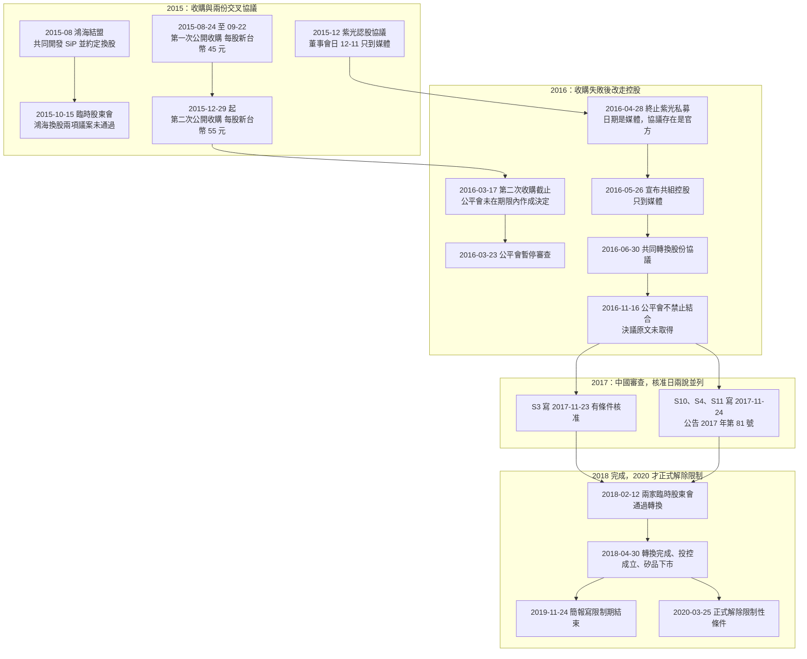

# 第 2 章：日月光為什麼要買矽品，又花了三年？

## 開場問題

> 2015 年秋天的公開收購、2016 年夏天的換股協議、2018 年春天的下市，中間還夾著鴻海、紫光，以及台灣與中國的競爭法審查。拖這麼久，是同一道門沒開，還是好幾件事前後卡住？

先讀 [第 1 章](01-who-is-spil.md)。本章的收購方在 2015–2016 年是日月光半導體，不是代號 3711 的投控。投控要到 2018-04-30 才成立。日月光書已有的集團關係與反壟斷獨立運作，這裡只連過去，不把該章重抄一遍，見 [新聞裡的「日月光」到底是哪個主體](../../ase/html/02-group-and-business.html)。

本章不評價這筆交易貴不貴，也不從後見之明補一個「所以應該買」的理由。

## 主體

寫作時查到的資料沒有收錄一份可引用的收購動機全文。寫作時未查到日月光對「為什麼要買」的完整官方說明，本章不另編策略故事。公開紀錄能證明的是路徑：兩次公開收購都沒有走到 100% 持股，交叉協議先後終止，最後改成雙方同意的控股公司，再等審查與股東會。矽品成為投控 100% 子公司，日期是 2018-04-30，不是 2015 年。（[S1](appendix-sources.md#S1)、[S3](appendix-sources.md#S3)、[S4](appendix-sources.md#S4)）[官方文件]

上圖把衝突的日子分成兩個節點。不要把 11-23 與 11-24 收成一天，也不要把 2019-11-24 與 2020-03-25 收成一天。

### 2015：兩次報價，外加鴻海與紫光

2015-08，矽品與鴻海結盟，共同開發 SiP，並約定換股。（[S6](appendix-sources.md#S6)）[官方文件] 媒體把宣布換股的日期寫成 2015-08-28。[媒體報導] 結盟這件事是官方文件，28 日這個日子不是。

第一次公開收購自 2015-08-24 至 2015-09-22，上限 7.79 億股，每股新台幣 45 元，每單位 ADS 新台幣 225 元。（[S2](appendix-sources.md#S2)、[S4](appendix-sources.md#S4)）[官方文件] 媒體寫日月光在 2015-09-22 取得約 24.99%，成為矽品第一大股東。[媒體報導] 寫作時查到的資料沒有用 20-F 原文記載這個比例，本章不把 24.99% 升成官方持股。不論比例是多少，這一次都還沒有產生後來的 100% 子公司。

2015-10-02，日月光向台中地院聲請假處分，要阻止矽品召開臨時股東會，聲請被駁回。（[S6](appendix-sources.md#S6)）[官方文件] 2015-10-15，矽品臨時股東會上，鴻海換股所需的兩項議案都未通過：提高授權資本額，以及修改取得或處分資產程序。（[S6](appendix-sources.md#S6)）[官方文件]

2015-12，矽品與紫光簽認股協議及策略聯盟。紫光以每股新台幣 55 元認購 10.33 億股新股，約占 24.9%。（[S6](appendix-sources.md#S6)）[官方文件] 董事會日 2015-12-11 取自媒體。[媒體報導] 協議內容與董事會日期要拆開引用。

第二次公開收購自 2015-12-29 至 2016-03-17，上限 7.70 億股，每股新台幣 55 元。這次因為公平會未在期限內作出決定而失敗。（[S2](appendix-sources.md#S2)、[S4](appendix-sources.md#S4)）[官方文件] 寫作時查到的資料沒有記載這次的 ADS 單價，本章不照第一次的 5 股換算去補。

### 2016：從公開收購改成共同控股

2016-03-23，公平會暫停審查。（[S4](appendix-sources.md#S4)）[官方文件] 2016-03 至 04 月，日月光從公開市場再買進 2.583 億股。（[S4](appendix-sources.md#S4)）[官方文件] 這是另一次買進，不是第二次公開收購的成交數。

2016-04-28 這個日期，媒體寫矽品董事會決議終止紫光私募並簽署終止協議。[媒體報導] 終止協議本身列在矽品 20-F 附件，協議存在是官方文件；原件附於 2017-04-11 申報的那一份。（[S5](appendix-sources.md#S5)）[官方文件]

2016-05-26，媒體報導雙方宣布共組產業控股公司（合意書）。[媒體報導] 正式的共同轉換股份協議（Joint Share Exchange Agreement）簽於 2016-06-30；2017-12-14 另簽補充協議。（[S1](appendix-sources.md#S1)、[S2](appendix-sources.md#S2)、[S5](appendix-sources.md#S5)）[官方文件] 5 月 26 日的宣布不能代替 6 月 30 日的協議。

2016-07-29，媒體報導日月光向公平會申報結合。[媒體報導] 2016-11-16，公司簡報與媒體都寫公平會依公平交易法第 13 條第 1 項決議不禁止結合。（[S11](appendix-sources.md#S11)）[公司自述] [媒體報導] 公平會官方公告原文寫作時未取得，所以這一天不能標成 [官方文件]。

中國商務部於 2016-12-14 第一次立案。（[S10](appendix-sources.md#S10)）[官方文件]

### 2017–2018：有條件批准，然後才完成

美國 FTC 於 2017-05-16 核准，出處是公司簡報，不是本章取得的 FTC 公報。（[S11](appendix-sources.md#S11)）[公司自述] 2017-06-06，撤件重報後，商務部再次立案。（[S10](appendix-sources.md#S10)）[官方文件]

商務部核准日有兩說，並列，不調和：

- 2017-11-24：公告 2017 年第 81 號的公告日，簡報同此日，FY2018 20-F 寫「On November 24, 2017, we received approval from MOFCOM」。（[S10](appendix-sources.md#S10)、[S11](appendix-sources.md#S11)、[S4](appendix-sources.md#S4)）[官方文件]
- 2017-11-23：FY2020 20-F 寫有條件核准發生在 November 23, 2017。（[S3](appendix-sources.md#S3)）[官方文件]

有一種說法推測 11-23 是決定作成日、11-24 是公告日。這一點未證實，不當作事實，也不算本章的推論結論。

公告是附加限制性條件的批准，限制期 24 個月。（[S10](appendix-sources.md#S10)）[官方文件] 條件全文沒有取得。中央社 2017-11-24 的歸納是媒體轉述，只有下面四點，外加每 6 個月向商務部提交履行報告。[媒體報導]

1. 24 個月內維持獨立法人地位與原有經營模式。
2. 控股公司只取得分紅與財報資訊，暫不行使其他股東權利。
3. 不歧視客戶。
4. 不限制客戶轉換供應商。

其中「維持獨立營運 24 個月」另有 FY2018 20-F 的句子：條件要求 ASE 與 SPIL 維持獨立營運 24 個月。（[S4](appendix-sources.md#S4)）[官方文件] 第 2 到第 4 點以及每 6 個月的報告義務，本章只標 [媒體報導]。

同一天還有另一份合約，不要和收購對價搞混。2017-11-24，矽品子公司 SPIL（Cayman）與紫光簽約，出售矽品蘇州 30% 股權，價款人民幣 10.26 億元，2018-02 完成。（[S5](appendix-sources.md#S5)）[官方文件] 這是蘇州股權交易，不是日月光買下矽品的價格。

2018-01-16，日月光把所持 9,690,452 單位矽品 ADS 轉換為 48,452,260 股普通股。（[S3](appendix-sources.md#S3)、[S4](appendix-sources.md#S4)）[官方文件] 2000 年每單位代表 5 股，見第 1 章；本章直接引用這兩個 2018 年股數，不另造一條換算公式。

2018-02-12，日月光與矽品分別召開臨時股東會，通過股份轉換。（[S3](appendix-sources.md#S3)、[S4](appendix-sources.md#S4)）[官方文件] 簡報曾把 2018-04-17 標為兩家股票的最後交易日，而且當時註明暫定。（[S11](appendix-sources.md#S11)）[公司自述] 本章沒有交易所公告可把這一天升成官方事實。

2018-04-30，股份轉換完成，投控成立。矽品成為投控 100% 持有的非公開子公司，台股與 NASDAQ ADS 下市。（[S1](appendix-sources.md#S1)、[S3](appendix-sources.md#S3)、[S4](appendix-sources.md#S4)）[官方文件] 同一天，投控與台灣銀行等銀行團簽訂新台幣 900 億元聯貸，用途為支應收購矽品。（[S1](appendix-sources.md#S1)）[官方文件]

矽品股東每股取得的現金，媒體寫新台幣 51.2 元：原始對價 55 元，扣除 2016 年現金股利 2.8 元與資本公積發放 1 元。[媒體報導] 完成日與下市是 [官方文件]；51.2 元不是。

## 口徑

這段故事裡的價格不是同一個東西。

| 數字 | 它是什麼 | 它不是什麼 | 等級 |
|---|---|---|---|
| 每股新台幣 45 元；每單位 ADS 225 元 | 第一次公開收購的出價，期間 2015-08-24 至 09-22 | 不是完成日的現金對價 | [官方文件]（[S2](appendix-sources.md#S2)、[S4](appendix-sources.md#S4)） |
| 每股新台幣 55 元 | 第二次公開收購的出價，期間 2015-12-29 至 2016-03-17；紫光認股價格也是 55 元 | 第二次收購失敗，這個 55 元沒有變成全體股東的成交價 | [官方文件]（[S2](appendix-sources.md#S2)、[S4](appendix-sources.md#S4)、[S6](appendix-sources.md#S6)） |
| 每股新台幣 51.2 元 | 媒體所寫、完成時矽品股東每股取得的現金 | 不是從 20-F 抄出的句子 | [媒體報導] |
| 人民幣 10.26 億元 | 矽品蘇州 30% 股權的價款 | 不是收購整家矽品的對價 | [官方文件]（[S5](appendix-sources.md#S5)） |
| 新台幣 900 億元 | 2018-04-30 投控聯貸的額度，用途為支應收購 | 不是矽品的營收，也不是每股對價 | [官方文件]（[S1](appendix-sources.md#S1)） |

日期同樣不能併檔。公平會暫停審查是 2016-03-23。（[S4](appendix-sources.md#S4)）[官方文件] 不禁止結合的 2016-11-16 只到簡報與媒體。商務部 11-23 與 11-24 兩說並列。簡報上的限制期屆滿是 2019-11-24。（[S11](appendix-sources.md#S11)）[公司自述] 正式解除是 2020-03-25。（[S3](appendix-sources.md#S3)）[官方文件]

主體口徑也要守住。2015 年與 2016 年的公開收購、公開市場買進，20-F 的主詞是日月光，當時投控還不存在。2018-04-30 簽聯貸、成為母公司的，才是投控。（[S1](appendix-sources.md#S1)）[官方文件] 不能把 2015 年的 45 元收購寫成「3711 用 45 元買下矽品」。

## 機制

「花了三年」不是文件裡的一個工期欄位。從 2015-08 的第一次公開收購，到 2018-04-30 完成，中間隔著幾道性質不同的關卡。本章只把這些日子先後排開，不把「三年」寫成官方用語，也不另算一個官方沒有寫的工期。

第一道是控制權沒有在公開收購裡完成。第一次有上限、有期間、有價格。（[S2](appendix-sources.md#S2)、[S4](appendix-sources.md#S4)）[官方文件] 完成後的持股比例只到媒體。第二次在截止日失敗，原因是公平會未在期限內作出決定。（[S2](appendix-sources.md#S2)、[S4](appendix-sources.md#S4)）[官方文件]

第二道是矽品同時有別的結盟。鴻海換股的股東會議案在 2015-10-15 未通過。（[S6](appendix-sources.md#S6)）[官方文件] 紫光認股協議後來終止；終止協議的存在是官方文件，終止日 2016-04-28 是媒體日期。

第三道才是雙方改寫交易形式。2016-06-30 的共同轉換股份協議，把「一方公開收購另一方」換成「共組控股公司」。（[S1](appendix-sources.md#S1)、[S5](appendix-sources.md#S5)）[官方文件] 協議之後仍要等公平會與商務部。公平會 2016-11-16 的不禁止，原文未取得。商務部從 2016-12-14 立案，到 2017 年 11 月才有條件批准。

第四道在完成之後還沒結束。有條件批准要求一段獨立營運，S4 寫明 24 個月。（[S4](appendix-sources.md#S4)）[官方文件] 簡報把屆滿日寫成 2019-11-24。（[S11](appendix-sources.md#S11)）[公司自述] 主管機關正式解除所有限制性條件是 2020-03-25。（[S3](appendix-sources.md#S3)）[官方文件] 讀 2018 年 5 月到 2020 年 3 月之間的新聞時，投控已經是母公司，並不表示兩家營運公司已經可以當成一家在定價、銷售或採購上合併行動。日月光書對這段獨立運作的摘要見 [新聞裡的「日月光」到底是哪個主體](../../ase/html/02-group-and-business.html)。條件第 2 到第 4 點的全文仍未取得，本章不把中央社的歸納升成公告原文，也不用它推測 2020 年以後實際整合到什麼程度。

## 證據

✅ 只表示寫作時查到的資料有記載，右欄等級保持原樣。🔶 是本章的讀法。❓ 是未取得、未證實，或兩說並列。

| 處置 | 主張 | 等級與依據 |
|---|---|---|
| ✅ 已有記載 | 第一次收購每股 45 元、ADS 每單位 225 元，期間 2015-08-24 至 09-22；第二次每股 55 元，期間 2015-12-29 至 2016-03-17，因公平會未在期限內決定而失敗 | [官方文件]（[S2](appendix-sources.md#S2)、[S4](appendix-sources.md#S4)） |
| ✅ 已有記載 | 鴻海結盟與 2015-10-15 議案未通過；紫光認股協議（每股 55 元、10.33 億股、約 24.9%） | [官方文件]（[S6](appendix-sources.md#S6)） |
| ✅ 已有記載 | 2016-06-30 共同轉換股份協議，2017-12-14 補充協議；2018-02-12 臨時股東會；2018-04-30 完成、投控成立、矽品下市 | [官方文件]（[S1](appendix-sources.md#S1)、[S3](appendix-sources.md#S3)、[S4](appendix-sources.md#S4)、[S5](appendix-sources.md#S5)） |
| ✅ 已有記載 | 商務部公告 2017 年第 81 號附加條件批准，限制期 24 個月；S4 寫明獨立營運 24 個月；2020-03-25 正式解除 | [官方文件]（[S10](appendix-sources.md#S10)、[S4](appendix-sources.md#S4)、[S3](appendix-sources.md#S3)） |
| ✅ 已有記載 | 核准日的另一說是 2017-11-23 | [官方文件]（[S3](appendix-sources.md#S3)）。與 11-24 並列，不調和 |
| ✅ 已有記載 | 公平會 2016-11-16 不禁止結合；FTC 2017-05-16 核准；限制期屆滿寫成 2019-11-24；最後交易日 2018-04-17 標為暫定 | [公司自述]（[S11](appendix-sources.md#S11)）。公平會該日同時有 [媒體報導] |
| ✅ 已有記載 | 第一次收購後約 24.99%；現金對價每股 51.2 元（媒體寫成 55 元扣除股利 2.8 元與資本公積 1 元） | [媒體報導] |
| 🔶 推論 | 「花了三年」適合描述 2015-08 到 2018-04-30 這段關卡串連，不適合當成官方工期；獨立營運還要再算到 2020-03-25 | 讀法。[推論] |
| ❓ 未知 | 日月光為何收購的完整官方說明；日月光原股東在轉換中取得的對價明細 | 寫作時查到的資料這一段沒有列出 |
| ❓ 未知 | 11-23 與 11-24 哪一天是決定作成日 | 未證實，不採未證實的推測 |
| ❓ 未知 | 商務部附加條件全文；公平會 2016-11-16 決議原文 | 寫作時未取得 |
| ❓ 未知 | 2018-04-17 是否確為最後交易日 | 只有標成暫定的簡報 |

## 理解檢查

??? question "2015 年每股 45 元的公開收購，買方是日月光投控嗎？"
    不是。投控在 2018-04-30 股份轉換完成時才成立（[S1](appendix-sources.md#S1)）。[官方文件] 20-F 把 2015–2016 年的公開收購記在日月光名下。45 元是第一次收購的每股價格，期間 2015-08-24 至 09-22（[S2](appendix-sources.md#S2)、[S4](appendix-sources.md#S4)）。[官方文件] 不能寫成「3711 用 45 元買下矽品」。

??? question "45 元、55 元、51.2 元，哪一個是完成時矽品股東拿到的現金？證據等級是什麼？"
    媒體寫完成時每股現金是新台幣 51.2 元，並說明是原始 55 元扣除 2016 年現金股利 2.8 元與資本公積發放 1 元。[媒體報導] 45 元與第二次收購的 55 元是公開收購出價，紫光認股價格也是 55 元，這三組價格的出處是 [官方文件]。51.2 元不能升成官方對價。完成日與下市仍是 2018-04-30，那部分是 [官方文件]。

??? question "商務部核准日應該寫 2017-11-24，還是把 11-23 與 11-24 併成一天？"
    兩說並列，不併。公告、簡報與 FY2018 20-F 寫 2017-11-24（[S10](appendix-sources.md#S10)、[S11](appendix-sources.md#S11)、[S4](appendix-sources.md#S4)）。[官方文件] FY2020 20-F 寫 2017-11-23（[S3](appendix-sources.md#S3)）。[官方文件] 「23 日決定、24 日公告」只是未證實的推測。

??? question "限制什麼時候結束？簡報上的 2019-11-24 能不能當作正式解除日？"
    不能。2019-11-24 是簡報所列的限制期結束（[S11](appendix-sources.md#S11)）。[公司自述] 正式解除所有限制性條件是 2020-03-25（[S3](appendix-sources.md#S3)）。[官方文件] 獨立營運的 24 個月見 S4，是 [官方文件]；中央社歸納的另外三點只是 [媒體報導]。

??? question "本章哪幾項關鍵文件其實沒有拿到原文？這會讓你不能主張什麼？"
    公平會 2016-11-16 決議原文未取得，所以「不禁止結合」停在 [公司自述] 加 [媒體報導]。商務部附加條件全文未取得，所以獨立營運 24 個月可以引 S4，但控股公司暫不行使其他股東權利、不歧視客戶、不限制轉換供應商、每 6 個月報告，都只能停在中央社歸納。另外，收購動機的完整官方說明、51.2 元的公司原文、2018-04-17 是否確為最後交易日，寫作時都沒有升格的依據。缺了這些，就不能宣稱條件的每一點都已用公告原文核對，也不能把暫定的最後交易日寫成交易所事實。

## 來源與待查

本章用到的代號：[S1](appendix-sources.md#S1)、[S2](appendix-sources.md#S2)、[S3](appendix-sources.md#S3)、[S4](appendix-sources.md#S4)、[S5](appendix-sources.md#S5)、[S6](appendix-sources.md#S6)、[S10](appendix-sources.md#S10)、[S11](appendix-sources.md#S11)。[S11](appendix-sources.md#S11) 的檔名推定約 2018-02-01，那是簡報時點的推定，不是簡報內每一個事件的日期。科技新報、中央社、鉅亨網等媒體沒有另編代號。

仍開放的問題：

- 日月光說明收購理由的完整官方文本；日月光原股東在股份轉換中取得什麼，寫作時查到的資料未逐項列出。
- 2015-08-28、2015-12-11、2016-04-28、2016-05-26、2016-07-29，以及 24.99% 與 51.2 元：等級停在 [媒體報導]。
- 公平會 2016-11-16 決議原文；商務部 2017 年第 81 號附加條件全文。
- 2017-11-23 與 2017-11-24 的差異尚未證實。
- 2018-04-17 最後交易日在簡報中標為暫定，沒有另找到交易所公告。
- 2019-11-24 與 2020-03-25 必須分開；正式解除之後兩家公司實際整合到什麼程度，寫作時查到的資料沒有寫。
