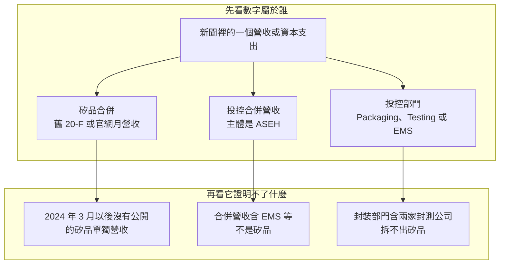

# 第 3 章：為什麼看不到矽品的營收？

## 開場問題

> 官網的月營收停在 2024 年 2 月，之後整排都是「-」。投控年報又只見封裝、測試、EMS。若一則新聞丟出一個「很像矽品」的營收，你怎麼知道它不屬於矽品？

先分清主體，見 [第 1 章](01-who-is-spil.md)。本章不判斷營收好不好，不談股價，也不做估值。投控合併數字怎麼接到獲利與資本支出，日月光書已經寫了，見 [營收成長為什麼不一定等比例提高獲利](../../ase/html/09-capacity-and-economics.html)。本章只處理一件事：哪些數字的主體是矽品，哪些不是。

## 主體

矽品層級還能公開對上的營收，分三段，三段的證據等級不同。

2013–2017 年是矽品自己最後一段經查核的選定財務資料，口徑是合併營收，單位是新台幣百萬元。（[S5](appendix-sources.md#S5)）[官方文件]

| 年度 | 矽品合併營收（新台幣百萬元） | 等級 |
|---|---:|---|
| 2013 | 69,356 | [官方文件] |
| 2014 | 83,071 | [官方文件] |
| 2015 | 82,840 | [官方文件] |
| 2016 | 85,112 | [官方文件] |
| 2017 | 83,554 | [官方文件] |

2018–2021 年未逐年查核。理論上可以用 2022 年的成長率回推 2021 年，但那個回推數未證實。本章不列出回推數，也不用它填空。

2022 年與 2023 年來自矽品月營收新聞稿，不是 20-F。（月營收新聞稿；清單頁為 [S9](appendix-sources.md#S9)）[公司自述]

| 期間 | 矽品合併營收（新台幣百萬元） | 新聞稿同時寫的變動 | 等級 |
|---|---:|---|---|
| 2022 年 | 130,787 | 年增 21.3% | [公司自述] |
| 2023 年 | 113,166 | 年減 13.5%；第四季 29,548 | [公司自述] |
| 2024 年 1 月 | 9,213 | 單月，不是全年 | [公司自述] |
| 2024 年 2 月 | 8,054 | 清單寫合併營收新台幣 80.54 億元，2024-03-11 發布 | [公司自述] |
| 2024 年 3 月起 | 清單顯示「-」 | 沒有公開的矽品單獨營收 | [公司自述] |

官網簡介把 2023 年寫成新台幣 1,132 億元。（[S7](appendix-sources.md#S7)）[公司自述] 月營收新聞稿寫 113,166 百萬元。[公司自述] 公開資料把兩者放在同一年的矽品營收。本章把它們看成同一筆的兩種進位，不另造第三個數字。80.54 億元與 8,054 百萬元也是同一筆 2024 年 2 月營收的兩種寫法，不是兩個月。（[S9](appendix-sources.md#S9)）[公司自述]

官網註記：2010–2012 年同時提供個體與合併數；2013 年起因採用 IFRSs，只提供合併數，含子公司。（[S9](appendix-sources.md#S9)）[公司自述] 2010–2012 年的金額，寫作時查到的資料沒有抄進上表，本章不補。因此本章的「矽品營收」若沒有另外聲明，指的是矽品合併，不是矽品母公司單體，更不是投控合併。

2017 年還能看到營收組成，這是最後一份矽品 20-F 裡的結構，不是往後各年的結構。（[S5](appendix-sources.md#S5)）[官方文件]

| 2017 年矽品合併營收組成 | 占比 |
|---|---:|
| 凸塊與覆晶 | 39.9% |
| 基板封裝 | 27.5% |
| 導線架 | 17.4% |
| 測試 | 14.3% |

四個百分比照錄，本章不加總，也不補一項「其他」。寫作時查到的資料沒有解釋差額。這組比例不能拿去拆 2022 年以後的新聞稿營收，那些年份沒有對應的組成。

## 口徑

投控不依法人揭露營收。20-F 的報導部門是 Packaging、Testing、EMS，另有 Others。行文把前兩個稱為封裝、測試，EMS 保持英文，避免另造財報上沒有的部門名。矽品的營收散在 Packaging 與 Testing，無法單獨拆出。（[S1](appendix-sources.md#S1)）[官方文件] Others 的金額，寫作時查到的資料沒有逐項列出，本章不估。

下表的主體是日月光投控（ASEH）合併，不是矽品。單位是新台幣百萬元。（[S1](appendix-sources.md#S1)）[官方文件]

| 投控項目 | 2023 | 2024 | 2025 |
|---|---:|---:|---:|
| 合併營收 | 581,914 | 595,410 | 645,388 |
| Packaging（封裝，含日月光半導體、矽品等） | 256,806 | 261,731 | 308,343 |
| Testing（測試） | 49,880 | 54,561 | 71,900 |
| EMS | 268,218 | 271,293 | 257,193 |

封裝部門的括注是本書的說明：裡面有日月光半導體、矽品等，不是矽品一家。三個部門加總不會自動等於合併營收，因為還有 Others，也可能有部門間沖銷。這兩項的金額本章沒有，所以不自己加總、不發表一個「差額」。

同一份 20-F 裡還有容易被當成矽品的集團數字，主體仍然是投控。（[S1](appendix-sources.md#S1)）[官方文件]

| 投控合併項目 | 2023 | 2024 | 2025 |
|---|---:|---:|---:|
| 資本支出（新台幣百萬元） | 48,758.7 | 96,207.5 | 171,616.5 |
| 員工總數（人） | 92,894 | 95,492 | 105,947 |

2025 年底集團 105,947 人、其中台灣 67,870 人，這是國別，不是矽品員工人數。（[S1](appendix-sources.md#S1)）[官方文件] 官網約 32,000 人是矽品自述，等級不同，不能拿來和集團人數相減。（[S7](appendix-sources.md#S7)）[公司自述]

同一則新聞裡的數字，可能落在三個口袋。先問主體，再問是全年還是單月，最後才看大小。

用 2023 年對一下，三個口袋都有記載，不能互相代替。矽品合併營收 113,166 百萬元是 [公司自述]。投控合併營收 581,914 百萬元、封裝部門 256,806 百萬元是 [官方文件]。官網另把同一年的矽品營收寫成 1,132 億元，那也是 [公司自述]，不是投控合併，也不是本章把百萬元換算後的新數字。

季報若使用 ATM 這類簡稱，那是另一套顆粒度。日月光書已把 ATM 和 20-F 的 Packaging、Testing 分開，本章不重述，見 [營收成長為什麼不一定等比例提高獲利](../../ase/html/09-capacity-and-economics.html)。

## 機制

看不到矽品營收，不是因為報表把那一欄藏進附註腳注，而是因為揭露義務的主體換了，部門切法又本來就不依法人。

矽品在 2018-04-30 下市，但仍到 2024-04 才獲准停止公開發行。（[S1](appendix-sources.md#S1)）[官方文件] 官網月營收清單的最後一筆是 2024 年 2 月，2024-03-11 發布，3 月到 12 月顯示「-」。（[S9](appendix-sources.md#S9)）[公司自述] 時間上與 2024-04 停止公開發行相鄰。公司沒有說明停刊原因，因果未證實。本章不把「時間相近」寫成「因此停刊」，也不補一段法規義務當作原因。

停刊之後，外界剩下的經查核管道是投控 20-F。那份報表回答的是「集團的封裝、測試、EMS 各做多少」，不是「矽品這家法人做多少」。（[S1](appendix-sources.md#S1)）[官方文件] 所以即使用 2025 年的封裝部門減去某個想像中的日月光半導體，也得不到矽品。本章不做這道減法。收購產生的購買價格分攤會影響投控損益，但寫作時查到的資料沒有列出可引用的金額，本章同樣不補，避免用一個未知的攤提去反推矽品獲利。

2017 年的組成還說明另一種看不見。當年測試占矽品合併營收 14.3%，凸塊與覆晶占 39.9%。（[S5](appendix-sources.md#S5)）[官方文件] 投控的 Testing 部門是集團測試，EMS 則是另一條業務。把矽品 2017 年的 14.3% 套到投控 2025 年的 Testing，或把投控封裝成長讀成矽品的凸塊與覆晶成長，都跨了主體，也跨了年份。

公司債是同一類缺口，不是營收的替代指標。停止公開發行之後，矽品是否仍有流通在外的公司債，寫作時未查到。最後可確認的一筆，是 2014 年海外第四次無擔保轉換公司債 4 億美元，2019-10-31 到期。[媒體報導] 投控 FY2025 合併報表列有國內無擔保公司債，到期日為 2026-04 與 2027-08。（[S1](appendix-sources.md#S1)）[官方文件] 報表沒有載明發行主體是不是矽品。發行主體寫作時未查到，不能把這兩筆債記成矽品的債。

2026 年另有一筆容易被讀成「矽品募了 10 億美元」的融資。媒體報導投控發行海外第一次無擔保轉換公司債 10 億美元，票面利率 0%、期間 5 年，用途為認購日月光半導體及矽品的現金增資新股；並寫訂價公告日 2026-08-04、預定發行日 2026-08-10、金管會於 2026-07-31 申報生效。[媒體報導] 這組內容來自搜尋摘要，未逐字核對公開資訊觀測站原文，等級停在媒體。認購矽品的金額未查到。本章不按兩家公司均分，也不用任何營收比例去猜。

## 證據

✅ 只表示寫作時查到的資料有記載。公司自述不會因為放進 ✅ 列就變成經查核數字。🔶 是讀新聞的規則。❓ 是未查到，或明確禁止用回推數填上的空格。

| 處置 | 主張 | 等級與依據 |
|---|---|---|
| ✅ 已有記載 | 2013–2017 年矽品合併營收，以及 2017 年四項組成 | [官方文件]（[S5](appendix-sources.md#S5)） |
| ✅ 已有記載 | 2022 年 130,787、2023 年 113,166（第四季 29,548）；2024 年 1 月 9,213、2 月 8,054（80.54 億元，2024-03-11 發布）；其後清單為「-」 | [公司自述]（[S9](appendix-sources.md#S9) 與月營收新聞稿） |
| ✅ 已有記載 | 官網 2023 年營收新台幣 1,132 億元 | [公司自述]（[S7](appendix-sources.md#S7)）。與 113,166 百萬元同一年、不同進位 |
| ✅ 已有記載 | 投控 2023–2025 年合併營收與 Packaging、Testing、EMS；資本支出與集團員工數 | [官方文件]（[S1](appendix-sources.md#S1)）。主體是 ASEH，不是 SPIL |
| ✅ 已有記載 | 2014 年那筆 4 億美元轉換公司債於 2019-10-31 到期；2026 年投控 10 億美元、0%、5 年可轉債的媒體說法 | [媒體報導]。10 億美元的日期未逐字核對公開資訊觀測站 |
| 🔶 推論 | 同一則新聞的營收必須先歸到矽品合併、投控合併或投控部門，否則 2023 年的矽品 113,166 百萬元（官網寫 1,132 億元）會和投控合併 581,914 百萬元、封裝部門 256,806 百萬元被讀成同一家公司 | 讀法。[推論] |
| ❓ 未知 | 2018–2021 年矽品逐年營收 | 未逐年查核。不用 2022 年增率回推 |
| ❓ 未知 | 月營收停在 2024 年 2 月的原因 | 與停止公開發行時間相鄰，因果未證實 |
| ❓ 未知 | 停止公開發行後是否仍有流通公司債；投控可轉債認購矽品增資的金額 | 寫作時未查到，不猜 |
| ❓ 未知 | Others 金額，以及部門加總與合併營收的差額 | 寫作時查到的資料未列出，本章不計算 |

## 理解檢查

??? question "2024 年 2 月的 80.54 億元是誰的營收？為什麼 3 月以後是「-」？"
    80.54 億元是矽品官網月營收清單上的 2024 年 2 月合併營收，等於表上的 8,054 百萬元，發布日 2024-03-11（[S9](appendix-sources.md#S9)）。[公司自述] 3–12 月顯示「-」。矽品於 2024-04 獲准停止公開發行（[S1](appendix-sources.md#S1)）。[官方文件] 兩件事時間相鄰，但停刊原因未經公司說明，不能寫成因果。

??? question "能不能用 2022 年年增 21.3%，回推出 2021 年矽品營收？"
    不能。2022 年的 130,787 百萬元與年增 21.3% 是月營收新聞稿的 [公司自述]，不是邀請讀者還原上一年。2018–2021 年寫作時未逐年查核，回推數未證實。本章不列出那個數。

??? question "投控 2025 年 Packaging 營收 308,343 百萬元，是矽品的先進封裝營收嗎？"
    不是。308,343 是投控封裝部門，單位新台幣百萬元，裡面含日月光半導體、矽品等（[S1](appendix-sources.md#S1)）。[官方文件] 它也不是投控合併營收 645,388，更不是 EMS 的 257,193。2017 年矽品自己的凸塊與覆晶占比 39.9% 不能拿來拆這個 2025 年部門數字。

??? question "2023 年同時出現 113,166 百萬元和 1,132 億元，是不是兩套營收？"
    不是本章要另造的第三個數字。113,166 百萬元來自月營收新聞稿，1,132 億元來自官網簡介，都是 [公司自述]，指同一年的矽品口徑。它們和投控合併的 581,914 百萬元不是同一主體。

??? question "本章哪些錢的數字看起來具體，卻不能寫進矽品？"
    至少四個缺口。第一，2018–2021 年沒有逐年查核的矽品營收，不能用成長率回推。第二，月營收在 2024 年 2 月之後變成「-」，原因未證實。第三，停止公開發行後是否仍有流通公司債，未查到；合併報表裡 2026-04 與 2027-08 到期的國內無擔保公司債，沒有寫明是不是矽品發行。第四，投控 2026 年 10 億美元可轉債用途含認購矽品增資，但認購矽品的金額未查到，而且這組發行日期只到未核對原文的媒體摘要。這四項都不能用猜測補上。

## 來源與待查

本章用到的代號：[S1](appendix-sources.md#S1)、[S5](appendix-sources.md#S5)、[S7](appendix-sources.md#S7)、[S9](appendix-sources.md#S9)。2022 年與 2023 年全年數出自官網月營收新聞稿，來源索引沒有另編代號，等級是 [公司自述]。公司債與 2026 年可轉債的媒體說法也沒有編進 S1–S11。

仍開放的問題：

- 2018–2021 年矽品逐年營收。或可從官網月營收 PDF 補，寫作時尚未逐年查核。
- 月營收停刊的原因，以及停止公開發行的金管會文號與確切日期。
- Others 的金額；部門間沖銷的金額。本章拒絕自行加總後當成因。
- 停止公開發行後，矽品是否仍有流通在外的公司債。
- 投控 10 億美元可轉債中，認購矽品現金增資的金額。不要猜。
