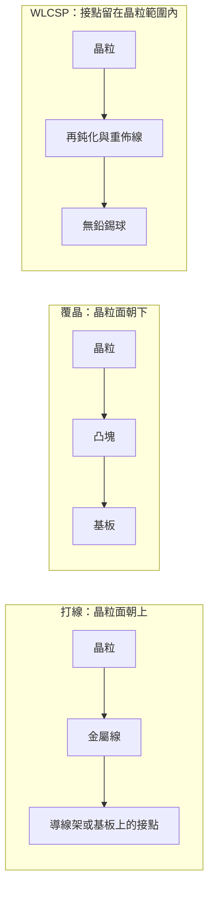
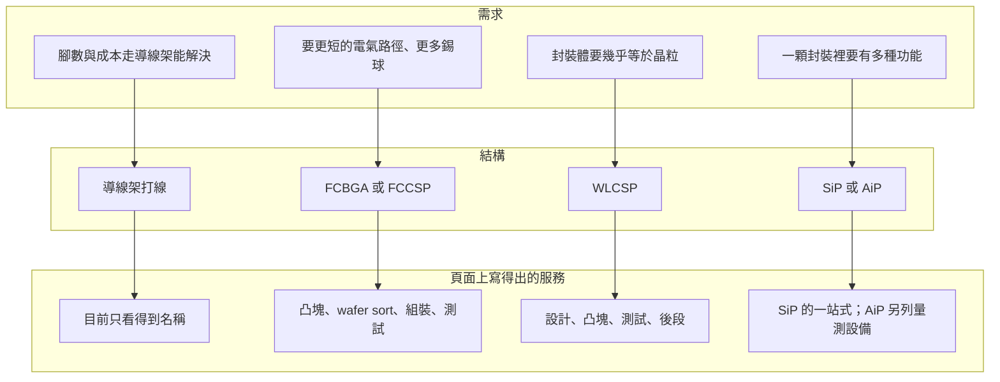

# 第 4 章：基本盤是什麼？

## 開場問題

新聞若只剩先進封裝的名字，矽品會變成一家「只做最難那一段」的公司。公開頁面上排在前面的，其實是每天都在做的封裝種類。

> **先不看論文裡的新名詞。矽品公開說自己在做的封裝，結構上到底差在哪裡，服務又停在哪一句？**

這一章只回答基本盤。後面的中介層、扇出多晶片與矽橋各是一代，不在這裡混進來。

## 先看結構

晶粒要接到外面的電路，差別先看「接點落在哪、晶粒哪一面朝上」。名詞先放在結構後面。

**圖 4-1**：三種接法差在路徑，不差在商品名稱。打線用金屬線把面朝上的晶粒拉到導線架或基板；覆晶把面朝下的晶粒用凸塊直接接到基板；WLCSP 的錫球做在晶粒這一側，封裝幾乎跟晶粒一樣大。圖上沒有尺寸。

下面三張是 Wikimedia 的通用照片與示意，用來辨認這三種路徑長什麼樣子。它們不是矽品的產品，也不是官網的製程文件。點圖開啟 Commons 檔案頁；圖檔以 `Special:FilePath` 載入，沒有放進本書。

<figure class="wiki-image" id="w04-1">
  
  <figcaption>圖 4-W1｜打線的起點：接墊上的球形鍵合，金線從這裡拉出去。原圖是某顯示器元件的金線打在金接墊上，用來對照圖 4-1 的打線路徑。看不出線徑，也不是矽品的材料或參數。攝影：Shaddack，公有領域，未修改。<a href="99-image-credits.md#w04-1">出處</a></figcaption>
</figure>

<figure class="wiki-image" id="w04-2">
  
  <figcaption>圖 4-W2｜覆晶的側視：晶粒翻過來，凸塊落在載板上。圖裡的底填膠是通則結構常見的一層。矽品 Flip Chip 頁的 turnkey 只寫凸塊、wafer sort、覆晶組裝、測試，沒有寫底填膠，這張圖不補那一句。厚度與間距都不是實際比例。繪者：Twisp，公有領域，未修改。<a href="99-image-credits.md#w04-2">出處</a></figcaption>
</figure>

<figure class="wiki-image" id="w04-3">
  
  <figcaption>圖 4-W3｜這張圖是打線式 BGA，不是覆晶。晶粒面朝上，金屬線拉到中間那層，底下再排錫球。圖上把中間那層標成 Interposer；在這裡它是封裝基板，不是第 6 章那種帶 TSV 的矽中介層。用來讀官網「基板／打線」為什麼既有線、又有球。層厚與球距不是實際比例。原圖：Tosaka，向量化：Serenthia，CC BY-SA 3.0，未修改。<a href="99-image-credits.md#w04-3">出處</a></figcaption>
</figure>

官網把產品名稱分成幾欄，但導線架與多數基板打線**只列名稱，沒有附說明**（查閱日 2026-10-12）。[公司自述]

| 官方分類 | 頁面上的名稱 | 頁面實際寫了什麼 |
|---|---|---|
| 導線架（Quad） | LQFP、TQFP、E-pad LQFP、E-pad TQFP、QFN | 只列名稱 |
| 基板／打線 | PBGA、EDHS-PBGA、TFBGA / VFBGA、LGA | 只列名稱 |
| 基板／覆晶 | FCBGA、FCCSP | 只列名稱 |

名稱來源是封裝產品頁。[公司自述] 本書不替這些縮寫補腳數、厚度或散熱能力。

系統級的兩項不是另一種「接點形狀」，而是**一顆封裝裡放進哪些東西**：

- SiP：一顆或多顆半導體元件，加上被動元件，組成封裝內的功能模組。[公司自述]
- AiP：把天線、晶片與被動元件放進同一顆封裝，頁面鎖定的應用是 mmWave、5G、藍牙與雷達。[公司自述]

需求、結構與服務不要壓成一張「越先進越好」的梯子。能對上的只有公開句子。

**圖 4-2**：需求／結構／服務矩陣。箭頭表示「公開資料足以這樣對照」，不是製程先後，也不是營收權重。

若要用營收看基本盤有多重，只能回到下市前。矽品 FY2017 20-F 列出的營收組成是凸塊與覆晶 39.9%、基板封裝 27.5%、導線架 17.4%、測試 14.3%。[官方文件] 四項合計 99.1%，剩下的 0.9 個百分點本章不自行命名。這四個會計分類**不能**分派到 FCBGA、WLCSP 或 AiP。口徑與整表在 [第 3 章](03-invisible-financials.md)，這裡不重抄。

## 逐步製程

下面三張表分開。只有覆晶那張的順序來自官網自己的 turnkey 句子；另外兩張若把項目排開，不代表廠內就依這個順序生產。本章沒有製程溫度、時間或力量。

### 導線架打線：教學簡化

官網沒有站點表。下表只幫讀者把「面朝上、用線連出去」想成連續的工件變化，**不是**矽品產線文件。[推論]

| 步驟 | 輸入 | 操作 | 輸出 | 目的 |
|---|---|---|---|---|
| 1 | 裸晶、導線架 | 晶粒面朝上固定到導線架 | 黏在框架上的晶粒 | 先有機械位置，才能打線 |
| 2 | 上一站的半成品 | 以金屬線連接晶粒接墊與框架接點 | 已電氣連通的半成品 | 把訊號與電源拉到封裝外緣 |
| 3 | 已打線的半成品 | 用膠包覆 | 被保護的模封體 | 固定細線、隔開外界 |
| 4 | 模封體 | 切成可上板的單顆外形 | 單顆導線架封裝 | 讓接腳能焊到電路板 |

金屬線的材料、線徑與第 4 步的模具，頁面都沒有寫。LQFP、TQFP、QFN 與兩種 E-pad 只停留在名稱，最後成型怎麼分，本章不猜。

基板上的打線（PBGA 等）同樣只列名稱。不要把導線架這四步直接改貼到基板打線上。

### 覆晶：官網寫出的 turnkey

Flip Chip 頁把服務寫成凸塊、wafer sort、覆晶組裝、測試，並寫錫球可支援 2,597 顆以上。[公司自述] 相關技術名稱有 Cu Pillar／Bond-on-Trace（BOT）與 Fine Pitch Die Bonding，沒有參數。[公司自述]

| 步驟 | 輸入 | 操作 | 輸出 | 目的 |
|---|---|---|---|---|
| 1 凸塊 | 晶圓 | 在晶圓上做凸塊 | 帶凸塊的晶圓 | 讓面朝下的晶粒有可焊接的接點 |
| 2 wafer sort | 帶凸塊的晶圓 | 在晶圓階段做電性分類 | 知道好壞的晶粒 | 壞晶粒不要進組裝 |
| 3 覆晶組裝 | 要組裝的晶粒、基板 | 晶粒面朝下接到基板 | 已接合的封裝體 | 接點直接落在基板上，不再靠打線 |
| 4 測試 | 封裝體 | 做成品測試 | 可出貨或剔除的判定 | turnkey 把測試算進同一條服務 |

「2,597 顆以上」是頁面對錫球數的能力句子，不是某一顆 FCBGA 的實測腳數。wafer sort 與第 5 章的 CP 用詞不同，官網沒有對照表，本章不把它們合成同一站。測試在測什麼，留給 [第 5 章](05-testing.md)。

凸塊服務頁的最小陣列間距如下（查閱日 2026-10-12）。[公司自述] 這是能力表，不是產品出貨清單。

| 凸塊類型 | 最小陣列間距 | 材料 |
|---|---|---|
| Solder Bump | 150 µm | Sn/Ag 或 SnAgCu |
| Ball Placement | 300 µm | SnAgCu |
| Cu Pillar Bump | 60 µm | Cu/Ni/SnAg 或 Cu/SnAg |
| µBump（含 µPad + TSV reveal、C4） | 40 µm | Cu/Ni/Cu/SnAg（µBump）、Cu/SnAg（C4） |

這張表不是由粗到細排列。Ball Placement 的 300 µm 比 Solder Bump 的 150 µm 更寬。µBump 那一列把 µPad、TSV reveal 與 C4 寫在一起，間距只給了一個 40 µm；本章不把 40 µm 改派給其中一種。材料堆疊的厚度沒有出現，不補。

晶圓尺寸要照頁面的不一致來寫：**官網概述提及 200 mm 與 300 mm，能力表只列 12 吋**。[公司自述] 200 mm 是 8 吋、300 mm 是 12 吋。概述沒有說每一種凸塊都涵蓋兩種尺寸，能力表也沒有 8 吋那一欄。兩句不能合成「8 吋與 12 吋都做到 40 µm」。

表上的 µBump 不是混合鍵合；寫作時查無矽品具名的公開資料。

### WLCSP：頁面列出的項目，不是站點順序

WLCSP 頁寫的是 12 吋晶圓，用 PBO/PI 做再鈍化與重佈線，使用無鉛錫球，並做背面研磨、背面貼膜與雷射打印；出貨形式為晶圓、捲帶或 tray；服務包含設計、凸塊、測試、後段。[公司自述] 頁面沒有寫哪一步在前。下表因此按「頁面有哪些交付」，不按推測的機台順序。

| 項目 | 輸入 | 操作 | 輸出 | 目的 |
|---|---|---|---|---|
| 再鈍化與重佈線 | 12 吋晶圓 | 以 PBO 或 PI 做再鈍化與 RDL | 接點位置已重排的晶圓 | 保護晶圓表面，並把接點帶到要植球的位置 |
| 錫球 | 完成重佈線的晶圓 | 植無鉛錫球 | 可焊接的 WLCSP | 對外連接；球仍在晶粒範圍內 |
| 背面與標記 | 晶圓 | 背面研磨、背面貼膜、雷射打印 | 厚度與標記已處理的晶圓 | 減薄、保護與追溯 |
| 出貨 | 完成的晶圓級封裝 | 以晶圓、捲帶或 tray 交付 | 三種形態之一 | 配合客戶後段，而不是只交一種包裝 |
| 一條龍 | 設計需求 | 設計、凸塊、測試、後段 | 頁面所稱的整段服務 | 服務範圍不只有植球 |

WLCSP 也稱 WLBGA。[公司自述] 它是圖 4-1 的第三種：接點不往晶粒外面長。接點長到晶粒外面的扇出，是 [第 7 章](07-fanout-to-fomcm.md)，原理不在這裡重講。

### SiP 與 AiP：只寫到頁面停住的地方

<figure class="wiki-image" id="w04-4">
  
  <figcaption>圖 4-W4｜一塊板上放了好幾顆大小不同的元件，上面再蓋一片標著 SiP 的蓋子。用來辨認「一顆模組裡有多種東西」。圖上的大元件畫成帶引腳的零件，不是裸晶，也看不出打線或覆晶。不是矽品的產品。作者：Verdel，CC BY-SA 4.0，未修改。<a href="99-image-credits.md#w04-4">出處</a></figcaption>
</figure>

| 項目 | 輸入 | 操作 | 輸出 | 目的 |
|---|---|---|---|---|
| SiP | 一顆或多顆半導體元件、被動元件 | 組成封裝內的功能模組；頁面並寫設計、凸塊、wafer sort、組裝、測試 | 一顆裡有完整功能的封裝 | 頁面稱為 One Stop Shop |
| AiP | 天線、晶片、被動元件 | 整合進同一顆封裝；站點順序未公布 | 帶天線的封裝 | 對應頁面列出的 mmWave、5G、藍牙與雷達 |

AiP 頁列出的量測設備是 Anritsu MS4647B（10 MHz–67 GHz）、ME7838E（70 kHz–110 GHz）、FormFactor Elite300 探針台。[公司自述] 這是設備的頻率範圍，不是「每一件產品都測到 110 GHz」。

## 缺陷與限制

基本盤的限制主要是**資料停在哪裡**，不是本章能算出的失效率。

導線架與多數基板封裝只有名稱。讀者不能從 LQFP 或 PBGA 這幾個字推出腳距、散熱片構造或可靠度結果。Stacked Die、Multi-Package、Fine Pitch WB 與 Molding 這幾頁，研究時沒有逐頁展開，本章不補內容。

凸塊表的數字是最小陣列間距。它沒有說現在出貨的產品用哪一列，也沒有說 40 µm 已經用在哪一個客戶。概述與能力表的晶圓尺寸不一致，已在上一節照原樣保留。

翹曲、TIM 與 EMI 是另一種限制：底稿記錄 OpenAlex 自 2014 年以來的矽品具名作品共 278 筆，其中大量是 FCBGA／FCCSP 翹曲、TIM、EMI shielding、雙面 SiP 與 AiP 這類題目。**量產型論文很多，本書未逐篇核對全文。** 這裡的「量產型」是題目屬於量產封裝會遇到的問題，不是「論文已證明賣給某客戶」。因此本章沒有任何翹曲微米數，也不引用未核對的曲線。

官網的公開分類停在通用技術名稱。寫作當日查到的技術頁沒有出現 FO-MCM、FO-EB、CoWoS、CPO 這些名字。[公司自述] 那些名字若出現，是在後面章節的論文或集團文件裡，不能倒過來說「官網有這個平台」。

FY2017 的四個百分比是截至 2017-12-31 的歷史口徑。[官方文件] 矽品後來不再單獨公布這種組成。把 17.4% 或 39.9% 讀成 2026 年的產品結構，證據不夠。

## 檢查與控制

公開資料看得到的控制點，比「廠內怎麼控」少很多。

| 想確認的事 | 頁面給了什麼 | 仍然不能做的事 |
|---|---|---|
| 覆晶組裝前知不知道晶粒好壞 | turnkey 包含 wafer sort。[公司自述] | 沒有涵蓋率、過殺或漏檢數字 |
| 凸塊能排多密 | 四種最小間距與材料。[公司自述] | 不能推出實際製程窗口，也不能把 40 µm 說成混合鍵合 |
| 晶圓尺寸 | 概述提及 200 mm 與 300 mm，能力表只列 12 吋。[公司自述] | 不能宣稱兩種尺寸都覆蓋全表 |
| AiP 量測設備 | 三台儀器與頻率範圍。[公司自述] | 不能把儀器上限寫成產品規格 |
| 翹曲、散熱材料、EMI | 知道這類論文很多 | 未逐篇核對全文，不能寫控制限 |

成品測試的溫度、功率與平行度在第 5 章，不搬進這張表。本章也沒有進料抽樣頻率或機台校正週期。

## 矽品連結

狀態只分三檔。已證實表示那句話有對應的公開句子；未知表示寫作時沒有能回答的資料，不是證明它不存在。

| 項目 | 狀態 | 證據等級 |
|---|---|---|
| 導線架名稱含 LQFP、TQFP、E-pad LQFP、E-pad TQFP、QFN | ✅ 已證實（僅名稱） | [公司自述] |
| 基板打線名稱含 PBGA、EDHS-PBGA、TFBGA / VFBGA、LGA | ✅ 已證實（僅名稱） | [公司自述] |
| 覆晶名稱含 FCBGA、FCCSP | ✅ 已證實（僅名稱） | [公司自述] |
| 凸塊四種最小間距與材料，查閱日 2026-10-12 | ✅ 已證實 | [公司自述] |
| 概述提及 200 mm 與 300 mm，能力表只列 12 吋 | ✅ 已證實兩處不一致 | [公司自述] |
| 8 吋也能做到表上每一種間距 | ❓ 未知 | 兩處文字沒有對上 |
| WLCSP 為 12 吋、PBO/PI、無鉛錫球，出貨為晶圓、捲帶或 tray | ✅ 已證實 | [公司自述] |
| 覆晶 turnkey 含凸塊、wafer sort、組裝、測試；錫球可支援 2,597 顆以上 | ✅ 已證實 | [公司自述] |
| Cu Pillar／BOT、Fine Pitch Die Bonding | ✅ 已證實（僅名稱） | [公司自述] |
| SiP 的功能模組與 One Stop Shop 範圍 | ✅ 已證實 | [公司自述] |
| AiP 應用方向與三台量測設備型號 | ✅ 已證實 | [公司自述] |
| FY2017 四個營收組成百分比 | ✅ 已證實（歷史口徑，見第 3 章） | [官方文件] |
| 這四個百分比等於現在的產品結構 | ❓ 未知 | 下市後無此單獨揭露 |
| 翹曲、TIM、EMI 的具體數值 | ❓ 未知 | 論文多，本書未逐篇核對全文 |
| 混合鍵合 | ❓ 未知 | 寫作時查無具名公開資料 |
| 官網技術頁有沒有 FO-MCM、FO-EB、CoWoS、CPO | ✅ 已證實沒有這些名稱 | [公司自述] |
| Stacked Die、Multi-Package 等未展開頁的內容 | ❓ 未知 | 底稿未逐頁讀 |

## 理解檢查

??? question "FCBGA 為什麼不是把打線封裝多加幾條線？"

    打線是晶粒面朝上，用金屬線拉到導線架或基板。覆晶是晶粒面朝下，凸塊直接接到基板。FCBGA／FCCSP 在官網上是覆晶這欄的名稱，不是導線架清單裡的一項。[公司自述] 線的數量改變不了接點在哪一側。

??? question "凸塊表的 40 µm 能不能寫成『矽品已能量產混合鍵合』？"

    不能。40 µm 是 µBump 那一列的最小陣列間距，同一列還寫了 µPad、TSV reveal 與 C4，沒有分開的間距。[公司自述] 微凸塊不是混合鍵合。混合鍵合在寫作時查無矽品具名的公開資料。表也沒有說哪一個客戶已經用到這個間距。

??? question "看到概述寫 200 mm 與 300 mm，為什麼仍不能說 8 吋、12 吋都能做完全表？"

    這題問的就是證據缺口。概述提及兩種直徑，能力表只列 12 吋，兩處沒有互相說明。[公司自述] 缺的是一張把「尺寸 × 凸塊類型」填滿的表。在那張表出現之前，只能保留不一致，不能升格。

??? question "FY2017 導線架占 17.4%，能否用來估計現在導線架還剩多少？"

    不能。17.4% 與另外三個百分比來自矽品 FY2017 20-F，是下市前的歷史口徑。[官方文件] 會計分類也不能對上今天的 FCBGA 或 WLCSP。現況要看第 3 章所說的揭露限制，不能用一個舊百分比外推。

## 來源與待查

官網各技術頁與產品頁都沒有發布日期。本章凡標 [公司自述] 的官網句子，查閱日都是 2026-10-12。

| 來源 | 本章用到的範圍 |
|---|---|
| [導線架產品頁](https://www.spilglobal.com/IC_PackagingSecond/Leadframe) | LQFP、TQFP、E-pad 與 QFN 的名稱 |
| [基板產品頁](https://www.spilglobal.com/IC_PackagingSecond/LaminateSubstrate) | 打線與覆晶的名稱 |
| [WLCSP 頁](https://www.spilglobal.com/IC_PackagingData/WaferLevelWLCSP) | 12 吋、PBO/PI、無鉛錫球、出貨形式、一條龍 |
| [凸塊頁](https://www.spilglobal.com/ServiceData/Bumping) | 四種間距、材料；200 mm 與 300 mm 的概述 |
| [Flip Chip 頁](https://www.spilglobal.com/TechnologyList/FanOutWLP2) | turnkey、2,597 顆以上、Cu Pillar／BOT 等名稱 |
| [SiP 頁](https://www.spilglobal.com/TechnologyData/SysteminPackageSiP) | 功能模組與 One Stop Shop |
| [AiP 頁](https://www.spilglobal.com/TechnologyData/AntennainPackageAiP) | 應用與三台量測設備 |
| 矽品 FY2017 20-F（研究底稿代號 S5） | 只取營收組成四個百分比；整表見第 3 章 |

待查，以及會改寫本章的資料：

- 能力表若補上 200 mm，並逐列對上凸塊類型，尺寸那一句就要改寫。
- 翹曲、TIM、EMI 要等逐篇核對全文之後才能引用數字；現在一篇都不引用。
- Stacked Die、Multi-Package、Fine Pitch WB、Molding 的頁面內容仍未整理。
- 混合鍵合若出現矽品具名的論文或公告，上一節「查無」那句就要撤回。
- 官網若在有日期的頁面列出 FO-MCM、FO-EB、CoWoS 或 CPO，本章「頁面沒有這些名稱」只代表 2026-10-12 的查閱結果。
