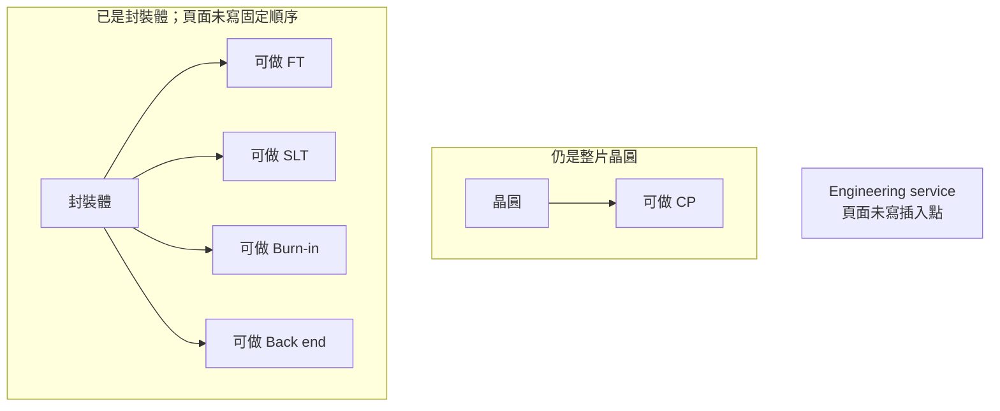
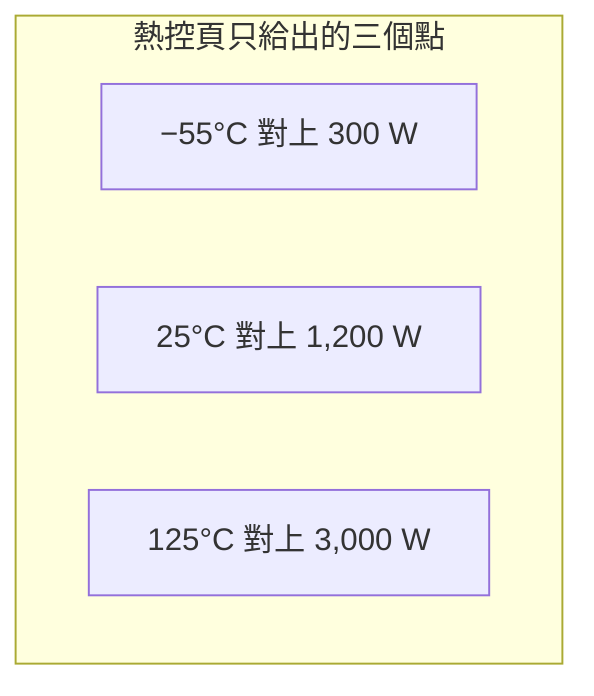

# 第 5 章：封測廠的「測」做什麼？

## 開場問題

封裝把晶粒變成可以拿去上板的東西。測試沒有改變那顆晶粒的電路，它佔用的是機台時間。

> **矽品公開的「測」，是在哪些插入點、對哪些元件、把規格寫到哪裡？這些頁面能不能告訴我們一年測多少顆？**

先備是 [第 4 章](04-mainstream-packaging.md) 的 turnkey：覆晶服務裡已經出現 wafer sort 與測試這兩個詞。本章只拆測試頁自己寫了什麼。

## 先看結構

測試頁列出的服務是 CP（晶圓針測）、FT／SLT、Burn-in、Back end、Engineering service，並寫涵蓋數位、混合訊號與 RF 元件（查閱日 2026-10-12）。[公司自述] 頁面沒有規定這些服務的固定先後。下圖只分成「還是整片晶圓」和「已經是封裝體」，避免排成一條假產線。

**圖 5-1**：官網列出的測試服務落在哪種工件上。CP 的對象仍是晶圓。FT、SLT、Burn-in、Back end 的對象是封裝之後的料，但誰先誰後沒有公布。Engineering 連插入點都沒有寫。

<figure class="wiki-image" id="w05-1">
  
  <figcaption>圖 5-W1｜晶圓針測用的探針卡。探針收向中央，對的是還在晶圓上的接墊，所以它只對應 CP 這一格，對不上 FT 或 Burn-in。這不是矽品的機台，也看不出一年測多少顆。攝影：Ajoones，CC BY 3.0，未修改。<a href="99-image-credits.md#w05-1">出處</a></figcaption>
</figure>

機台能力頁的類別是 Logic、Mixed signal、RF。[公司自述] **這頁沒有列記憶體測試類別。** 機型清單是圖片，文字擷取不到，本章不依圖猜測型號。

類別與 20-F 不是同一句話。官網服務頁寫數位、混合訊號與 RF。[公司自述] 投控 20-F 寫到矽品時，測試只到 logic and mixed signal，並寫有 turnkey。[公司自述] 本書不把 RF 補進 20-F 那句，也不因為 20-F 沒寫 RF 就改寫官網。

FT／SLT 頁的規格全部如下，不往 CP 或 Burn-in 搬。[公司自述]

| 項目 | FT | SLT |
|---|---|---|
| 封裝尺寸 | 2×2–120×120 mm | 5×5–120×120 mm |
| 最大接觸力 | 480 kg | 200 kg |
| 測試溫度 | −55°C 至 175°C（±3°C） | 同一句，頁面沒有分成兩套溫度 |
| 熱控能力 | 300 W（−55°C）、1,200 W（25°C）、3,000 W（125°C） | 與 FT 同頁列出，沒有另給一套瓦數 |
| 平行測試 | 冷測 ×8；常溫／高溫 ×16 | 冷測 ×6；常溫／高溫 ×12 |
| 測試板 | 頁面未單列 FT 板的最大尺寸 | 最大 580×580 mm |

溫度那一列在頁面上是整頁的測試溫度，不是兩套獨立規格；上表為了對照才分欄。±3°C 沒有說明是設定點誤差、空間均勻性，或兩者都是。熱控只給三個溫度點，中間溫度的瓦數沒有寫，本章不內插。

**圖 5-2**：3,000 W 只寫在 125°C 這個點上。它不是全溫度都可用的功率，也沒有第四個點。

為什麼測試時間貴，[矽格書的成本模型](../../sigurd/html/02-test-cost-model.html)已經把機台小時、測試時間、平行度與稼動率寫成可重算的帳。本章不重算。矽品頁面只對得上那條帳裡的「平行度」這一項；小時成本與稼動沒有公開數字，不能代填。

## 逐步製程

下表的「操作」只解釋這項服務在區分什麼工件。除了 FT／SLT 已公布的接觸、溫度與平行度之外，不補程式內容。順序不是官網流程。

| 服務 | 輸入 | 操作 | 輸出 | 目的 |
|---|---|---|---|---|
| CP | 整片晶圓 | 以探針做晶圓針測，頁面沒有再列電性項目 | 晶粒級的測試結果 | 在切割與組裝之前知道晶粒差異 |
| FT | 封裝體，尺寸落在 2×2–120×120 mm | 以最高 480 kg 的接觸力接觸；溫度與平行度用上一節的 FT 欄 | 這一次成品測試的判定 | 封裝完成後確認能不能過這一站 |
| SLT | 封裝體，尺寸落在 5×5–120×120 mm；測試板最大 580×580 mm | 以最高 200 kg 的接觸力做系統級測試；平行度用上一節的 SLT 欄 | 系統級條件下的判定 | 頁面把它列成與 FT 不同的服務 |
| Burn-in | 頁面未寫明工件範圍 | 只列服務名稱，沒有溫度、時間或功率 | 未知 | 名稱上是老化篩選；條件未公布 |
| Back end | 頁面未寫明 | 只列服務名稱 | 未知 | 名稱上屬於測試後段；站點未公布 |
| Engineering | 頁面未寫明 | 只列工程服務 | 未知 | 量產程式之外的工程支援，範圍未公布 |

第 4 章的 wafer sort 是覆晶 turnkey 裡的一個詞。本章的 CP 是測試服務頁上的一個詞。兩頁都沒有寫「兩者是同一站」或「兩者一定先後相接」。缺這張對照，就不能合成一條從晶圓到出貨的唯一路徑。

AiP 的儀器型號在第 4 章。測試這邊只補一篇論文：EPTC 2019 提出以正交訊號做 mmWave AiP 的 over-the-air 測試，用來提升產出（DOI 10.1109/eptc47984.2019.9026630）。[論文] IEEE 頁面未能抓取。底稿沒有提升百分比，這句也不等於某一客戶已經量產。

## 缺陷與限制

規格本身就帶著使用限制，不必再編一個失效率。

冷測同時碰上兩件較緊的公開數字：熱控在 −55°C 只有 300 W，平行度降到 FT ×8、SLT ×6。常溫與高溫的平行度較高，125°C 那個點才寫到 3,000 W。[公司自述] 把這兩列放在一起，只能說「冷測的公開上限比較緊」。沒有稼動率與產品組合，就不能進一步說冷測一定是全廠瓶頸。那一步是 [推論]，而且缺資料，本章停住。

SLT 的接觸力上限是 200 kg，封裝尺寸下限是 5×5 mm，測試板到 580×580 mm 為止。FT 可以接觸到 480 kg，尺寸可以小到 2×2 mm。頁面沒有解釋差異的原因。

175°C 出現在溫度範圍的上端，但熱控的三個點只到 125°C 的 3,000 W。175°C 時還能控多少瓦，頁面沒有寫。

Burn-in 不能借用 FT／SLT 的溫度與瓦數。測試服務頁只把它列為名稱；那組數字掛在 FT／SLT 規格頁。投控 20-F 另有一句集團層級的高功率冷卻 handler 與 burn-in，底稿標明不專指矽品。[公司自述] 不能拿集團句子來填矽品 Burn-in 的規格。

機台頁沒有記憶體類別，意思只是「這一頁沒有這一欄」。圖片裡的機型又讀不到。沒有這一欄，不足以證明矽品不做記憶體測試，也不足以證明它做。這是未知。

產能與測試營收占比沒有公開數字。這不是表格漏了一格。矽品已不單獨公布這種營運數字，寫作時未查到現行測試產能，也未查到現行測試營收占比。FY2017 測試占營收 14.3% 是下市前的歷史組成，見 [第 3 章](03-invisible-financials.md)，不能換成今天的產能或占比。[官方文件]

## 檢查與控制

測試站本身就是一道判定。公開資料能說的是判定時的邊界，不是良率。

| 想控制的事 | 公開邊界 | 沒有寫的 |
|---|---|---|
| 接觸會不會超過機台負荷 | FT 最大 480 kg；SLT 最大 200 kg。[公司自述] | 實際用到幾公斤、插座壽命 |
| 溫度設在哪裡 | −55°C 至 175°C，並附 ±3°C。[公司自述] | ±3°C 的定義、175°C 的可用功率 |
| 熱能不能帶走 | 三個溫度點對上 300 W、1,200 W、3,000 W。[公司自述] | 其他溫度、瞬時與持續的差別 |
| 一次測幾顆 | FT 冷測 ×8、常溫／高溫 ×16；SLT 冷測 ×6、常溫／高溫 ×12。[公司自述] | 平行效率、換料時間、稼動率 |
| SLT 板能做多大 | 最大 580×580 mm。[公司自述] | 板子實際用了多少面積 |
| 測哪一類元件 | 官網寫數位、混合訊號、RF；機台類別為 Logic、Mixed signal、RF。[公司自述] | 記憶體是否在範圍內；機型名稱 |
| 矽品在集團文件裡被寫到哪 | logic and mixed signal，加 turnkey。[公司自述] | 不能擴成 HPC 或矽光子 |

集團測試研發要單獨放。2026-04 申報的投控 20-F 寫到 HPC、mmWave、SiP、矽光子、光感測模組測試，以及高功率冷卻 handler 與 burn-in 時，底稿的等級是集團層級，不專指矽品。[公司自述] 矽品自己的那句停在 logic and mixed signal 與 turnkey。把集團研發清單讀成「矽品獨有的測試平台」，是把主體寫錯。

成本帳上的控制則回到矽格那一章：平行度上升不一定讓每顆成本等比下降，因為還有測試時間與稼動。矽品沒有公開這兩個數，本章給不出矽品的每顆測試成本。

## 矽品連結

| 項目 | 狀態 | 證據等級 |
|---|---|---|
| 服務含 CP、FT、SLT、Burn-in、Back end、Engineering | ✅ 已證實（名稱） | [公司自述] |
| 元件範圍寫數位、混合訊號與 RF | ✅ 已證實 | [公司自述] |
| 機台類別為 Logic、Mixed signal、RF，且沒有列記憶體類別 | ✅ 已證實「頁面如此」 | [公司自述] |
| 因此不做記憶體測試 | ❓ 未知 | 頁面缺欄不等於能力不存在 |
| 機型名稱 | ❓ 未知 | 清單是圖片，文字未擷取 |
| FT／SLT 的尺寸、接觸力、溫度、三個熱控點、平行度、SLT 板尺寸 | ✅ 已證實 | [公司自述] |
| 上述熱控與溫度直接適用於 Burn-in | ❓ 未知 | 數字不在 Burn-in 名下 |
| ±3°C 的統計定義 | ❓ 未知 | 頁面只有這個公差 |
| 20-F 寫到矽品的測試範圍 | ✅ 已證實只到 logic and mixed signal，並含 turnkey | [公司自述] |
| HPC、mmWave、矽光子等測試研發屬於矽品獨有 | ❓ 未知；文件寫的是集團 | [公司自述] |
| AiP OTA 論文的題旨 | ✅ 已證實有這篇論文 | [論文] |
| 該論文證明某客戶 AiP 已量產 | ❓ 未知 | 全文未核，也沒有客戶公告 |
| 現行測試產能、現行測試營收占比 | ❓ 未知 | 寫作時未查到 |
| wafer sort 與 CP 是不是同一站 | ❓ 未知 | 兩頁沒有對照 |

## 理解檢查

??? question "3,000 W 能不能當成矽品熱控在任何測試溫度都做得到的功率？"

    不能。FT／SLT 頁把 3,000 W 寫在 125°C，1,200 W 寫在 25°C，300 W 寫在 −55°C。[公司自述] 溫度範圍雖然寫到 175°C，那個溫度沒有對應瓦數。三個點之間也不做內插。這組數字也不自動適用於只列了名稱的 Burn-in。

??? question "為什麼本章不直接算出矽品測一顆要多少錢？"

    測試時間貴，是因為機台小時有限。算法在矽格書的測試成本模型裡，本章不重寫。矽品公開了平行度，卻沒有公開測試時間、稼動率與機台小時成本。缺這三項，代填任何單價都是假帳。

??? question "機台頁沒有記憶體類別，為什麼不能寫成矽品不測記憶體？"

    這是證據缺口。能證實的只有「Tester capability 頁的類別是 Logic、Mixed signal、RF，沒有記憶體這一欄」，而且機型是圖片、文字沒有讀到。[公司自述] 缺欄有三種可能：真的不做、做了但沒放上這一頁、或放在讀不到的圖片裡。在新的頁面或文件出現之前，狀態維持未知。

??? question "20-F 裡的矽光子與 HPC 測試，可以寫進矽品的能力簡介嗎？"

    不能直接寫成矽品獨有。底稿把 HPC、mmWave、SiP、矽光子、光感測模組、高功率冷卻 handler 與 burn-in 放在集團測試研發。[公司自述] 同一份文件寫到矽品的句子只到 logic and mixed signal，另加 turnkey。主體要維持在集團，除非另有句子指明由矽品執行。

## 來源與待查

官網沒有發布日期。本章官網句子的查閱日為 2026-10-12。論文的 IEEE 頁面未能抓取，年份與題旨依底稿，不把摘要以外的數字補進來。

| 來源 | 本章用到的範圍 |
|---|---|
| [測試服務頁](https://www.spilglobal.com/ServiceSecond/Test) | CP、FT／SLT、Burn-in、Back end、Engineering；數位、混合訊號、RF |
| [機台能力頁](https://www.spilglobal.com/ServiceThird/Testercapability) | Logic、Mixed signal、RF；沒有記憶體類別；機型為圖片 |
| [FT／SLT 頁](https://www.spilglobal.com/ServiceThird/FTSLTservice) | 尺寸、接觸力、溫度、熱控、平行度、SLT 板 |
| 投控 20-F（2026-04 申報；底稿所引） | 矽品句：logic and mixed signal 與 turnkey。集團句：HPC、mmWave、SiP、矽光子等 |
| EPTC 2019，DOI 10.1109/eptc47984.2019.9026630 | 只保留 AiP OTA 的題旨；不在 T1–T14 對照表，故不編代號 |
| [第 3 章](03-invisible-financials.md) | FY2017 測試營收占比的口徑，本章不重抄 |
| [矽格書：測試時間為什麼就是錢](../../sigurd/html/02-test-cost-model.html) | 機台小時的成本結構；不代填矽品數字 |

待查，以及會改寫本章的資料：

- 矽品或投控若公布測試產能、測試營收占比或機台小時，本章「未公開」的結論就要改。
- 機台頁若出現記憶體類別，或圖片中的型號被正式文字取代，機台那一列要重寫。
- FT／SLT 的瓦數若被文件明文延伸到 Burn-in 或 175°C，現在的「不能搬」就要收回。
- wafer sort 與 CP 若有官方對照，第 4 章與本章的路徑才能接成一條。
- AiP OTA 論文的全文若讀到，也只能先改論文能支持的句子；客戶量產仍要另有公告。
