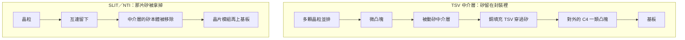
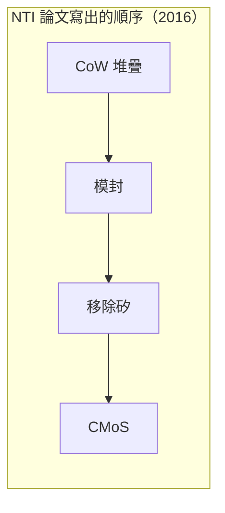

# 第 6 章：矽品在 2.5D 時代做了什麼？

## 開場問題

2014 年前後，矽品的論文開始出現矽中介層。同一個時期，也有論文把中介層裡的矽拿掉。兩件事都容易被後來的新聞收成一個詞。

> **矽品在 2014 到 2016 年公開的 2.5D 與無矽中介層，是不是今天新聞裡的 CoWoS？**

不是。這一章只寫那一代：TSV 矽中介層，以及與 Xilinx 合著的 SLIT（2014）、NTI（2016）。CoWoS 外包的證據留在 [第 10 章](10-beside-tsmc.md)，這裡只保留這一句分界。

## 先看結構

官網的「2.5D/3D Integration with TSV」寫的是：在晶圓上做銅填充 TSV。2.5D 是多顆晶粒並排放在被動矽中介層上；3D 是晶粒垂直堆疊。應用句寫高階 HPC、網通與資料伺服器（查閱日 2026-10-12）。[公司自述] 頁面沒有日期，也沒有出現 CoWoS、FO-MCM、FO-EB 或 CPO。

關鍵製程在頁面上分成兩段，縮寫本身沒有展開。MEoL 列出載板鍵合／解鍵合、晶圓薄化、TSV reveal、C4 與 micro bumping。BEoL 列出 die stacking 組裝。[公司自述]

SLIT 與 NTI 是論文裡的另一條結構：中介層的矽最後不留在封裝裡。SLIT 是 Silicon-Less Interconnect Technology，NTI 是 Non-TSV Interposer。官網那段「矽還在、TSV 還在」的說明，沒有描述這兩條。

**圖 6-1**：剖面只比較「矽還在不在、電要不要穿過整片矽」。沒有厚度、線寬或晶粒顆數。左側的堆疊用官網列出的 TSV、微凸塊與 C4 來讀。[公司自述] 右側的「互連留下、矽移除」來自 SLIT／NTI 的論文題名，不是官網平台。[論文] CMoS 在下一節只按論文的流程名稱使用。

<figure class="wiki-image" id="w06-1">
  
  <figcaption>圖 6-W1｜銅穿孔的三種時序：via-first、via-middle、via-last。矽品官網只寫在晶圓上做銅填充 TSV，沒有寫是哪一種。這張圖用來標出那個缺口，不能讀成矽品的製程。作者：Jknechtel，CC BY-SA 4.0，未修改。<a href="99-image-credits.md#w06-1">出處</a></figcaption>
</figure>

<figure class="wiki-image" id="w06-2">
  
  <figcaption>圖 6-W2｜多顆晶粒並排在一片矽上的樣子。這是 AMD Radeon RX Vega 64 工程樣品的去蓋照片，中央是 GPU，旁邊是記憶體堆疊。它說明「矽還留在封裝裡」可以長成什麼樣，不是矽品的 SLIT 或 NTI，也不是 CoWoS 的訂單。攝影：Fritzchens Fritz，CC0，未修改。<a href="99-image-credits.md#w06-2">出處</a></figcaption>
</figure>

NTI 摘要把順序寫成四步，不是一張產品剖面上的尺寸。

**圖 6-2**：CoW 在這裡只表示晶粒先堆到晶圓形態的結構上，接著模封、移除矽，再把晶片模組放到基板上。圖中沒有把「移除」寫成蝕刻；蝕刻是 SLIT 那篇的用詞，兩篇不要互換。

## 逐步製程

三條資料分開列。操作欄只用該來源出現的動作。目的欄若來源沒有明講，就標成教學解讀，不當成論文數據。摘要以外的數字，寫作時查到的資料沒有，全文也未核。IEEE 頁面未能抓取。

### 官網的 TSV 兩段

頁面列出段落內容，沒有給出溫度、厚度或節拍（查閱日 2026-10-12）。[公司自述]

| 步驟 | 輸入 | 操作 | 輸出 | 目的 |
|---|---|---|---|---|
| MEoL | 已做有銅填充 TSV 的晶圓 | 載板鍵合／解鍵合、晶圓薄化、TSV reveal、C4 與 micro bumping | 薄化後且凸塊已做的晶圓 | 教學解讀：把埋在矽裡的導通露出來，並做出對接用的凸塊。[推論] |
| BEoL | 完成上一列的晶圓與要堆疊的晶粒 | die stacking 組裝 | 完成堆疊組裝的工件 | 教學解讀：進入頁面所說的並排 2.5D，或垂直的 3D。[推論] |

「晶圓上製作銅填充 TSV」是這兩段之前的句子，本章不把鑽孔、填銅拆進 MEoL。2.5D 與 3D 在頁面上是兩種堆法，不要寫成每一件 2.5D 都含垂直堆疊。

### 2014 年的兩篇 2.5D 製程論文

[T2](appendix-sources.md#T2) 處理的是矽中介層背面 via reveal 的製程整合與製作困難，發布時間依 DOI 為 2014-05。[論文] 寫作時查到的資料沒有摘出厚度、良率或溫度，本章不補。它與官網的 TSV reveal 是同一類製程題目，但不能證明 2026 年網頁上的段落已經沿用 2014 年的條件。

另一篇是〈Integration study of die strength and various bumping volume and reliability performance on 2.5D silicon interposer assembly〉，DOI 10.1109/ectc.2014.6897258，同樣是 2014-05 的 ECTC 論文，不在 T1–T14 對照表內，所以不編代號。[論文] 標題表示論文在看晶粒強度、凸塊體積與可靠度。寫作時查到的資料沒有數字。這一篇不提供站點表，避免把標題裡的變因寫成製程參數。

| 步驟 | 輸入 | 操作 | 輸出 | 目的 |
|---|---|---|---|---|
| T2 所對上的製程問題 | 帶矽中介層、TSV 尚未從背面露出的工件 | 背面 via reveal 及其前後製程的整合 | 寫作時查到的資料未摘出具體半成品規格 | 論文在處理 reveal 這段的製作困難；數字全文未核 |

### SLIT：2014，與 Xilinx 合著

[T3](appendix-sources.md#T3) 的標題是 28 nm FPGA 上的 Silicon-Less Interconnect Technology，會議為 IMAPS 2014（DOI 年份 2014-10）。作者單位同時有 Xilinx 與矽品。論文以 Virtex-7 2000T 展示整合流程，做法是把 SSI 中介層的矽全部蝕刻移除。[論文] 合著只表示這篇論文的作者來自雙方，不是量產訂單。

寫作時查到的資料沒有把 SLIT 拆成與 NTI 相同的四步。下面維持一行，不把 2016 年的流程倒貼回來。

| 步驟 | 輸入 | 操作 | 輸出 | 目的 |
|---|---|---|---|---|
| SLIT 論文所展示的事 | 使用矽中介層的 Virtex-7 2000T 這類 28 nm FPGA 結構 | 將中介層的矽全部蝕刻移除 | 不再留有那片矽的互連結構 | 標題寫 cost effective and high performance；寫作時查到的資料沒有成本或電性的數字，不補 |

### NTI：2016，與 Xilinx 合著

[T4](appendix-sources.md#T4) 是 ECTC 2016，矽品與 Xilinx 合著。摘要中的流程是 CoW 堆疊、模封、移除矽、CMoS（晶片模組上基板）。[論文] 移除的方法，摘要這一層沒有寫成蝕刻，本章不用 SLIT 的「蝕刻」去填。

| 步驟 | 輸入 | 操作 | 輸出 | 目的 |
|---|---|---|---|---|
| 1 | 晶粒，以及晶圓形態的中介結構 | CoW 堆疊 | 晶粒已堆在晶圓結構上的工件 | 先完成堆疊，再處理矽 |
| 2 | 上一列的工件 | 模封 | 有模封保護的堆疊 | 論文把模排放在移除矽之前 |
| 3 | 模封後的堆疊 | 移除矽 | 不含那片矽的模組 | 做成無 TSV 矽本體的中介 |
| 4 | 晶片模組、基板 | 放到基板上，論文稱為 CMoS | 模組在基板上的封裝 | 完成對外組裝 |

這四列的輸入與輸出，是按摘要裡的箭頭整理的教學讀法。站點內部的材料與參數，摘要沒有，全文未核。[論文]

摘要另寫：晶片模組從室溫到回焊峰溫的翹曲變化小於 35 µm。[論文] **這是摘要所載，全文未核。** 峰溫是幾度、量的是哪一個對角、樣本數是多少，摘要這一層都沒有。它不是官網規格，也不是量產放行標準。

## 缺陷與限制

這一代公開資料的上限是「製程被寫出來、並用一顆 FPGA 展示過」，不是「客戶已下單」。

T2 與凸塊體積那篇的標題都指向難點：背面露出、晶粒強度、凸塊體積、可靠度。難點的存在不等於本書知道失效率。數字不在寫作時查到的資料裡，就不能寫「做到多少微米才算通過」。

SLIT 的展示載具是 Virtex-7 2000T。[論文] 展示流程沒有附帶量產公告。寫作時未查到 SLIT 或 NTI 的量產公告。未查到不是證明全世界都沒有，而是本章不能寫成已量產。

NTI 的小於 35 µm 只綁在「室溫到回焊峰溫的翹曲變化」這一句。不能改寫成「模組翹曲永遠小於 35 µm」，也不能拿去和後來扇出論文的翹曲比較。那些論文不在這一代。

官網今天仍列著 TSV 2.5D/3D。[公司自述] 無日期的網頁只能證明查閱當天看得到這段自述。它沒有產量、客戶名稱，也沒有說 2014 年的 reveal 條件仍在使用。它更沒有把 SLIT／NTI 收進同一頁。

2023-06-13 的 DigiTimes 有一則付費牆報導，稱矽品以 2.5D 與 fan-out 切入 Marvell 供應鏈。寫作時未讀全文，等級是 [業界消息]，未經雙方證實。本章不把它寫成供貨事實。fan-out 那一半也不在這一章展開。

FO-MCM 是 2019 年以後的扇出多晶片，在 [第 7 章](07-fanout-to-fomcm.md)。FO-EB 是再下一章的矽橋。三者不要因為都服務 HPC，就合成一種封裝。

## 檢查與控制

能從公開題目看見的，是他們當時在檢查哪些現象。看不見的是儀器、抽樣與規格限。

| 現象 | 哪份資料把它當成問題 | 本章實際上沒有的控制資料 |
|---|---|---|
| TSV 從背面露出 | 官網的 TSV reveal；T2 的製程整合。[公司自述] [論文] | 露出的深度、殘留厚度、使用的量測工具 |
| 凸塊體積與晶粒強度 | 2014 年第二篇的標題。[論文] | 任何體積或強度數字 |
| 移除矽之後的翹曲 | T4 摘要的小於 35 µm。[論文] | 峰溫、樣本數、量測方法；全文未核 |
| 可靠度 | 2014 年第二篇標題寫 reliability performance。[論文] | 測試條件與結果 |
| 是否已量產 | 寫作時未查到公告 | 沒有出貨、年份與客戶可對 |

35 µm 因此不能放進「檢查標準」那一欄當門檻。它是一篇摘要裡的結果句。若全文的條件與這句不同，這句就要改；在讀到全文之前，連「結果」都只停在摘要。

SEMICON Taiwan 2014 有矽品講者談 2.5D 的後續應用，來源是 SST／IFTLE 的轉述。[媒體報導] 轉述不是量測報告，不能拿來補上表的空格。

## 矽品連結

| 項目 | 狀態 | 證據等級 |
|---|---|---|
| 官網描述銅填充 TSV、2.5D 並排於被動矽中介層、3D 垂直堆疊 | ✅ 已證實為頁面句子 | [公司自述] |
| 官網把製程分成 MEoL 與 BEoL，並列出頁面上的那些項目 | ✅ 已證實 | [公司自述] |
| 官網這頁有沒有 CoWoS、FO-MCM、FO-EB、CPO | ✅ 已證實沒有 | [公司自述] |
| T2：2014 年背面 via reveal 的製程整合論文 | ✅ 已證實有這篇 | [論文] |
| DOI 10.1109/ectc.2014.6897258：晶粒強度、凸塊體積與可靠度 | ✅ 已證實有這篇；數字未知 | [論文] |
| T3：與 Xilinx 合著，以 Virtex-7 2000T 展示 SLIT，蝕刻移除中介層的矽 | ✅ 已證實到論文自述 | [論文] |
| 合著等於 Xilinx 已把量產交給矽品 | ❓ 未知 | 合著不是訂單 |
| T4：CoW 堆疊、模封、移除矽、CMoS | ✅ 已證實到摘要中的流程名稱 | [論文] |
| 室溫到回焊峰溫的翹曲變化小於 35 µm | ✅ 已證實「摘要有這句」；全文未核 | [論文] |
| 35 µm 是量產規格 | ❓ 未知 | 摘要沒有這樣寫 |
| SLIT 或 NTI 的量產公告 | ❓ 未知 | 寫作時未查到 |
| Marvell 供應鏈 | ❓ 未知 | [業界消息]，付費牆未讀全文 |
| 這一代就是今日 CoWoS，或可證明第 10 章的外包 | ❓ 未知；本章不予採計 | 世代不同，外包證據另章 |

## 理解檢查

??? question "圖 6-1 左右兩側，電通過中介層的方式差在哪？"

    左側依官網：矽留著，銅填充的 TSV 穿過矽，晶粒並排在被動矽中介層上。[公司自述] 右側依 SLIT／NTI：中介層的矽被移除，互連不再靠穿過那片矽的 TSV。[論文] 差別是矽本體還在不在，不是線寬或客戶名稱。

??? question "小於 35 µm 為什麼不能寫進規格比較表？"

    T4 摘要寫的是晶片模組從室溫到回焊峰溫的翹曲變化小於 35 µm。[論文] 摘要所載，全文未核。峰溫、樣本與量法都不在寫作時查到的資料裡。少了這些條件，這句只是摘要結果，不是上下限規格，也不能拿去跟其他世代的翹曲數字比。

??? question "為什麼 2014 年的 2.5D 論文不能拿來證明矽品現在承接 CoWoS？"

    論文證明的是當時有人把 TSV 中介層與背面 reveal 的困難寫成 ECTC 論文，以及另兩篇把矽移除的展示。[論文] 官網現在仍有 TSV 2.5D 的自述，但沒有 CoWoS 這個名字，也沒有日期與產量。[公司自述] CoWoS 外包是後來的另一件事，公開證據要到第 10 章再評，不能用 2014 年的製程論文往上填。

??? question "DigiTimes 寫了 Marvell，為什麼狀態仍是未知？"

    這就是證據缺口。寫作時只取得 2023-06-13 的付費牆連結，全文沒有讀，等級停在業界消息，而且未經雙方證實。[業界消息] 標題或轉述裡同時出現 2.5D 與 fan-out，即使讀了全文，沒有雙方公告也不能升成供貨事實。未讀之前，連報導裡的製程段落都不能引用。

## 來源與待查

論文年份依 DOI 判定。OpenAlex 的會議名稱欄位曾把多篇都標成後來的 ECTC，本章不採用那個欄位。作者單位依 OpenAlex 擷取結果。IEEE 頁面未能抓取，所以正文的數字只留摘要裡有、且寫作時已擷取的那一句 35 µm。

| 來源 | 本章用到的範圍 |
|---|---|
| [2.5D/3D with TSV 頁](https://www.spilglobal.com/TechnologyData/25D3DwithTSV) | 銅 TSV、並排與垂直堆疊、MEoL／BEoL；確認沒有 CoWoS 等名稱 |
| [T2](appendix-sources.md#T2)，DOI 10.1109/ectc.2014.6897513 | 2014 年背面 via reveal 的製程整合；無數字可引 |
| DOI 10.1109/ectc.2014.6897258 | 2014 年晶粒強度、凸塊體積與可靠度；不編 T 代號 |
| [T3](appendix-sources.md#T3)，DOI 10.4071/isom-wp11 | SLIT、Virtex-7 2000T、蝕刻移除矽、與 Xilinx 合著 |
| [T4](appendix-sources.md#T4)，DOI 10.1109/ectc.2016.83 | NTI 四步流程與摘要中的 35 µm |
| SST／IFTLE 210（2014-09） | SEMICON Taiwan 2014 演講的媒體轉述，不當數據 |
| DigiTimes 2023-06-13（付費牆） | Marvell 供應鏈的業界消息，全文未讀 |

另有 EPTC 2021〈High Reliability Solution of 2.5D Package Technologies〉（DOI 10.1109/eptc53413.2021.9663941）。那是較晚的論文，本章不展開，也不把它併進 2014–2016 的 SLIT／NTI。

投控 20-F 後來把 2.5D 寫進集團能力名單。那是集團自述，不是這兩年論文的量產證明，也不指出由哪一家子公司執行。與 CoWoS 有關的名單留在第 10 章。

會改寫本章的資料：

- SLIT 或 NTI 的客戶量產公告、或雙方新聞稿。出現之後才能把「未查到」改成已證實，且範圍只能跟公告的動詞一樣大。
- T4 全文若顯示 35 µm 的條件與摘要不同，翹曲那一句要改寫或撤回。
- T2 與 10.1109/ectc.2014.6897258 的全文若讀到，才能增加製程數字；讀完也不自動等於量產。
- Marvell 若有雙方公告，才討論供應關係；只有付費牆轉述仍然不夠。
- 官網若出現 CoWoS 這個名稱，本章「頁面沒有」只保留為 2026-10-12 的查閱結果。
