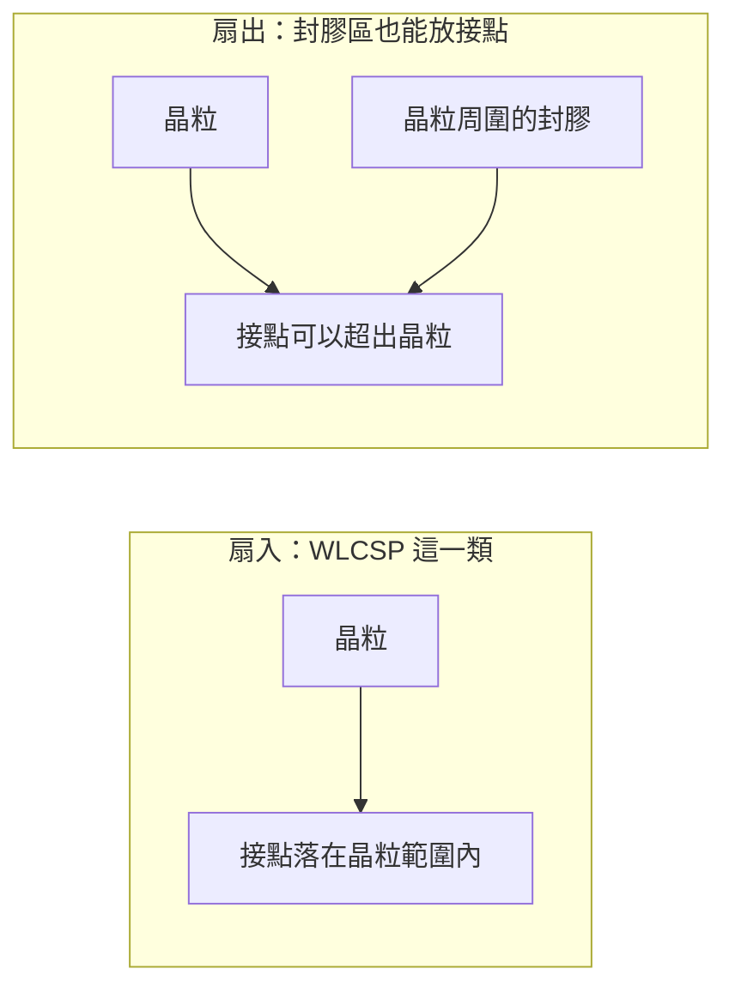
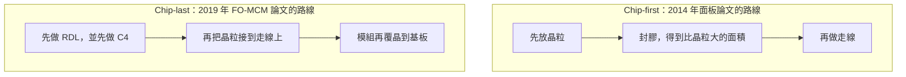

# 第 7 章：扇出怎麼走到多晶片？

## 開場問題

第 4 章的 WLCSP 把錫球留在晶粒範圍裡面。晶粒外面若沒有另一片矽中介層，接點要更多，空間就得從別的地方來。

> **接點可以長到晶粒外面之後，矽品的公開資料是怎樣走到「一顆模組裡有多顆晶片」的？走到的那一步，有沒有官方的客戶量產證據？**

2.5D／SLIT 是第 6 章那一代。本章的主線是 2019 年的 FO-MCM，另外只用一節記下 2014 年的面板級嘗試，兩者不併成同一條量產線。埋入矽橋的 FO-EB 是 [第 8 章](08-fo-eb.md)，這裡不展開。

## 先看結構

扇出指的是：晶粒周圍先做出比晶粒大的封膠區，重佈線可以走在晶粒與封膠的共同面上，所以對外接點不必全部擠在晶粒投影裡面。扇入則是接點都還在晶粒範圍內。原理、die shift 與兩條通用流程，[均豪書的扇出章](../../gpm/html/05-fan-out.html)與 [CoPoS 書的扇出頁](../../copos/html/04-fan-out-and-foplp.html)已經寫過。本章不重講，只用這個差別來讀矽品自己的頁面與論文。

**圖 7-1**：多出來的接點面積來自晶粒旁邊的封膠，不是來自第 6 章那種整片矽中介層。圖中沒有線寬，也沒有說矽品每一種扇出都沒有基板。FO-MCM 後面仍要接到一塊基板上。

官網 FanOut-WLP 依應用分成三類（查閱日 2026-10-12，頁面沒有日期）。[公司自述]

| 頁面分類 | 頁面寫的對象 | 頁面強調的事 |
|---|---|---|
| 低腳數 | PMIC、RF、WiFi、PA、audio | 分類名稱本身 |
| Mobile | 手機與平板的 AP／BB | 輕薄 |
| High-end | HPC、網通、伺服器 | 細線寬、多層 RDL，並寫在 molding compound 中作為 bridging technology |

**這頁沒有出現 FO-MCM、FO-EB、FOPLP 這三個名字。**[公司自述] High-end 那句 bridging technology 因此不能直接換成 FO-MCM，也不能預支成第 8 章的矽橋。無日期網頁上的一句英文，對不上 2019 年或 2020 年的論文代號。

論文這邊，先後與「誰先放晶粒」是兩件不同的事。

**圖 7-2**：兩條路線只比較放晶粒的先後。這是讀論文標題用的教學對照，不是矽品公布的站點清單，也沒有把載板材料、解黏或底部填充補進去。2014 年的面板論文寫明 chip-first。[論文] 2019 年 FO-MCM 的標題寫 C4 bumps built first、chip last。[論文]

<figure class="wiki-image" id="w07-1">
  
  <figcaption>圖 7-W1｜扇出的通則分類。前兩格是先放晶粒，第三格是後放晶粒，用來對照圖 7-2 的先後。圖內文字是簡體，沒有改繪。它沒有畫 2014 年那片 370×470 mm 的玻璃載板，也不是 FO-MCM 的站點圖。作者：思考的苇丛，CC BY 4.0，未修改。<a href="99-image-credits.md#w07-1">出處</a></figcaption>
</figure>

這裡的玻璃是製程用的載板（carrier），不是玻璃核心基板；寫作時查無矽品具名的公開資料。

### 2014 年只做過的面板嘗試

FOPLP 不是本章主線，只留這一節。

[T1](appendix-sources.md#T1) 與另一篇翹曲論文（DOI 10.1109/ectc.2014.6897534，不在 T1–T14 表內）都是 ECTC 2014。它們使用 LCD Gen 2.5 玻璃載板，尺寸 370×470 mm，製程是 chip-first 的面板扇出。[論文] 玻璃載板是暫時的製程載具，不是封裝成品裡的玻璃核心。

翹曲有兩組不能合併的說法：

- 論文側：材料調整後，壓膜後降到 3 mm，重構完成後降到 1 mm。[論文] 摘要所載，全文未核。
- 媒體側：SST／IFTLE 207（2014-09-05）轉述矽品宣稱解膠後可控制在 ±0.5 mm，並以 compensable patterning 處理 die shift。[媒體報導] 這是轉述，不是論文摘要的同一句。

3 mm、1 mm 與 ±0.5 mm 對上的製程點不同，來源等級也不同。本章不把它們平均成一個規格。

2014 年之後，矽品 FOPLP 的產線狀態未查到。2024-07-03 的 TrendForce 稱 AMD、NVIDIA 曾與台積電、矽品討論面板化，並把 AI GPU 用 FOPLP 的量產窗口推估在 2027–28。[業界消息] 推估不是矽品公告，也不能把 2014 年的玻璃載板實驗接到這條時間線上。這一節到此為止。

## 逐步製程

主線是 FO-MCM。面板那一列只重述上一節已經出現的動作，避免變成第二條製程教材。所有尺寸都是摘要所載，全文未核。IEEE 頁面未能抓取。

### FO-MCM：先做 C4 與走線，再放晶粒

公開摘要把 FO-MCM 寫成：多顆晶粒以扇出 RDL 互連，最細到 2/2 µm，模組再覆晶到 BGA 基板；論文裡看得到 chip-last 與 C4-first。[論文] 下面的輸入與輸出只整理各篇摘要已經點名的物件，不補中間機台。

| 步驟 | 輸入 | 操作 | 輸出 | 目的 |
|---|---|---|---|---|
| 1 | 尚未放上功能晶粒的走線基底；載具材料摘要未寫 | 先做 RDL，並先做 C4。ECTC 2019 寫到 2/2 µm 線寬線距 | 已經有細走線與 C4 的結構 | 標題所稱的 C4 built first：晶粒放上去之前，對外凸塊與走線先在 |
| 2 | 矽晶粒。2019 年這篇是 2 顆 daisy-chain 矽晶粒 | chip-last，接到已做好的 RDL | 28×30 mm 的晶片模組 | 讓多顆晶粒靠扇出走線互連，而不是靠整片矽中介層 |
| 3 | 該晶片模組與高密度基板 | 組裝到 70×70 mm 基板 | 摘要中的 FO-MCM | 模組還要再覆晶到基板才成為這篇論文的封裝；文中目標是縮短 cycle time，沒有寫短了多少 |

[T5](appendix-sources.md#T5) 就是上表這篇 ECTC 2019 論文。[論文] Daisy-chain 晶粒是串成迴路、用來確認連通的測試晶粒，不是客戶的功能晶片。28×30 mm、2/2 µm、70×70 mm 都只屬於這篇摘要。

IWLPC 2019 是另一篇（DOI 10.23919/iwlpc.2019.8914123，不編 T 代號）。摘要寫 3 層 RDL、最小 2/2 µm，並寫 “Package level reliability qualification is also finished”，點名的項目是 TCT、uHAST、HTSL。[論文] 摘要所載，全文未核。循環數、時數與溫度寫作時都未取得，本章不補。這句認證也不自動掛到下面的 77.5 mm 論文上。

[T7](appendix-sources.md#T7) 是 ECTC 2020，對象是 77.5×77.5 mm 的封裝、2 顆 26×16 mm 晶粒、3 層預製 RDL，標題談的是大尺寸與細銅線的挑戰。[論文] 寫作時查到的資料沒有寫它通過了 IWLPC 那三項認證，也沒有寫它是 28×30 mm 模組的下一代產品。兩組尺寸並陳，不畫成路線圖。

IMAPS 2023 有一篇〈Assembly Technology for FO-MCM with HBM in HPC Application〉（DOI 10.4071/001c.74633）。[論文] 寫作時查到的資料只記這篇存在，沒有收進任何 HBM 數量、層數或尺寸。本章同樣不補。

### 面板旁支：不另做一條站點表

| 步驟 | 輸入 | 操作 | 輸出 | 目的 |
|---|---|---|---|---|
| 2014 年論文所寫的面板扇出 | LCD Gen 2.5 玻璃載板，370×470 mm；以及要放上去的晶粒 | chip-first：先放晶粒，再在面板上做扇出 | 面板級扇出的重構結果 | 用比圓晶圓大的矩形載板做一次加工；載板不是成品裡的玻璃核心 |

翹曲數字留在上一節，不放進「輸出」欄冒充成每一片的規格。2014 年以後的產線步驟，未查到，所以表到這裡就停。

## 缺陷與限制

扇出要同時保住平面、位置與翹曲，通用原因在均豪書那一章。矽品這章能寫的限制，是來源彼此蓋不到的範圍。

Chip-first 的面板更大，位置誤差與翹曲會更難。矽品 2014 年的公開數字卻不能合成一個窗口：論文摘要是壓膜後 3 mm、重構完成後 1 mm；IFTLE 轉述的是解膠後 ±0.5 mm。[論文] [媒體報導] 點不同、等級不同。compensable patterning 只出現在媒體轉述裡，本章沒有它的演算法或補償量。

FO-MCM 的細線是摘要裡的 2/2 µm。T7 的標題表示 77.5 mm 這種大封裝加上細銅線仍是挑戰，但沒有給出斷線率或良率。[論文] 沒有良率，就不能把「論文做得出 2/2 µm」寫成「產線穩定做得出 2/2 µm」。

認證的範圍要收緊。IWLPC 2019 的摘要說封裝級可靠度認證做完，項目是 TCT、uHAST、HTSL。[論文] 這是論文自述。它不是客戶量產，沒有客戶名字，也沒有說 2020 年那顆 77.5 mm 封裝適用同一句話。T5 的 daisy-chain 晶粒同樣不是客戶晶片。

寫作時未查到 FO-MCM 的官方客戶量產宣告。母公司 20-F 從 2025-03 申報版起，把 2.5D／FO-MCM／FO-EB 寫進集團能力；2024-04 那一版沒有這串名字。[公司自述] 名單沒有寫由矽品或日月光執行。論文作者單位是矽品，所以「這個平台名稱對得上矽品的論文」可以標成推論；「客戶已經在買」不能跟著推論升級。[推論] FO-EB 留在第 8 章，不因為出現在同一串名單裡就與 FO-MCM 合成一代。

2023 年那則把 fan-out 和 2.5D 一起寫進 Marvell 供應鏈的付費牆報導，處理方式與 [第 6 章](06-interposer-era.md) 相同：全文未讀，不是供貨事實。[業界消息]

官網高階類別、2019 年的 FO-MCM、第 8 章的矽橋，是三層資料。少一層對照，bridging technology 就會被讀成已經量產的矽橋。

## 檢查與控制

| 想確認的事 | 公開資料停在哪 | 不能當成的控制限 |
|---|---|---|
| 面板翹曲 | 論文摘要的 3 mm 與 1 mm，對上壓膜後與重構完成後。[論文] | 不是解膠後的規格；全文未核 |
| 解膠後翹曲與 die shift | IFTLE 轉述 ±0.5 mm，並提到 compensable patterning。[媒體報導] | 不是論文摘要；沒有補償量 |
| 走線有多細 | 2019 年兩篇摘要都寫到 2/2 µm。[論文] | 沒有線寬的製程窗口與良率 |
| 封裝級可靠度 | IWLPC 2019 摘要點名 TCT、uHAST、HTSL 已做完。[論文] | 沒有條件；不等於客戶量產；不涵蓋未點名的論文 |
| 大尺寸模組 | T7 提出 77.5×77.5 mm 與細銅線的挑戰。[論文] | 沒有通過／失敗的數據 |
| 有 HBM 的組裝論文 | IMAPS 2023 這篇存在。[論文] | 沒有任何可引用的 HBM 數字 |
| 客戶是否已採用 | 寫作時未查到官方量產宣告 | 集團 20-F 的列名補不上這格 |

TCT、uHAST、HTSL 的常用中文是溫度循環、無偏壓高加速應力、高溫儲存。這只是在讀縮寫。摘要沒有循環數、濕度或小時數，教學全名不能倒回去變成試驗條件。

## 矽品連結

| 項目 | 狀態 | 證據等級 |
|---|---|---|
| 官網扇出分低腳數、Mobile、High-end，高階句含 bridging technology | ✅ 已證實為頁面句子 | [公司自述] |
| 官網有沒有 FO-MCM、FO-EB 或 FOPLP 字樣 | ✅ 已證實查無 | [公司自述] |
| 2014 年以 370×470 mm 玻璃載板做 chip-first 面板扇出 | ✅ 已證實到論文 | [論文] |
| 翹曲 3 mm、1 mm | ✅ 已證實「摘要有這兩個點」；全文未核 | [論文] |
| 解膠後 ±0.5 mm | ✅ 已證實有這則轉述；不是論文摘要 | [媒體報導] |
| 2014 年之後 FOPLP 仍在產線 | ❓ 未知 | 寫作時未查到 |
| 2027–28 是不是矽品的 FOPLP 量產時程 | ❓ 未知 | [業界消息]（外界推估，不是公告） |
| 玻璃核心基板 | ❓ 未知 | 寫作時查無具名公開資料 |
| T5：chip-last、C4-first、28×30 mm、2/2 µm、70×70 mm、daisy-chain | ✅ 已證實到摘要 | [論文] |
| IWLPC 2019：3 層 RDL、2/2 µm，封裝級認證做完（TCT、uHAST、HTSL） | ✅ 已證實「摘要如此自述」 | [論文] |
| 該認證等於客戶量產 | ❓ 未知 | 論文自述不能升格 |
| T7：77.5×77.5 mm、兩顆 26×16 mm、3 層預製 RDL | ✅ 已證實到摘要 | [論文] |
| 28×30 mm 與 77.5 mm 是同一條量產線的前後代 | ❓ 未知 | 兩篇摘要沒有這樣寫 |
| IMAPS 2023 的 HBM 組裝論文 | ✅ 已證實論文存在 | [論文] |
| HBM 的數量或結構 | ❓ 未知 | 寫作時查到的資料沒有摘要數字 |
| 20-F 自 2025-03 申報版把 FO-MCM 列進集團能力 | ✅ 已證實為集團名單 | [公司自述] |
| 名單即矽品正在對客戶量產 FO-MCM | ❓ 未知 | 文件沒有子公司與客戶 |
| 「名稱對得上矽品論文」 | 🔶 推論 | [推論] |
| Marvell 採用矽品扇出 | ❓ 未知 | [業界消息]，全文未讀 |

## 理解檢查

??? question "官網高階扇出寫了 bridging technology，為什麼還不能稱為 FO-MCM？"

    官網那句沒有 FO-MCM 這個名字，頁面也沒有日期。[公司自述] FO-MCM 是 2019 年論文使用的平台名，內容是 chip-last、先做 C4，模組再上基板。[論文] 同一句 bridging 也不能拿來預告第 8 章的矽橋。三層資料要分開，否則無日期網頁會被讀成整個世代。

??? question "Chip-first 和 chip-last 誰先放晶粒？矽品哪一年的論文落在哪一側？"

    Chip-first 先放晶粒，再在包含封膠的面上做走線。Chip-last 先做走線，再放晶粒。2014 年的面板扇出論文是 chip-first。[論文] 2019 年 FO-MCM 的標題是 C4 先做、chip last。[論文] 先後會改掉「走線做在已經放好的晶粒上，還是做在還沒放晶粒的平面上」。通用後果見均豪書，本章不重講。

??? question "摘要寫 qualification finished，為什麼客戶量產仍是未知？"

    這是本章的證據缺口。IWLPC 2019 的摘要說封裝級可靠度認證做完，並點名 TCT、uHAST、HTSL。[論文] 全文未核，沒有試驗條件，沒有客戶。認證做完只覆蓋那句話自己的範圍。T5 用的還是 daisy-chain 測試晶粒。官方客戶量產宣告，寫作時未查到。集團 20-F 的列名同樣沒有寫到出貨。

??? question "3 mm、1 mm 和 ±0.5 mm 為什麼不能寫成『翹曲已控制在 0.5 mm 以內』？"

    3 mm 在論文摘要裡對上壓膜後，1 mm 對上重構完成後，而且全文未核。[論文] ±0.5 mm 是 IFTLE 轉述的解膠後說法，等級是媒體報導。[媒體報導] 製程點不同，證據等級不同。合成一個規格會把兩種來源裡較小的數字升成全製程的控制限。

## 來源與待查

官網查閱日 2026-10-12。論文年份依 DOI。摘要以外的數字不進正文。不在對照表裡的論文只寫 DOI，不自編 T 代號。

| 來源 | 本章用到的範圍 |
|---|---|
| [FanOut-WLP 頁](https://www.spilglobal.com/TechnologyData/FanOutWLP) | 三類應用；確認沒有 FO-MCM、FO-EB、FOPLP |
| [均豪書第 5 章](../../gpm/html/05-fan-out.html)、[CoPoS 書扇出頁](../../copos/html/04-fan-out-and-foplp.html) | 扇出原理；本章只連結 |
| [T1](appendix-sources.md#T1)，DOI 10.1109/ectc.2014.6897402 | 370×470 mm 玻璃載板、chip-first 面板扇出 |
| DOI 10.1109/ectc.2014.6897534 | 壓膜後 3 mm、重構完成後 1 mm |
| SST／IFTLE 207（2014-09-05） | 解膠後 ±0.5 mm 與 compensable patterning 的轉述 |
| TrendForce 2024-07-03 | 面板化討論與 2027–28 推估；業界消息 |
| [T5](appendix-sources.md#T5)，DOI 10.1109/ectc.2019.00009 | C4-first、chip-last、28×30 mm、2/2 µm、70×70 mm |
| DOI 10.23919/iwlpc.2019.8914123 | 3 層 RDL、認證句、TCT／uHAST／HTSL |
| [T7](appendix-sources.md#T7)，DOI 10.1109/ectc32862.2020.00183 | 77.5×77.5 mm、26×16 mm 晶粒、3 層預製 RDL |
| DOI 10.4071/001c.74633 | 只記 HBM 組裝論文存在 |
| 投控 20-F 的 2024-04、2025-03 申報版比較 | FO-MCM 進入集團名單的時間；不寫子公司 |

第 8 章才寫扇出裡的一小塊矽橋。那條線從 ECTC 2020 的 FO-EB 論文開始，代號是 [T6](appendix-sources.md#T6)。它不是本章的 FO-MCM，也不是第 6 章留下矽的 TSV 中介層。結構與論文裡的認證用詞都留在 [第 8 章](08-fo-eb.md)。

會改寫本章的資料：

- 具名客戶的量產新聞稿或雙方公告。動詞寫到哪裡，結論才能寫到哪裡。
- 2014 年之後矽品 FOPLP 產線的官方狀態。只有 TrendForce 的推估不夠。
- T5、T7 與 IWLPC 2019 的全文。讀完可以修正尺寸與認證的條件，仍然不會自動變成客戶出貨。
- IMAPS 2023 的全文。在讀到之前，HBM 維持「有這篇論文」。
- 官網若在有日期的頁面寫上 FO-MCM 或 FOPLP，本章「查無名稱」只保留為 2026-10-12 的結果。
