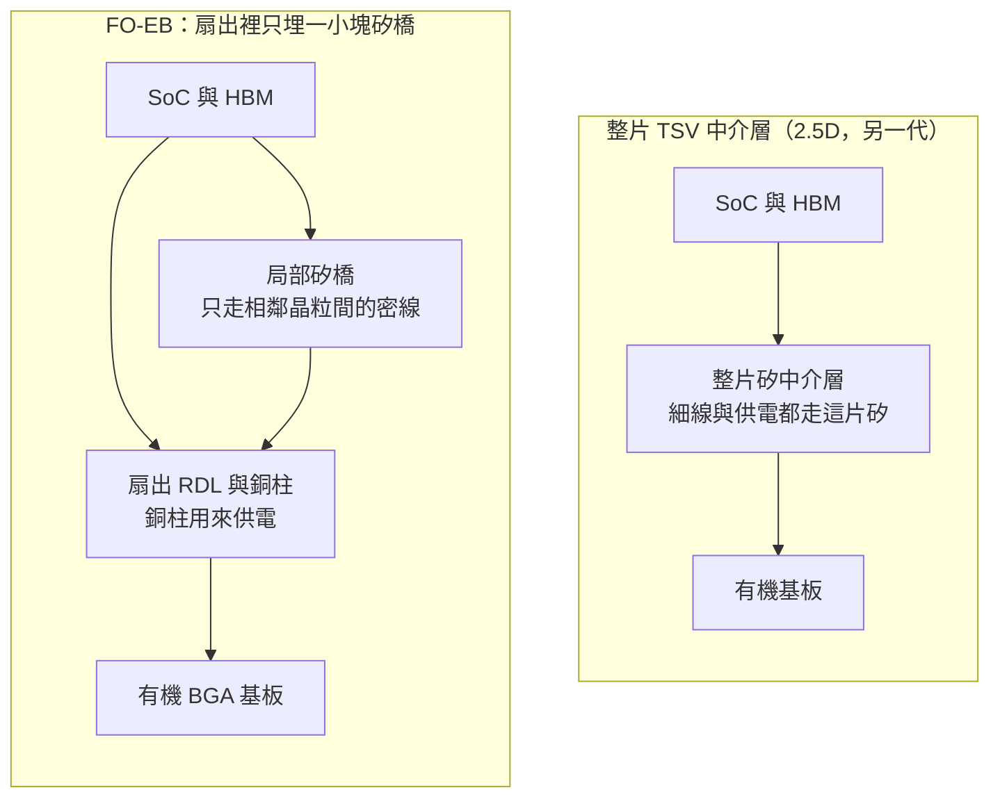
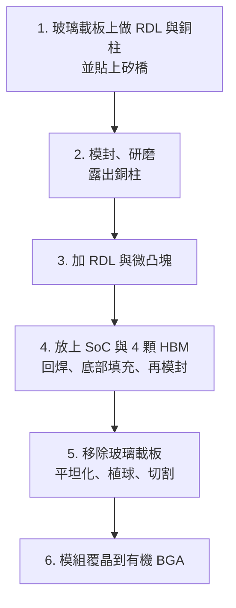

# 第 8 章：為什麼要在扇出裡埋一小塊矽橋？

## 開場問題

扇出（fan-out）已經能把接點拉到晶粒外面：晶粒旁邊用封膠補出一塊地，再在這塊地上做重佈線層（RDL，redistribution layer）。接點不必全擠在晶粒正下方。

那為什麼還要在這層扇出裡面，再埋進一小塊矽？

> **為什麼要在扇出裡埋一小塊矽橋？**

因為要接的線不是同一種。運算晶片和旁邊的高頻寬記憶體（HBM）之間，要在很短的距離上走很密的線，這段用矽上的細線比較合適。電源和對外接點要能載電流，不必每一條都做成矽製程那種細線。2014 年前後的 2.5D，是把這些事都放在一整片帶矽穿孔（TSV，through-silicon via）的矽中介層上。那是另一代，不是這一章的結構。

這一章的平台叫 **FO-EB**（Fan-Out Embedded Bridge，扇出嵌入式橋接）。論文裡也寫成 **FOEB**。日月光投控 Form 20-F 用的是 FO-EB。正文一律寫 FO-EB。

它和 2019 年的 FO-MCM 也不是同一代。FO-MCM 是多晶粒扇出、沒有把矽橋埋進去，見 [扇出走到多晶片](07-fanout-to-fomcm.md)。FO-EB 從 2020 年的論文才公開。

!!! warning "不是客戶量產"
    論文寫 “qualified pass”，或寫 “could be mass production”，只表示**論文作者說**這項封裝通過了論文裡的認證，並且「可以」走向量產。這不是客戶已下單，也不是已出貨。寫作時查無客戶量產公告。本章每一個世代都停在這條線以內。

讀完要能分開三句話：論文做過這個結構；論文作者自述通過認證；沒有公開證據說某客戶已經用它量產。

---

## 先看結構

先看 FO-EB 想取代的那一片，再看它自己留下什麼。

整片 TSV 中介層像一塊大轉接板：多顆晶粒並排坐在上面，細線走在矽裡，上下的電也穿過矽裡的孔。面積一大，整片矽都得是好的。

FO-EB 把「必須很密」的那一段收成一小塊矽橋，只蓋住晶粒和晶粒相鄰的地方。其餘的扇出區用 RDL。垂直方向的供電改走**銅柱**，不靠整片矽裡的 TSV。這是它和整片 TSV 中介層的差別，依據是 ECTC 2020 論文與對該次簡報的轉述，見 [T6](appendix-sources.md#T6)。[論文] [媒體報導]

玻璃在這條流程裡是**玻璃載板**：暫時托住整片工件，做完要拿掉。它不是玻璃核心基板。

**圖 8-1**：整片中介層與 FO-EB 的剖面對照。左圖是更早的 2.5D，右圖才是 2020 年這一代。右圖的玻璃載板沒有畫進來，因為它在完成前會被移除。

### 和 EMIB、CoWoS-L 只比結構

Intel 的 EMIB、台積電的 CoWoS-L，別的書有各自的定義。公開資料支持得了的差異只有這一條：FO-EB 是**局部矽橋**，不是**整片 TSV 中介層**；供電用銅柱。[論文] [媒體報導]

EMIB 在結構分類上也不是整片矽中介層。橋到底埋在載板還是埋在扇出模組裡，站點並不一樣。那張對照留在 [EMIB 與局部橋接](../../gpm/html/10-emib-bridge.html)。3D InCites 提到簡報裡有 FO-EB 與 EMIB 的比較圖，圖上的數字不在寫作時查到的資料裡，這裡不補，也不裁判誰的電性贏。

CoWoS-L 這一方，寫作時查到的資料沒有矽品對照段落。結構上同屬局部橋接，本書不把矽品論文等同 CoWoS-L 量產。見 [CoWoS-R 與 CoWoS-L](../../cowos/html/06-cowos-r-l.html)。

### 世代不要併成一行

| 世代 | 公開時間 | 結構上多了什麼 | 證據能說到哪 | 不能說成什麼 |
|---|---|---|---|---|
| FO-EB | ECTC 2020-06，[T6](appendix-sources.md#T6) | 扇出裡埋矽橋；銅柱供電。轉述的目標市場是伺服器、高效能運算、路由器與交換器 | 論文。2022 年摘要自述可 qualified pass。客戶量產未知 | 不是 2014 的 2.5D，也不是 2019 的 FO-MCM |
| FO-EB-T | 概念：EPTC 2021-12，[T8](appendix-sources.md#T8)。專文：ECTC 2023-05，[T10](appendix-sources.md#T10) | 矽橋換成**帶 TSV 的矽橋**，訊號與電源可直接穿過矽橋 | 研發／驗證。2025 年仍有翹曲與良率研究 | 不是 FO-EB 改個名字 |
| 散熱與銦 TIM | ECTC 2025 | 測試載具約 5,700 mm²：2 顆 TV1、8 顆 TV2、10 顆橋、銦 TIM | 測試載具的熱介面研究 [論文] | TV1、TV2 不是產品名，也不是客戶規格 |
| 3D SRAM chiplet | ECTC 2026-05-26，[T14](appendix-sources.md#T14) | 在 FO-EB 平台做 SRAM 小晶片的 3D 整合 | Intel 與 SPIL **合著** [論文] | 合著不是訂單 |
| 液態金屬 TIM | ECTC 2026 | 題目是液態金屬合金 TIM 的可靠度評估 | 只記到論文存在 [論文] | 摘要沒有給本書可引用的壽命數字 |
| 超薄晶片模組 | ECTC 2026 | 題目是 FO-EB 的超薄晶片模組挑戰 | 只記到論文存在 [論文] | 不補摘要沒有的厚度 |

**表 8-1**：FO-EB 的世代。時間列的是公開論文，不是量產日期。

FO-EB-T 的概念出現在 2021 年那篇 HPC 論文裡，不是 2023 年才忽然存在。2023 年才有專文把結構寫清楚：矽晶粒、扇出繞線，並選擇性用帶 TSV 的矽橋取代有機中介層。[論文] 2024 年的 IMAPS 論文（2025-02-13 刊出）仍在寫 FO-EB-T 用於 HPC，另有一篇有限元素模擬。那些文章沒有把階段改成客戶量產。

混合鍵合：寫作時查無公開資料。玻璃核心基板：寫作時查無公開資料。

---

## 逐步製程

下面六步是 ECTC 2020 簡報的流程，經 3D InCites（2020-07-27）轉述。作者單位是矽品（Joe Lin、C. Key Chung、C. F. Lin 等，該篇作者都屬 SPIL）。[論文] [媒體報導]

本書沒有逐站核對 IEEE 全文。站內的溫度、線寬、良率都不在這份轉述裡，表上不補。這也不是任何客戶的量產流程。

**圖 8-2**：FO-EB 六步。第 1 步在轉述裡是同一步：先在玻璃載板上做 RDL 與銅柱，再貼矽橋。銅柱的角色是供電。

| 步 | 輸入 | 操作 | 輸出 | 目的 |
|---|---|---|---|---|
| 1 | 玻璃載板 | 做 RDL 與銅柱，並貼上矽橋 | 載板上已有走線、銅柱與矽橋 | 細線先做在平整的暫時載板上；矽橋只放在需要密線的位置；銅柱預備垂直供電 |
| 2 | 上一步的載板 | 模封後研磨，露出銅柱 | 表面磨平、銅柱露出的重組體 | 給下一層 RDL 一個平面，並讓銅柱能繼續往上導通 |
| 3 | 磨平的重組體 | 加 RDL 與微凸塊 | 可承接大型晶粒的接點面 | 把矽橋的密線接到 SoC 與 HBM 要落下的位置 |
| 4 | 微凸塊面 | 放上 SoC 與 4 顆 HBM；回焊、點底部填充並固化；再模封，蓋住整片 | 含運算晶粒與記憶體的晶圓形態模組 | 晶粒在走線與微凸塊之後才放上去 |
| 5 | 仍黏在玻璃上的模組 | 移除玻璃載板，平坦化、植球、切割 | 一顆顆扇出模組 | 玻璃只是暫時的。拿掉之後，模組才能翻面去接基板 |
| 6 | 切割後的模組 | 以傳統覆晶貼到有機 BGA | 底下有錫球、可焊到電路板的封裝 | 對外接點改由有機基板承擔 |

**表 8-2**：六步的輸入、操作、輸出與目的。第 4 步的回焊、底部填充與第二次模封，來自媒體對簡報的轉述。[媒體報導]

從順序可以看出：SoC 和 4 顆 HBM 不是一開始就埋進膠裡。它們坐在已經做好的扇出與矽橋之上。供電走銅柱，而不是走一整片 TSV 中介層。轉述沒有給銅柱的直徑或電流。

---

## 缺陷與限制

這條平台公開討論最多的限制是**翹曲**：不同材料熱脹冷縮不一樣，大片工件會彎。RDL 要做在比較平的面上，彎太大，後續對位與接合都會差。

3D InCites 轉述該次簡報：製程中必須控制翹曲；要控的包括模封膠的熱膨脹係數（CTE）、玻璃轉移溫度（Tg），以及玻璃載板的 CTE。轉述並寫，測試結果是需要較高的玻璃 CTE 才處理得了這個封裝。同一則轉述中，SPIL 的結論是 FO-MCM 與 FO-EB 的翹曲相近，都優於 2.5D。[媒體報導] 這是相對結論。圖上若有微米數，寫作時查到的資料沒有抄下來，本書不補。

可靠度摘要要整句保留，不能改寫。EPTC 2021 寫：FO-EB 相對 2.5D，溫度循環做到 2 倍長，而且沒有一顆失效（“2x longer temperature cycle without a single failure as compared to 2.5D”）。[論文] [T8](appendix-sources.md#T8) 這是摘要裡**和 2.5D 的比較**。不要改成「壽命兩倍，而且已經量產」。

同一篇首次提出下一代 FO-EB-T，並寫模擬顯示功耗比 FO-EB 低 55%。[論文] 55% 是**模擬**，不是量到的產品功耗，也不是客戶機櫃的用電。

ECTC 2022 有一篇把 FO-EB 的製程翹曲、可靠度與認證放在一起。摘要結語的意思是 FO-EB “could be qualified pass and mass production”（擷取到的摘要寫作 “F O-EB package could be qualified pass and mass production”，中間空格像是換行造成的）。[論文] [T9](appendix-sources.md#T9) 主詞是論文裡的封裝，不是某一家客戶的料號。另一篇 2022 論文比較 2.5D、FO-EB、FO-MCM 的電性與翹曲。寫作時查到的資料沒有錄下那些數字，本章不編。

FO-EB-T 到 2025 年還在處理翹曲。EPTC 2025 討論 dummy die 的尺寸與封膠調整，對象是「最多約 10% 晶圓面積的 RDL 缺陷區」。[論文] 這句話說明缺陷區仍然是研究題目。它**不是**「良率 90%」，更不是量產良率。

熱是後面接上來的題目，仍是論文，不是產品規格。2025 年的載具約 5,700 mm²，組成是 2 顆 TV1、8 顆 TV2、10 顆橋，搭配銦 TIM。[論文] 2026 年另有液態金屬 TIM 的可靠度評估，以及超薄晶片模組的挑戰。這兩篇本章只記題目，不補摘要沒有的結果。

混合鍵合與玻璃核心基板沒有被這些論文補上。上一節已各寫一句：寫作時查無公開資料。

---

## 檢查與控制

論文公開點名要控的，首先是翹曲。轉述把手段落到模封膠的 CTE、Tg，以及玻璃載板的 CTE。[媒體報導] 2023 年 FO-EB-T 的評估論文繼續看玻璃載板與模封材料對晶圓翹曲的影響。[論文] [T10](appendix-sources.md#T10) 本書不另造光學量測或 X-ray 的規格。

可靠度這邊，公開文字停在溫度循環的比較，以及 2022 年那篇製程與可靠度評估。能不能寫「通過」，只到摘要的 qualified pass，而且標成論文自述。

熱的檢查也要看載具。銦 TIM 那篇的 5,700 mm²、TV1、TV2 與 10 顆橋，是測試載具的組成。[論文] 液態金屬 TIM 只看到論文題目，看不到可引用的通過標準。

讀新聞時可以用這張表把等級按住：

| 句子裡出現 | 先問 | 不能直接寫成 |
|---|---|---|
| FO-EB、FOEB、FO-EB-T | 是 2020 的橋、2021／2023 的帶 TSV 橋，還是 2025 以後的散熱或 SRAM 論文？ | 同一代、同一組規格 |
| qualified pass、could be mass production | 這是論文摘要，還是客戶或投控的出貨公告？ | 客戶已量產 |
| 功耗低 55% | 原文有沒有寫模擬？ | 實測、量產功耗 |
| 溫循 2 倍長且無失效 | 比較對象是不是 2.5D？樣本範圍寫了沒有？ | 壽命兩倍且已量產 |
| 約 10% 的 RDL 缺陷區 | 這是 dummy die 要處理的面積，還是良率報告？ | 良率 90% 或量產良率 |
| Intel、Broadcom 出現在作者欄 | 是合著論文，還是訂單？ | 客戶已經採用 |
| 20-F 把 FO-EB 和 CoWoS 寫在一起 | 說話的是集團，有沒有寫執行者？ | 矽品已量產 CoWoS 或 FO-EB |
| glass | 是做完就拿掉的玻璃載板，還是玻璃核心基板？ | 矽品已有玻璃核心基板 |

**表 8-3**：檢查主張時往下對的問題。證據只降級，不升級。

---

## 矽品連結

| 項目 | 標記 | 怎麼讀 |
|---|---|---|
| ECTC 2020 起，FO-EB 論文作者單位是 SPIL | ✅ 已證實 | [論文] [T6](appendix-sources.md#T6) |
| 六步：玻璃載板上的 RDL 與銅柱、矽橋、模封研磨、RDL 與微凸塊、SoC 加 4 顆 HBM、去載板、覆晶到有機 BGA；銅柱供電 | ✅ 已證實到論文加轉述 | [論文]＋[媒體報導]。不是客戶流程 |
| 論文認證（qualified pass／could be mass production） | ✅ 論文自述 | [論文] [T9](appendix-sources.md#T9)。作者對技術成熟度的說法 |
| 客戶量產 | ❓ 未知 | 寫作時未查到官方或雙方公告。**不是客戶量產** |
| 20-F 把 FO-MCM／FO-EB 與 CoWoS、CoPoS、CoWoP、CPO、3D IC 並列 | ✅ 集團層級自述 | [公司自述]。2026-04 申報。文件沒有寫由矽品或日月光執行 |
| 「FO-MCM／FO-EB 這兩項代表矽品平台」 | 🔶 推論 | [推論]。依據只是論文作者單位為 SPIL，而 20-F 沒有寫執行者 |
| ECTC 2026 的 3D SRAM，Intel 與 SPIL 合著 | ✅ 研究合作 | [論文] [T14](appendix-sources.md#T14)。不是訂單 |
| 與 EMIB、CoWoS-L 的電性對照 | ❓ 未知 | 寫作時查到的資料沒有可引用的對照數字 |

**表 8-4**：矽品連結。客戶量產這一行保持未知。論文認證這一行只到論文自述。

20-F 的策略段寫，集團發展了 “2.5D/FO-MCM/FO-EB/ CoWoS/CoPoS/CoWoP/CPO/3D IC” 這類方案。版本上，2024-04 申報版還沒有列出 2.5D／FO-MCM／FO-EB；2025-03 申報版加入這三項；2026-04 申報版再加入 CoWoS 等名稱。[公司自述] 列名是集團能力，不是矽品出貨證明。

「這兩項代表矽品平台」不能升格。FO-MCM、FO-EB 確實是矽品論文使用的名字，所以**可以推論**列名裡的這兩項對得上矽品論文；20-F 自己沒有寫執行者。推論停在這裡。和日月光平台的結構像不像，見 [第 11 章](11-sibling-platforms.md)，不是本章能證明的分工。

---

## 理解檢查

??? question "看到 qualified pass，可以不可以說客戶已量產？"
    不可以。ECTC 2022 摘要寫 FO-EB could be qualified pass and mass production，是論文作者對技術成熟度的自述。[論文] 客戶量產要有客戶新聞稿、投控對該料號的出貨說明，或同等的雙方公告。寫作時沒有這類文件。qualified pass 不能升級。

??? question "為什麼 FO-EB 用一小塊矽橋，還要另外做銅柱？這和整片 TSV 中介層差在哪？"
    矽橋只負責相鄰晶粒之間的密線。銅柱負責供電。整片 TSV 中介層則是細線和上下導通都落在同一片大矽上。這是 2020 年論文與簡報轉述支持的結構差異，不是電性勝負。[論文] [媒體報導]

??? question "FO-EB、FO-MCM、2014 年的 2.5D，可以寫成同一代嗎？"
    不可以。2.5D 矽中介層是 2014 年前後的論文。FO-MCM 是 2019 年起的多晶粒扇出，沒有嵌入矽橋。FO-EB 是 2020 年才公開的嵌入橋。FO-EB-T 還要再分開：概念在 2021，專文在 2023，差別是矽橋裡有 TSV。

??? question "EPTC 2021 說功耗比 FO-EB 低 55%。可以寫進產品規格嗎？"
    不可以。那是 FO-EB-T 相對 FO-EB 的**模擬**。[論文] 同一篇的溫循句子是「相對 2.5D，循環做到 2 倍長且沒有一顆失效」，不能改成「壽命兩倍且已量產」。

??? question "ECTC 2026 有 Intel 合著的 SRAM 論文。是不是 Intel 已經採用 FO-EB？"
    不是。合著只代表那篇研究一起署名。[論文] 它不能證明訂單、份額或量產。2025 年的銦 TIM 論文同樣只證明有一個約 5,700 mm² 的測試載具，TV1 與 TV2 不是產品名。

??? question "流程裡的 glass，是不是玻璃核心基板？混合鍵合做完了嗎？"
    都不是。FO-EB 的 glass 是做完就移除的玻璃載板。玻璃核心基板與混合鍵合，寫作時查無公開資料。

---

## 來源與待查

正文用 [T6](appendix-sources.md#T6)、[T8](appendix-sources.md#T8)、[T9](appendix-sources.md#T9)、[T10](appendix-sources.md#T10)、[T14](appendix-sources.md#T14) 對來源索引。其餘 DOI 記在這裡。查閱日是 2026-10-12。

| 主張 | 出處 | 等級 |
|---|---|---|
| FO-EB／FOEB 首次公開；作者單位 SPIL；SoC 加 4 顆 HBM | [T6](appendix-sources.md#T6)，ECTC 2020-06，DOI [10.1109/ectc32862.2020.00015](https://doi.org/10.1109/ectc32862.2020.00015) | [論文] |
| 六步、銅柱供電、目標市場、翹曲要控 CTE／Tg、FO-MCM 與 FO-EB 翹曲相近且優於 2.5D；文中有 EMIB 比較圖 | 3D InCites／IFTLE 456，2020-07-27，<https://www.3dincites.com/2020/07/iftle-456-spil-fan-out-embedded-bridge-foeb-technology/> | [媒體報導] |
| 溫循相對 2.5D 為 2 倍長且無一顆失效；首提 FO-EB-T；模擬功耗低 55% | [T8](appendix-sources.md#T8)，EPTC 2021-12-07，DOI [10.1109/eptc53413.2021.9663964](https://doi.org/10.1109/eptc53413.2021.9663964) | [論文] |
| could be qualified pass and mass production | [T9](appendix-sources.md#T9)，ECTC 2022，DOI [10.1109/ectc51906.2022.00174](https://doi.org/10.1109/ectc51906.2022.00174) | [論文] |
| 比較 2.5D、FO-EB、FO-MCM 的電性與翹曲（數字未錄） | ECTC 2022，DOI [10.1109/ectc51906.2022.00337](https://doi.org/10.1109/ectc51906.2022.00337) | [論文] |
| FO-EB-T 專文兩篇之一：材料與翹曲；T10 為其中的評估篇 | [T10](appendix-sources.md#T10)，DOI [10.1109/ectc51909.2023.00229](https://doi.org/10.1109/ectc51909.2023.00229)；另一篇 DOI [10.1109/ectc51909.2023.00177](https://doi.org/10.1109/ectc51909.2023.00177) | [論文] |
| FO-EB-T 用於 HPC；另有 FEM 模擬 | IMAPS，2025-02-13 刊出，DOI [10.4071/001c.129736](https://doi.org/10.4071/001c.129736)、[10.4071/001c.129749](https://doi.org/10.4071/001c.129749) | [論文] |
| 約 10% 晶圓面積的 RDL 缺陷區與 dummy die | EPTC 2025，DOI [10.1109/eptc67330.2025.11392617](https://doi.org/10.1109/eptc67330.2025.11392617) | [論文] |
| 約 5,700 mm² 測試載具、銦 TIM | ECTC 2025，DOI [10.1109/ectc51687.2025.00134](https://doi.org/10.1109/ectc51687.2025.00134) | [論文] |
| SRAM chiplet，Intel 與 SPIL 合著 | [T14](appendix-sources.md#T14)，ECTC 2026-05-26，DOI [10.1109/ectc51846.2026.00101](https://doi.org/10.1109/ectc51846.2026.00101) | [論文] |
| 超薄晶片模組；液態金屬合金 TIM | ECTC 2026，DOI [10.1109/ectc51846.2026.00010](https://doi.org/10.1109/ectc51846.2026.00010)、[10.1109/ectc51846.2026.00362](https://doi.org/10.1109/ectc51846.2026.00362) | [論文] |
| 20-F 集團列名 FO-MCM／FO-EB 等 | ASEH Form 20-F，2026-04-01 申報，<https://www.sec.gov/Archives/edgar/data/1122411/000119312526135585/d50802d20f.htm> | [公司自述] |

待查，寫作時沒有納入正文的數字或公告：

- FO-EB／FO-MCM 的客戶量產公告。沒有這份文件之前，維持 ❓ 未知。
- IEEE 全文是否與 3D InCites 的六步逐字相同。本章步驟依轉述。
- EMIB 比較圖與 2022 年電性比較論文裡的具體數字。寫作時未取得，不回填。
- 液態金屬 TIM、超薄晶片模組摘要中的厚度、壽命或良率。寫作時未取得者不補。
- 混合鍵合、玻璃核心基板的矽品公開資料。寫作時查無。
