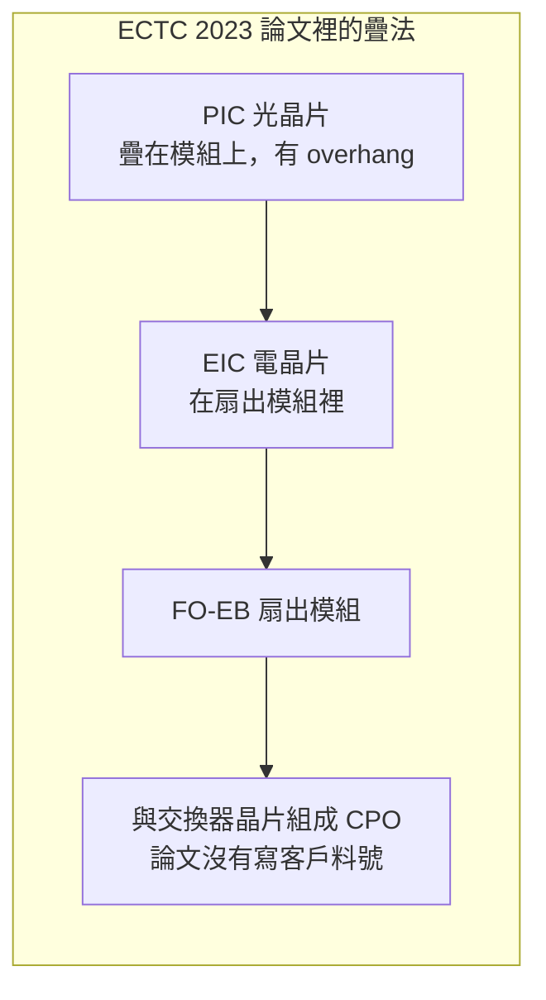
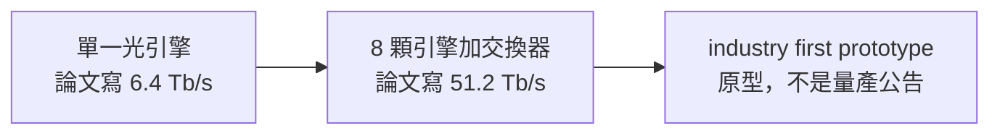

# 第 9 章：光進封裝走到哪一步？

## 開場問題

交換器晶片若把電訊號送出封裝、再在板子上轉成光，中間多一段電的走線。光電共封裝（CPO，co-packaged optics）想把光引擎拉近交換器，讓這段變短。

> **光進封裝走到哪一步？**

以寫作時查得到的公開資料，走到**研發與原型**，沒有走到客戶量產。這一章全部停在這個定位裡。

<figure class="wiki-image" id="w09-1">
  
  <figcaption>圖 9-W1｜可插拔光模組。電訊號先離開交換器封裝，到面板這一端才轉成光。CPO 想縮短的就是這一段。照片裡是 X2 與 SFP+，不是光電共封裝，也不是 Broadcom 與矽品那篇 51.2 Tb/s 原型。攝影：Martijn Boer，公有領域，未修改。<a href="99-image-credits.md#w09-1">出處</a></figcaption>
</figure>

先把兩個名字分開。PIC（photonic integrated circuit）是處理光的晶片。EIC（electronic integrated circuit）是陪在旁邊、用電去驅動或接收的晶片。兩者要疊在一起，還要再和交換器放進同一個封裝，散熱、對位和翹曲會同時出現。矽品公開的做法，是沿用前一章的 FO-EB，不是另起一條已量產的光封裝產線。FO-EB 的結構見 [扇出裡的矽橋](08-fo-eb.md)。

!!! warning "這一章不是量產章"
    論文裡的結構、與 Broadcom 合著的原型、後來的會議論文，都只證明研究還在做。合著不是訂單。投控 20-F 裡的矽光子測試是集團層級的自述，不是矽品 CPO 出貨。寫作時未查到量產公告。

---

## 先看結構

2023 年的第一篇（本次查到的範圍內）把 FO-EB 拿來放光引擎，見 [T11](appendix-sources.md#T11)。[論文] 摘要支持的疊法是：EIC 做在扇出模組裡，PIC 疊在這個模組上面，而且 PIC 採用 overhang——光晶片比下面的模組伸出一截。伸出多長、對位公差多少，摘要沒有寫，本書不補。

這個模組再與交換器晶片組成 CPO。論文沒有把這句話寫成某一家交換器的料號。

**圖 9-1**：只依 ECTC 2023 摘要畫的結構。這不是產線站點圖，也沒有長度或層數。

2024 年的尺度在另一篇，見 [T12](appendix-sources.md#T12)。Broadcom 與 SPIL 合著。論文寫單一光引擎 6.4 Tb/s，8 顆引擎與交換器晶片共同封裝成 51.2 Tb/s，並稱為 “industry first prototype system”。[論文] 兩個數字都是論文自己的話。本書不把它們換成實測報告，也不把 “industry first” 讀成產業組織的認證。

**圖 9-2**：ECTC 2024 合著論文裡的兩個數字，終點是原型。

同一年另有一篇 FO-EB 用於 CPO 的評估論文。寫作時查到的資料沒有錄規格，正文不補，只在來源節留題目與 DOI。

---

## 逐步製程

公開摘要沒有一條可照做的產線流程。沒有站點順序、溫度、對位精度或良率。下面只把論文已經寫出的組裝層次列成表，方便對照前一章的 FO-EB。不能把這張表當成矽品的光引擎製程。

| 層次 | 輸入 | 操作 | 輸出 | 目的 |
|---|---|---|---|---|
| 1 | FO-EB 這類扇出模組 | 把 EIC 做進模組，PIC 以 overhang 疊在上面 | 一顆光引擎的封裝結構 | 讓光電晶片沿用扇出裡的橋與重佈線，而不是先假定有整片新的中介層。操作細節摘要沒有寫 |
| 2 | 這種光引擎，以及交換器晶片 | 共同封裝 | CPO 模組 | 2024 年論文把規模寫成 1 顆引擎 6.4 Tb/s、8 顆引擎加交換器為 51.2 Tb/s 的原型 |

**表 9-1**：摘要裡看得到的層次。[論文] 空著的參數保持空白。

ECTC 2023 證明的是「FO-EB 上可以這樣疊 PIC／EIC」。ECTC 2024 證明的是「有一篇合著把這個方向做成他們所稱的原型系統」。兩步之間，寫作時查到的資料沒有公開的轉移產線紀錄。

---

## 缺陷與限制

Overhang 本身就是限制的來源：光晶片比下面的模組伸出，機械上怎麼撐、光怎麼對準，摘要都沒有給。本書只保留「論文使用 overhang」這句，不補失敗模式的尺寸。

散熱被點名了一次，而且只到題目。ICSJ 2025 的論文處理高導熱底部填充（underfill），原因是 EIC 埋在 PIC 下方、包在模封裡，熱不容易出來。[論文] 導熱係數、厚度、溫升都不在寫作時查到的資料裡，不寫。

另外兩篇也只記存在與題目，不加規格：

- IMPACT 2025：〈Advanced Co-packaged Optics (CPO) Solutions and Technology Challenge for Silicon Photonics Applications〉。能說的是矽光子 CPO 仍有技術挑戰這件研究題，不能說挑戰已經被哪一項規格解決。
- ECTC 2026：〈Optical Engine (OE) Integration Challenges for Next-Generation CPO on Networking and HPC Application〉。能說的是光引擎整合仍被寫成挑戰，對象包括網通與 HPC。沒有新的 Tb/s 數字可引用。

階段上的限制更硬：這些文章都沒有取代「未查到量產公告」。原型系統的英文是 prototype。後續會議繼續用 challenge、study 這類題目，不能反過來證明 2024 年的原型已經出貨。

混合鍵合、玻璃核心基板與 CPO 的關係，寫作時查無公開資料。FO-EB 裡的 glass 仍是前一章那個暫時載板，不是玻璃基板產品。

---

## 檢查與控制

這一章沒有公開的光學測試規格，所以「檢查」主要是檢查主張落在哪一階。論文若寫結構，就停在結構。論文若寫 prototype，就停在原型。20-F 若寫測試方案，就停在集團自述。

| 你看到的句子 | 對到哪一階 | 還缺什麼才升得了級 |
|---|---|---|
| FO-EB 整合 PIC／EIC，PIC overhang | 論文結構 [論文] | 客戶料號、出貨或量產公告 |
| 6.4 Tb/s、51.2 Tb/s、industry first prototype | 合著原型 [論文] | 獨立於論文的實測報告，以及訂單 |
| Broadcom 出現在作者欄 | 研究合作 | 雙方公告的採購或量產 |
| IMPACT、ICSJ、ECTC 2026 的題目 | 研究仍在進行 | 摘要裡實際寫出的規格。目前不補 |
| 20-F 有 silicon photonics 測試 | 集團層級 [公司自述] | 寫明是矽品、以及對應哪一個 CPO 產品 |

**表 9-2**：讀 CPO 新聞時的檢查。沒有右欄的文件，左欄不能升級。

投控 2026 年 20-F 的測試研發段寫到矽光子測試方案。說話的主體是集團，不是矽品單獨的產品頁。[公司自述] 它說明集團把矽光子測試放進研發敘事，不能說明矽品的 CPO 已經量產，也不能說明測試產能。

---

## 矽品連結

| 階段 | 公開證據 | 能支持 | 不能支持 |
|---|---|---|---|
| 論文結構 | ECTC 2023，[T11](appendix-sources.md#T11)：FO-EB 整合 PIC／EIC，PIC overhang | 矽品作者公開過這個結構 [論文] | 客戶採用、良率、量產 |
| 合著原型 | ECTC 2024，[T12](appendix-sources.md#T12)：Broadcom 與 SPIL 合著；單一光引擎 6.4 Tb/s；8 顆引擎加交換器 51.2 Tb/s；industry first prototype | 有一個論文所稱的原型系統 [論文] | 訂單、出貨、產業認證 |
| 後續論文 | IMPACT 2025、ICSJ 2025、ECTC 2026，只有題目 | 題目還在：挑戰、散熱用的高導熱 underfill、光引擎整合 | 摘要沒有的任何規格 |
| 客戶量產 | 寫作時未查到公告 | 沒有可引用的出貨事實 | 不能寫成矽品 CPO 已量產。這一行是 ❓ 未知 |

**表 9-3**：證據階段。最後一列故意空著。沒有公告，就不能用上面三列把它填滿。

和 FO-EB 相同的推論界限也在這裡：20-F 把 CPO 和 FO-EB、CoWoS 等寫在同一串集團能力裡。[公司自述] 那是列名。CPO 論文的作者單位含 SPIL，所以矽品做過這些研究；列名本身沒有指定由哪一家子公司出貨。

---

## 理解檢查

??? question "這一章的 CPO 可以寫成矽品的量產平台嗎？"
    不可以。定位是研發與原型。ECTC 2023 是結構論文，ECTC 2024 的原文是 prototype。寫作時未查到客戶量產公告。

??? question "Broadcom 與 SPIL 合著 51.2 Tb/s，是不是 Broadcom 已經向矽品下單？"
    不是。合著只代表那篇原型論文一起署名。[論文] 6.4 Tb/s 與 51.2 Tb/s 是論文裡的數字，industry first prototype 也是論文的用語，不是訂單，也不是獨立認證。

??? question "ICSJ 2025 既然在做高導熱 underfill，能不能補上導熱係數？"
    不能。寫作時查到的資料只支持兩件事：論文存在，以及題目是在處理 EIC 埋在 PIC 下方所造成的散熱。係數、厚度、溫升都不在寫作時查到的資料裡。IMPACT 2025 與 ECTC 2026 同樣只記題目。

??? question "20-F 寫了矽光子測試，能不能說矽品的 CPO 測試已經量產？"
    不能。那是集團層級的 [公司自述]，沒有寫執行者，也沒有寫對應哪一個量產料號。測試方案的研發敘事，填不了表 9-3 最後一列。

??? question "PIC overhang 是不是表示光晶片有一個已經公開的懸伸長度？"
    不是。Overhang 只說明論文採用「PIC 比下面的扇出模組伸出」這種疊法。[論文] 長度與公差，寫作時不在可引用的摘要裡。

---

## 來源與待查

[T11](appendix-sources.md#T11)、[T12](appendix-sources.md#T12) 對來源索引。查閱日是 2026-10-12。

| 主張 | 出處 | 等級 |
|---|---|---|
| FO-EB 整合 PIC／EIC，PIC overhang | [T11](appendix-sources.md#T11)，ECTC 2023，DOI [10.1109/ectc51909.2023.00047](https://doi.org/10.1109/ectc51909.2023.00047) | [論文] |
| 6.4 Tb/s 光引擎、8 顆引擎加交換器 51.2 Tb/s、industry first prototype；Broadcom 與 SPIL 合著 | [T12](appendix-sources.md#T12)，ECTC 2024，DOI [10.1109/ectc51529.2024.00022](https://doi.org/10.1109/ectc51529.2024.00022) | [論文] |
| 同一年另有 FO-EB CPO 的評估論文；規格寫作時未取得 | ECTC 2024，〈Fan-Out Embedded Bridge Structure for CoPackaged Optics Characterization and Evaluation〉，DOI [10.1109/ectc51529.2024.00201](https://doi.org/10.1109/ectc51529.2024.00201) | [論文] |
| CPO 挑戰，只記題目 | IMPACT 2025-10-21，DOI [10.1109/impact67645.2025.11281694](https://doi.org/10.1109/impact67645.2025.11281694) | [論文] |
| 高導熱 underfill；EIC 在 PIC 下方 | ICSJ 2025，DOI [10.1109/icsj66986.2025.11302565](https://doi.org/10.1109/icsj66986.2025.11302565) | [論文] |
| 光引擎整合挑戰，只記題目 | ECTC 2026，DOI [10.1109/ectc51846.2026.00116](https://doi.org/10.1109/ectc51846.2026.00116) | [論文] |
| 矽光子測試方案 | ASEH Form 20-F（2026）測試研發段；申報文本 <https://www.sec.gov/Archives/edgar/data/1122411/000119312526135585/d50802d20f.htm> | [公司自述] |

待查：

- 矽品或客戶對 CPO 量產、出貨、料號的公告。未查到之前，表 9-3 最後一列維持未知。
- ECTC 2024 評估論文、IMPACT 2025、ECTC 2026 摘要中的規格。寫作時未取得者不回填。
- ICSJ 2025 的導熱係數與結構尺寸。寫作時未取得者不補。
- 20-F 的矽光子測試是否專指矽品、對應哪一條產線。文件沒有寫。
