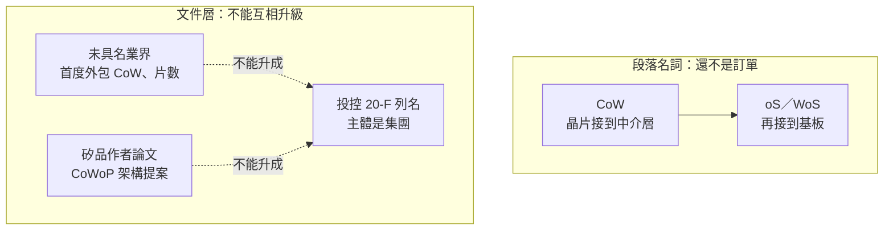

# 10　矽品在 CoWoS 供應鏈承接哪一段？

## 開場問題

新聞寫「矽品拿下台積電 CoWoS」。這句話把三件不同的事壓成一件：誰是主體、CoWoS 的哪一段、證據到哪一級。

本章只回答一個問題：**依寫作時已核過的公開資料，能不能證明矽品承接的是 CoW、oS，還是 WoS？** 答案先放在這裡：不能。沒有官方文件或雙方公告指出段落。下面示範證據不夠時，正文可以寫到哪裡為止。

查閱日：**2026-10-12**。不寫投資建議，不把未具名客戶補上名字。

## 主體：說話的人不是同一家公司

新聞裡的「矽品」要先對回法人。矽品精密（SPIL）是日月光投控 100% 子公司；投控才是合併財報與 20-F 的主體。集團結構見 [日月光書第 2 章](../../ase/html/02-group-and-business.html)，這裡不重述併購過程。

同一則 CoWoS 新聞裡，至少有五種說話的人：

| 說話的人 | 例子 | 這句話的主體 |
|---|---|---|
| 投控文件裡的 "our" | FY2025 Form 20-F 策略段列名 CoWoS／CoPoS／CoWoP | 投控集團，不是矽品單獨 |
| 投控營運長在法說 | 吳田玉談集團與代工夥伴共同開發 oS 與 CoW | 集團能力與合作，不是某一張矽品訂單 |
| 未具名「業界」 | 2024-08-06 傳出台積電首度把 CoW 外包給矽品中科 | 報導所引的匿名說法，台積電與矽品未回應 |
| 記者敘述、未引具名來源 | 2026-05-01 工商時報寫矽品「握有 CoW 訂單」 | 媒體陳述，不是公司公告 |
| 韓媒點名的對象 | 2026-08 ETNews 寫「包括日月光在內」的 OSAT | 點名的是日月光等，不是直接點名矽品 |

主體先拆開，後面的等級才不會被標題吸上去。

## 口徑：平台名稱、製程段落、集團列名

CoWoS 是平台名稱，不是一段製程。製程名詞沿用 [CoWoS 書的架構總覽](../../cowos/html/04-cowos-overview.html)：

- **CoW（Chip on Wafer）**：把運算晶片、HBM 等接合到中介層晶圓上。
- **WoS（Wafer on Substrate）**：再把含晶片的中介層接到有機封裝基板。

台灣新聞常把基板這一段寫成 **oS**。吳田玉的法說用的就是 oS 與 CoW。本書不把 oS 與 WoS 強行定義成兩個已獲台積電或矽品官方區分的步驟；只記錄：**報導裡的 oS／WoS 指的是基板側，CoW 指的是前段接合。** 兩者不能互換。寫「做 CoWoS」等於沒有回答本章的問題。

另外三個名字更不能混進訂單：

- **CoWoS／CoPoS／CoWoP** 出現在投控 20-F，是集團自述的技術清單。CoPoS 在該段沒有定義，矽品扮演的角色寫作時未查到。
- **CoWoP（Chip on Wafer on Platform PCB）** 在矽品作者的論文裡，是拿掉封裝基板、把 WoS 改接到平台 PCB 的架構提案。論文不是試產公告。
- 報導裡的 **CoWoS-like、年產能片數、月產能片數**，若沒有主體與段落，就不能抄成矽品的 CoW 產能。

## 機制：分段改變的是責任，不是「有沒有做先進封裝」

台積電長期把利潤較低的基板側外包、把 CoW 留在自己廠內，是多家媒體的背景敘述，不是本章要新證明的製程。讀者只需要知道這件事為什麼影響判讀：

- 接到 **WoS／oS**，表示做的是中介層之後的基板組裝，不表示已經建立 CoW 產線。
- 接到 **CoW**，才表示前段接合也外包。2024 年以後的新聞緊張之處在「是不是連 CoW 都釋出」，不在「矽品是不是封測廠」。
- **共同開發** 表示兩邊碰過技術問題，不表示量產工單已經下到哪一家、哪一座廠。
- 一篇 **架構論文** 表示作者提出可評估的做法，不表示客戶已選它量產。

所以「矽品做先進封裝」可以為真，同時「矽品承接 CoW」仍未被證明。這不是措辭保守，是兩句話的證據不同。

## 證據：主張能支持到哪

等級只有往下，沒有往上。下表是本章的全部底線。片數再具體，也不能把 `[業界消息]` 寫成訂單。

| 主張 | 來源 | 等級 | 能支持到哪 | 不能支持到哪 |
|---|---|---|---|---|
| 台積電長期把 WoS／oS 外包給 OSAT，矽品是其中之一 | 多家媒體的背景敘述；2024-08-06 科技新報轉載 MoneyDJ，以及其後沿用同一背景的報導 | `[媒體報導]` | 這是多家一致的產業背景，不是單一標題 | 不是台積電或矽品證實的訂單；不能指定廠區、年份片數，也不能改寫成「因此一定沒有 CoW」 |
| 2024-08-06：台積電首度把 CoW 外包給矽品中科；2025 年第二季進機、第三季放量；矽品 CoWoS 相關產能一年約 4–5 萬片；首期為 CoWoS-S | [科技新報 2024-08-06](https://technews.tw/2024/08/06/tsmc-cow-spil/)；[TrendForce 英文轉述](https://www.trendforce.com/news/2024/08/06/news-tsmc-assigns-cow-order-for-the-first-time-reportedly-to-osat-provider-spil/) | `[業界消息]` | 市場從這天開始流傳一個很具體的故事 | 台積電與矽品未回應。進機、放量、4–5 萬片、CoWoS-S 全都歸因未具名人士。到查閱日仍沒有官方證實。具體不等於可靠 |
| 吳田玉在法說表示：集團與晶圓代工夥伴共同開發 oS 與 CoW，已多年 | 同上 2024-08-06 報導所引法說 | `[公司自述]` | 集團公開談過這兩段的共同開發 | 不指出哪一段由矽品承接，也不是某一客戶的訂單。語句寫作時未另核法說逐字稿，但不因此升成官方訂單 |
| 投控 20-F 把 CoWoS、CoPoS、CoWoP 列進集團封裝能力 | 投控 FY2025 Form 20-F，2026-04-01 申報（成書計畫所稱的 FY2026 申報版）。策略段原文包括 "2.5D/FO-MCM/FO-EB/ CoWoS/CoPoS/CoWoP/CPO/3D IC"。[SEC 檔案](https://www.sec.gov/Archives/edgar/data/1122411/000119312526135585/d50802d20f.htm) | `[公司自述]` | 投控願意在年報裡用這些名字描述集團 | 主體是投控。"Our" 沒有指明矽品或日月光半導體。列名不是矽品承接證明，也不是量產證明 |
| CoWoP 是去除封裝基板、直接接到平台 PCB 的 WoS 改良架構 | ICEP-HBS 2026 論文 T13，〈New Advanced Packaging Architecture: CoWoP〉，DOI `10.23919/icep-hbs69241.2026.11550586`，2026-04-14。作者 Terry Hsu、Don Son Jiang 等，單位都是 SPIL | `[論文]` | 矽品人員提出並投稿了一個架構 | 不是試產、不是 NVIDIA 採用、不是獨家。論文自述的好處（訊號與電源完整性）停在提案 |
| 矽品獨家試產 CoWoP、是 NVIDIA 導入的首選夥伴；設備 2026 年第一季進駐台中，最快第二季試產 | [鉅亨 2026-02-05](https://m.cnyes.com/news/id/6333131)（經優分析轉載）。文內寫「業界傳出」；相關業者不評論單一客戶 | `[業界消息]` | 有這則傳聞，以及業者拒絕評論單一客戶 | 不能寫成已試產或已獲選。與上一列的論文是兩件事 |
| 反方：Rubin Ultra 未必採用 CoWoP | 研究底稿所記，2025 年 TrendForce 引美系券商的質疑。寫作時未核到該則 TrendForce 原文網址 | `[業界消息]` | 在「獨家、首選」之外，公開討論裡同時有相反的渠道說法 | 不是 NVIDIA 的官方否認，也不能反過來證明矽品論文不存在。反方必須留在表上 |
| 矽品「握有台積電 CoWoS 封裝中的 CoW 製程訂單」 | [工商時報 2026-05-01](https://www.ctee.com.tw/news/20260501700067-430501) | `[媒體報導]` | 記者把 2024 年以來的說法寫成現在式 | 未引具名來源，公司未證實。等級高於「據了解」，低於公告 |
| 台積電擴大把 CoW 外包 | [ETNews 2026-08-04](https://www.etnews.com/20260804000179)；[TrendForce 2026-08-05](https://www.trendforce.com/news/2026/08/05/news-tsmc-reportedly-expands-outsourcing-of-key-cowos-front-end-step-to-osats-amid-rising-nvidia-asic-demand/)；[鉅亨](https://news.cnyes.com/news/id/6560651) | `[業界消息]` | 依研究底稿，ETNews 點名的是「包括日月光在內」的 OSAT。背景句寫日月光、Amkor、矽品過去主要以授權做 WoS | 不是直接點名矽品為新增 CoW 承接者。中文轉述常把「等」寫成矽品，那一步是推論。韓文原文寫作時未逐句核對 |
| 斗六新廠「將導入 CoWoS」 | 2026-08-11 動土報導，例如 [ETtoday](https://finance.ettoday.net/news/3217403)、[TrendForce 2026-08-12](https://www.trendforce.com/news/2026/08/12/news-ases-spil-breaks-ground-on-nearly-twd-100b-plant-in-douliu-to-boost-cowos-capacity-operations-set-for-2028/) | `[媒體報導]` | 媒體如此描述這座尚未營運的廠 | 未細分 CoW、oS 或 WoS。近千億、6 公頃、2028 第一期與職缺是副董事長談話的媒體轉述，同樣是 `[媒體報導]`，不是 20-F |

表外還有幾則同一等級的傳聞，不另升級：2025-12-09 溢出訂單轉給日月光與矽品、2026-01-29 法人估計三家 OSAT 合計的 CoWoS-like 月產能、2026-06 Mirror Daily 稱日月光與矽品建自有 CoW 產線。它們都是 `[業界消息]`，沒有片數可以抄進矽品產能。

### 跨書的兩句話，本章不沿用

[CoWoS 書第 15 章](../../cowos/html/15-capacity-and-economics.html) 原本把 SPIL 約 6–8 萬片寫進 2026 年外包年量，並寫 SPIL 主導 CoWoP。[第 9 章](../../cowos/html/09-competing-technologies.html) 也寫過矽品主導 CoWoP。這兩處已改成與本章相同的等級。本章的讀法是：

- **6–8 萬片**：原始出處這次沒有查到。它不是矽品產能，不可以拿來和第 4–5 萬片互相「印證」。兩組數字都沒有官方來源；對不上時，不能挑較大的那組。
- **主導 CoWoP**：本章只保留上面的 `[論文]` 加 `[業界消息]`，以及 2025 年的反方摘記。不使用「主導」這個字當作已證實的分工。

兩本書並讀時，以這個較低的等級為準。

## 讀完可以說的那一句

目前沒有官方文件或雙方公告，能證明矽品承接的是 CoW、oS，還是 WoS。

可以同時成立的只有這些較弱的句子：媒體長期把矽品放在 WoS／oS 的外包背景裡；2024-08-06 起有未證實的 CoW 傳聞；投控年報把平台名字列在集團底下；矽品人員發表過 CoWoP 架構論文。缺的是把「段落」釘死的那一張公告。

產能與廠房能不能代替這張公告，見 [第 12 章](12-capacity-and-plants.md)。客戶新聞稿能不能代替，見 [第 13 章](13-customers-suppliers.md)。

## 理解檢查

??? question "投控 20-F 寫了 CoWoS。能不能寫成矽品已經接到 CoWoS 訂單？"
    不能。句子的主詞是投控的 "our"，等級是 `[公司自述]`。列名沒有廠區、沒有客戶、也沒有 CoW 或 WoS。把集團能力改寫成矽品訂單，是升級。

??? question "4–5 萬片寫得很具體，為什麼不能放進矽品產能表？"
    因為每一句都歸因給未具名業界，而且台積電與矽品沒有回應。具體是修辭，不是證據等級。查閱日之前兩年，沒有官方數字接上這組片數。

??? question "工商時報寫「握有 CoW 訂單」，等級是媒體報導。它能把 2024 年的業界消息升成事實嗎？"
    不能。它沒有具名來源，也沒有公司或客戶公告。等級可以高於「據了解」，仍然不能升成 `[官方文件]` 或 `[雙方公告]`。

??? question "ETNews 那則，證據缺口在哪裡？"
    研究底稿的讀法是：韓媒點名「日月光等」，沒有直接點名矽品為新增 CoW 承接者。寫作時未逐句核對韓文原文。在補上原文之前，中文稿裡的「矽品也接到」只能算受惠推論。同則裡的台積電月產能與 NVIDIA 預訂片數，也不是矽品產能。

??? question "什麼觀察會讓「矽品承接 CoW」從傳聞變成可寫的事實？"
    台積電或矽品的公告、法說逐字稿，或雙方新聞稿，明文寫出段落、廠區與期間。只再出現一次未具名片數，不夠。若新文件寫的是 oS 而不是 CoW，則 CoW 這句要撤回，不是改個同義詞。

## 來源與待查

### 本章直接使用的來源

| 代號 | 資料 | 日期 | 等級 |
|---|---|---|---|
| 科技新報／MoneyDJ | 〈台積電首度釋單 CoW 製程，傳花落矽品中科廠〉https://technews.tw/2024/08/06/tsmc-cow-spil/ | 2024-08-06 | `[業界消息]`；其中吳田玉語句 `[公司自述]` |
| TrendForce | 同上事件的英文轉述 https://www.trendforce.com/news/2024/08/06/news-tsmc-assigns-cow-order-for-the-first-time-reportedly-to-osat-provider-spil/ | 2024-08-06 | `[業界消息]` |
| S1 | 投控 FY2025 Form 20-F https://www.sec.gov/Archives/edgar/data/1122411/000119312526135585/d50802d20f.htm | 申報 2026-04-01 | 列名為 `[公司自述]`。年報本身是官方申報，但技術清單不是第三方訂單 |
| T13 | ICEP-HBS 2026 CoWoP 論文，DOI `10.23919/icep-hbs69241.2026.11550586` | 2026-04-14 | `[論文]` |
| 鉅亨 | CoWoP 試產傳聞 https://m.cnyes.com/news/id/6333131 | 2026-02-05 | `[業界消息]` |
| 工商時報 | 〈先進封裝需求有多旺？日月光小金雞 200 億連買 4 廠房〉https://www.ctee.com.tw/news/20260501700067-430501 | 2026-05-01 | 「握有 CoW 訂單」為 `[媒體報導]` |
| ETNews／TrendForce／鉅亨 | 2026-08 CoW 擴大外包 | 2026-08-04／05 | `[業界消息]` |
| 動土報導 | 斗六「導入 CoWoS」 | 2026-08-11／12 | `[媒體報導]` |

反方的 TrendForce 摘記沒有留下可用的原文網址，不另編成已核來源。

### 待查

1. 台積電或矽品對「CoW 外包給矽品」的官方證實或否認：未查到。
2. 矽品單獨的 CoW、oS、WoS 產能：未查到。cowos 書 6–8 萬片的原始出處：未查到，本章不採用。
3. ETNews 韓文是否有一句直接點名矽品：未逐句核對。
4. 2025 年 TrendForce 引美系券商質疑 Rubin Ultra 採用 CoWoP 的原文：未核到網址。
5. 20-F 所列 CoPoS 的定義，以及矽品是否執行：未查到。
6. 吳田玉該次法說的逐字稿：未核。
