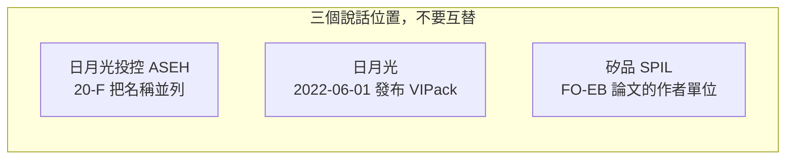

# 第 11 章：矽品和日月光的平台重疊嗎？

新聞會把矽品的 FO-EB 和日月光的 FOCoS-Bridge 放在同一句裡，好像集團裡有兩條互相競爭的產線，或其實是同一條。公開文件沒有這樣說。

> **矽品和日月光的平台重疊嗎？**

結構描述看起來像，這是本章可以做的比對。誰做哪一條、有沒有分工，寫作時查無官方說法。下面的比對表是作者推論，不是公司分工。

---

## 主體

三個名字不要合成一家。

日月光投控（ASEH）是合併財報和 Form 20-F 的說話者。20-F 裡的技術表冠上 “ASEH's”，範圍是整個集團。

日月光半導體發布 VIPack。日期是 2022-06-01。[公司自述] 官方把它定義成一個平台，下面有多項組成技術。六項各自做到哪一步，不在這裡展開，見 [VIPack 與扇出](../../ase/html/05-vipack-and-fanout.html)。本章只用到發布這件事：VIPack 是日月光的平台名稱，不是矽品論文的署名，也不是 20-F 裡每一列的執行者。

矽品（SPIL）是 FO-MCM、FO-EB、FO-EB-T 論文上的作者單位。那些名字的定義見 [扇出裡的矽橋](08-fo-eb.md)。論文作者單位不能自動變成投控 20-F 的執行者。

**圖 11-1**：比對之前先分開誰在說話。圖上沒有畫股權，因為這一章沒有分工文件可畫。

---

## 口徑

20-F 的先進封裝表列出 FOCoS，引腳範圍寫成 3000–7000；列出 FOCoS-Bridge，引腳範圍寫成 3000–14000。Bridge 那一列的英文摘錄是 “tiny silicon bridge … embedded in the fan-out RDL layer”（一小塊矽橋埋在扇出 RDL 層裡；擷取到的摘句在 bridge 與 embedded 之間有省略）。[公司自述]

這是 ASEH 的說法，不是矽品自己的產品頁。3000–7000 與 3000–14000 **不能**抄成 FO-MCM 或 FO-EB 的引腳數。矽品論文摘要沒有給這組數字，本書不補。

策略段則把另一組名字并列：2024-04 申報版還沒有 2.5D／FO-MCM／FO-EB；2025-03 申報版寫入這三項；2026-04 申報版再寫入 CoWoS 等，與 FOCoS 系列一起放在集團能力之下。[公司自述] 并列表示「集團說自己做得到這些」，沒有寫哪一家子公司做哪一列，也沒有寫兩列是同一條產線的兩個商標。

所以口徑上有兩套公開名稱。一套是日月光平台與 20-F 表格裡的 FOCoS、FOCoS-Bridge。一套是矽品論文裡的 FO-MCM、FO-EB、FO-EB-T。投控把它們寫進同一份集團文件，這件事本身不是分工說明。

---

## 機制

兩邊要解決的結構問題很近，所以名稱會像。

多顆晶粒放在一起時，晶粒之間要互連，封裝對外又要接到有機 BGA 基板上。只做扇出 RDL、不埋矽橋，是一類。在扇出 RDL 裡再埋一小塊矽橋、專門走最密的那一段，是下一類。矽橋若還要讓訊號和電源垂直穿過，就要在橋裡做 TSV，那又是一類。FO-EB 為什麼用局部矽橋而不是整片中介層，見 [第 8 章](08-fo-eb.md)，這裡不重講製程。

下表只做這三類的名稱對應。每一列都是作者依公開描述做的 [推論]。它不表示兩家的線寬、尺寸、可靠度或客戶相同，也不表示產線合併或互相代工。

**表 11-1：結構比對（作者推論，不是公司分工）**

| 公開描述裡的結構 | 矽品論文用的名字 | 日月光／投控文件用的名字 | 這一列是什麼 |
|---|---|---|---|
| 多晶粒加上扇出 RDL，模組再覆晶到 BGA 基板 | FO-MCM，見 [扇出走到多晶片](07-fanout-to-fomcm.md) | FOCoS | 作者依公開描述所做的 [推論] |
| 一小塊矽橋埋在扇出 RDL 裡 | FO-EB | FOCoS-Bridge。20-F 摘作 tiny silicon bridge … embedded in the fan-out RDL layer | 作者依公開描述所做的 [推論] |
| 橋裡帶 TSV，訊號與電源可以垂直穿過 | FO-EB-T | 帶 TSV 的橋。日月光那邊的規格不在這裡重抄 | 作者依公開描述所做的 [推論] |

FOCoS-Bridge 與它的 TSV 版本，階段和測試載具以日月光書為準，見 [VIPack 與扇出](../../ase/html/05-vipack-and-fanout.html)。那些載具尺寸、線寬和功率說法都是日月光材料裡的內容，不能挪到 FO-EB 名下。

2.5D 與 CPO 也是兩邊都有公開材料的題目。那只再加一層「名稱會同時出現」，仍然不是分工。CPO 在本書的階段見 [光進封裝](09-cpo.md)。

---

## 證據

查無官方分工說法。沒有找到投控或矽品的文件，說明 VIPack 與 FO-EB／FO-MCM 是分工、整合，還是互相獨立。20-F 只並列，不解釋。

吳田玉在法說會的說法，經媒體轉述，是：集團無論 oS 或 CoW，都與代工合作夥伴共同開發多年。[媒體報導] 這句話證明的是**集團與代工夥伴共同開發 oS 與 CoW**。它沒有區分子公司，沒有把某一段指給矽品或日月光，也不能用來填表 11-1 的執行者。

媒體與社群另有「日月光與矽品分食 CoW」的說法。那是 [業界消息]，不是上面那句法說的內容。CoW 傳聞本身放在 [站在台積電旁邊](10-beside-tsmc.md)。本章不把「分食」升級成平台分工。

| 主張 | 等級 | 能支持到哪 |
|---|---|---|
| VIPack 於 2022-06-01 由日月光發布，是一個多技術的平台 | [公司自述] | 平台發布。六項細節見日月光書 |
| 20-F 列出 FOCoS（3000–7000 引腳）與 FOCoS-Bridge（3000–14000 引腳，矽橋埋在扇出 RDL） | [公司自述] | 集團表格上的範圍與結構用詞。不是矽品產品頁 |
| 20-F 把 FO-MCM／FO-EB 與 FOCoS 系列並列，沒有寫執行者 | [公司自述] | 集團層級列名 |
| 表 11-1 的三列對應 | [推論] | 只表示公開描述像同一類結構 |
| 吳田玉：oS 與 CoW 均與代工夥伴共同開發 | [媒體報導] | 集團與代工夥伴。沒有子公司欄位 |
| 日月光與矽品分食 CoW | [業界消息] | 傳聞。見第 10 章，不在本章升格 |
| 官方的平台分工、整合或競爭說法 | 未查到 | 不能寫成已有分工 |

**表 11-2**：證據停在哪一列，句子就只能寫到哪一列。

會推翻「查無分工」的觀察很具體：投控或矽品的文件寫明哪一個平台由哪一家承接；或客戶公告點名 FO-EB、FO-MCM、FOCoS、FOCoS-Bridge 其中一個，而不是只點名集團。在那之前，表 11-1 維持作者推論。

---

## 理解檢查

??? question "結構比對表是不是公司已經公布的分工？"
    不是。表題寫的就是作者推論，不是公司分工。每一列都是依公開描述看出的結構相似，標 [推論]。查無官方分工說法。

??? question "20-F 寫 FOCoS-Bridge 是 3000–14000 引腳。這是矽品 FO-EB 的規格嗎？"
    不是。那組引腳在投控 20-F 的集團表格裡，是 ASEH 的說法，不是矽品產品頁。[公司自述] FO-EB 論文摘要沒有這組數字，不能橫向抄過去。

??? question "吳田玉說 oS 與 CoW 都和代工夥伴共同開發。這有沒有把 CoW 分給矽品、把另一段分給日月光？"
    沒有。媒體轉述的那句話只證明集團與代工夥伴共同開發這兩段，沒有點名子公司。[媒體報導] 「分食 CoW」是另一句 [業界消息]，要回到第 10 章看，不能當作本章的分工證據。

??? question "VIPack 在 2022 年發布，能不能代表 FO-EB 從那天起改由日月光的平台出貨？"
    不能。VIPack 的發布主體是日月光。[公司自述] FO-EB 的論文作者單位是矽品。兩件事同時存在，只說明集團裡有兩套公開名稱。它不證明整合、改名或出貨轉移。

---

## 來源與待查

查閱日是 2026-10-12。FO-EB 的論文代號沿用 [第 8 章來源](08-fo-eb.md)，不在這裡重列製程。

| 主張 | 出處 | 等級 |
|---|---|---|
| VIPack 於 2022-06-01 發布 | 日月光新聞稿的轉載頁，<https://markets.financialcontent.com/pennwell.pennenergy/article/bizwire-2022-6-1-ase-introduces-vipack-to-help-transform-packaging-solution-enablement>；平台組成見 [日月光書](../../ase/html/05-vipack-and-fanout.html) | [公司自述] |
| FOCoS 3000–7000 引腳；FOCoS-Bridge 3000–14000 引腳；tiny silicon bridge … embedded in the fan-out RDL layer | ASEH Form 20-F（2026）先進封裝表，<https://www.sec.gov/Archives/edgar/data/1122411/000119312526135585/d50802d20f.htm> | [公司自述] |
| 策略段並列 2.5D／FO-MCM／FO-EB，2026 年再列入 CoWoS 等；未寫執行者 | 同一份 20-F 的版本比較：2024-04 未列、2025-03 列入 FO-MCM／FO-EB、2026-04 再擴列 | [公司自述] |
| 表 11-1 三列 | 矽品論文的結構描述，對上 20-F 與日月光平台的公開用詞 | [推論] |
| 吳田玉：oS 與 CoW 均與代工夥伴共同開發多年 | TechNews 轉載 MoneyDJ，2024-08-06，<https://technews.tw/2024/08/06/tsmc-cow-spil/> | [媒體報導] |
| 日月光與矽品分食 CoW | 同題的媒體與社群說法；本章只定級，內容見 [站在台積電旁邊](10-beside-tsmc.md) | [業界消息] |

待查：

- 投控或矽品對 VIPack 與 FO-EB／FO-MCM 是否分工、整合或並存的正式說法。寫作時未查到。
- 20-F 引腳範圍的量測定義，以及英文摘句省略號中間的原文。未逐字還原之前，不把摘句當成已核對的連續引文，也不把引腳數挪給矽品。
- 任何把表 11-1 從推論升成事實的客戶公告或子公司文件。
