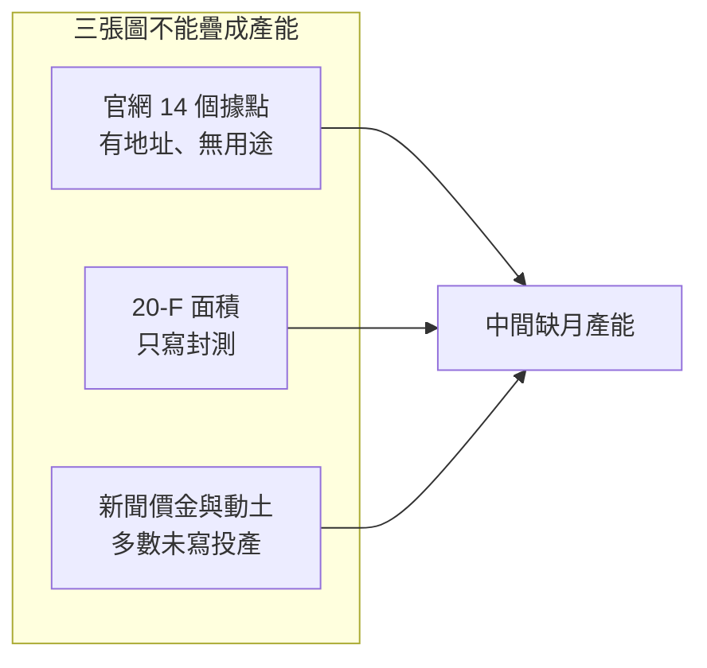

# 12　一年買五座廠，產能怎麼讀？

## 開場問題

2026 年的標題常是「矽品一年買下數座廠、斥資約 200 億」。讀者想知道的是產能：一個月能做多少片、做的是哪一段。公開資料給的卻是價金、土地面積和動土致詞。

本章先固定三個口徑，再看官網與 20-F 實際列了哪些廠，最後才讀購廠表。核心問題：**這些交易能不能讀成已經開出的封測產能？** 不能。價金不是片數。

查閱日：**2026-10-12**。財務上看不到矽品單獨營收的原因，見 [第 3 章](03-invisible-financials.md)。廠房也不能回答承接 CoW 還是 WoS，見 [第 10 章](10-beside-tsmc.md)。

## 主體：誰買、誰的資本支出、誰在動土

三個口袋不要混：

- **矽品精密**：購廠與動土的營運公司。停止公開發行之後，單獨營收不再公布。
- **日月光投控**：合併財報與資本支出的主體。法說上的 2026 年資本支出是投控整包，不是矽品預算。
- **日月光半導體**：另一家子公司。群創南科 Fab 5 的買方，來源之間互相衝突；在衝突解開之前，**那一筆不是矽品的廠**。

投控持有矽品 100%，不表示投控宣布的每一元都花在矽品，也不表示媒體標題寫「日月光投控擴產」時，登記買方就一定是投控。后里案就是標題與內文不一致的例子。

## 口徑：三種數字都不是月產能

| 你看到的數字 | 它量的是什麼 | 它不是什麼 |
|---|---|---|
| 購廠價金（億元台幣） | 取得該筆土地廠房的對價 | 月產能、機台數、良率、已投產 |
| 投控資本支出 | 集團合併的支出或支出計畫 | 矽品單獨資本支出，更不是矽品的 CoWoS 片數 |
| 動土典禮的投資額 | 管理層對整座計畫的規模說法，且經媒體轉述 | 已經安裝、已經量產的產能 |

2026-07-30 前後，媒體轉述投控法說把 2026 年資本支出上調到 **105 億美元**（約 40 億美元廠房設施、65 億美元設備）。年初的公開說法是 70 億美元，4 月說到 85 億美元。等級是 `[媒體報導]`（法說經媒體轉述）。主體是投控。不能除回矽品，也不能拿來對照某一座新廠的月產能。

2026-08-10 中央社報導矽品現金增資約 161.94 億元、由投控全額認購。那是融資，不是產能，細節放在 [第 14 章案例 7](14-reading-news.md)。投控 10 億美元可轉債裡有多少用於認購矽品，寫作時未查到。

20-F 裡看得到的官方面積，同樣不能換算片數。投控 FY2025 Form 20-F（2026-04-01 申報，代號 S1）寫矽品台灣廠位於台中、彰化、**雲林**、新竹，面積 **11,429,000 平方英呎**，用途只有 "packaging and testing"。FY2024 是 9,788,000 平方英呎，縣市還沒有雲林。兩年相差 1,641,000 平方英呎。`[官方文件]` 只支持「申報書上的廠房面積變大，而且雲林進入清單」。它沒有寫增加的是虎尾還是斗六，沒有寫 CoW 或測試，也沒有月產能。

## 機制：官網據點、年報用途、新聞購廠是三張圖

讀產能要按這個順序，不能從最新標題倒推：

1. 公司自己列出的據點（有地址，沒有用途）。
2. 年報願意寫的用途與面積（舊年度還分得細，新年度幾乎只剩「封測」）。
3. 新聞裡的購地、動土、開幕（有金額或致詞，多數沒有投產與段落）。

面板廠、太陽能廠、光罩廠的房子改做封測，是產業上說得通的 **`[推論]`**。推論不能寫成已投產。買到房子的日期，也不是第一片產品出去的日期。

### 官網的 14 個據點

矽品官網「據點」（查閱日未標頁面日期）列出 14 處，**沒有用途**。等級 `[公司自述]`。下表的「俗稱」是地址對出來的叫法，不是官網的製程分類。

| 官網名稱 | 地址所在 | 俗稱 |
|---|---|---|
| Corporate HQ & Da Fong Facility | 台中市潭子區 | 總部、大豐廠 |
| Chung Shan Facility | 台中市潭子區 | 中山廠 |
| Zhong Ke Facility | 台中市大雅區 | 中科廠 |
| Zhong Ke II Facility | 彰化縣二林鎮 | 中科二林廠 |
| Tan Ke Facility | 台中市潭子區 | 潭科廠 |
| Zhong Gong Facility | 台中市西屯區 | 中工廠 |
| Hsinchu I | 新竹科學園區 | 新竹一廠 |
| Hsinchu III | 新竹縣寶山鄉 | 新竹三廠 |
| Hsinchu Jie Show A | 新竹市 | 新竹介壽 A |
| Changhua Facility | 彰化縣和美鎮 | 彰化和美廠 |
| Houli Facility | 台中市后里區 | 后里廠 |
| Hu Ke Facility | 雲林縣虎尾鎮 | 虎科廠（虎尾） |
| Siliconware USA, Inc. | 加州聖荷西 | 北美業務據點，不是一座產線 |
| Siliconware Technology (SuZhou) | 蘇州工業園區 | 矽品蘇州 |

**官網沒有列出：斗六、台南新市、竹南、馬來西亞檳城。** 沒有列出，可能是頁面未更新，不能解讀成「因此不存在」，也不能解讀成「因此已經量產」。

### 年報曾經寫過的用途，停在較早的年度

`[官方文件]`，投控 FY2018 20-F 對矽品的分組是：

| 地點 | 用途 | 面積 |
|---|---|---|
| 台中 | 封裝為主（覆晶、晶圓凸塊、打線） | 5,724,000 平方英呎 |
| 彰化 | 封裝（SiP、覆晶、凸塊、打線） | 1,442,000 平方英呎 |
| 新竹 | 測試（晶圓針測、成品測試） | 1,169,000 平方英呎 |
| 蘇州 | 封測（覆晶、凸塊、打線） | 1,447,000 平方英呎 |

FY2025 不再這樣分。台灣四個縣市合成一行，用途只剩封裝與測試；蘇州另列一行，FY2025 面積 2,171,000 平方英呎。舊表不能拿來描述潭科、二林、虎尾或任何 2024 年以後的新廠。

馬來西亞子公司 Siliconware Precision Malaysia Sdn. Bhd. 在 FY2025 子公司表，持股 100%，業務寫 assembly and testing。`[官方文件]`。同一份 20-F 的廠區表**沒有把馬來西亞單列**。子公司存在，不能證明檳城廠已經投產。是否投產：**未證實**。

雲林出現在 FY2025 廠區清單，與虎尾廠 2025 年啟用的報導時間方向一致，但年報沒有寫虎尾或斗六。斗六新廠的報導目標是 2028 年第一期，時間上對不上「2025 年底已列入營運廠區」的唯一解釋。**不能把 20-F 的雲林讀成斗六已投產。**

## 證據：購廠與動土表

2024–2026 年的購廠，除了表中標明的新市例外，正文最高只到 `[媒體報導]`。賣方若是上市櫃公司，理論上會有處分公告；**賣方處分利益見於報導，公告原文寫作時未核對。** 未核對就不能標 `[雙方公告]`。

面板、太陽能、光罩廠房將來可能改做封測，這句話維持 `[推論]`，不寫成已投產。

| 日期 | 標的 | 金額 | 主體 | 證據等級 | 已知／未知 |
|---|---|---|---|---|---|
| 2021-05-19 動土；2023-01-17 報導 P1 落成 | 中科二林，開發約 14.5 公頃 | 報導寫總投資約 800 億元 | 報導主詞是矽品 | `[媒體報導]` | 已知：官網已有二林據點。另有 2024-10-28 取得中科二林土地使用權約 4.19 億元的重訊轉述，取地本身 `[公司自述]`，租期 42 年只見報導。2026-03 另傳「專 15-1 區」使用權約 3.436 億元，`[公司自述]` 且待覆核。未知：各期月產能；4.19 億元是不是為了 CoW（「為了 CoWoS」只是 `[業界消息]`） |
| 2022-07 承租；2022-11 P1 動工；2025-09 報導啟用 | 中科虎尾園區。報導另寫投資約 975 億元 | 承租金額未查到 | 報導主詞是矽品 | `[媒體報導]` | 已知：官網有虎科廠；啟用與「2025-11 量產」兩說並存；副董事長談話經轉述，稱第一期自啟用起已獲利。未知：哪一個月份才是量產；第二期進度。20-F 只讓雲林進入清單，沒有點名虎尾 |
| 動土日並列：MIDA 2024-05-24；Bernama 等媒體 2024-05-27 | 檳城 Bandar Cassia Technology Park P1，約 8 公頃。MIDA 寫服務含凸塊、晶圓級封裝、覆晶與測試 | RM60 億（MIDA 的 RM6 billion） | MIDA 新聞稿的主詞是 SPIL | 動土與範圍：MIDA `[官方文件]`（馬來西亞投資發展局，不是 20-F）。05-27 是 `[媒體報導]` | 已知：子公司在子公司表，廠區表沒有馬來西亞。未知：有沒有投產。兩種日期都先保留，不取其中一天當成唯一事實 |
| 2024 下半年；工商時報 2024-11-09 寫「日前」 | 雲林科技工業區斗六，原明徽能源廠房。土地 18,292 坪、建物 12,663 坪 | 37.02 億元 | 報導寫矽品得標 | `[媒體報導]` | 已知：只有這則報導的價金與坪數。未知：標售公告日、賣方公告原文、用途與投產。這是舊廠房，不是 2026-08-11 的新廠動土 |
| 2024-12-18 新鉅科董事會決議出售；過戶日未查到 | 中科后里廠房。報導稱須經 2025-02-19 股東臨時會 | 30.2 億元 | **標題常寫日月光投控，內文寫矽品** | `[媒體報導]` | 已知：賣方董事會與價金見於報導。未知：過戶日、最終登記買方、是否已投產。主體衝突未解之前，不把標題的「投控」和內文的「矽品」合成一家 |
| 2025-01-16 | 台中潭科廠開幕，不是購廠 | 無購廠價金 | 矽品的廠；高層談話經報紙轉述 | `[媒體報導]` | 已知：開幕與致詞見 [第 13 章](13-customers-suppliers.md)。未知：這座廠的製程段落與月產能。官網有潭科，仍無用途 |
| 2026-01-13 | 聯合再生竹南廠房，科研路 66、68 號，建物約 41,030 平方公尺 | 28.01 億元（未稅）。報導寫聯合再生處分利益約 21 億元 | 報導寫矽品購入 | `[媒體報導]` | 賣方處分利益見於報導，公告原文未核對。未知：製程、投產日、是否與同年台灣光罩竹南廠併場。官網沒有竹南 |
| **2026-03-24** | 台南市新市區廠房及附屬設施。20-F 寫向**非關係人**取得 | **63.25 億元（2.016 億美元）** | **矽品董事會** | 價金、日期、非關係人、標的為新市區廠房：`[官方文件]`（S1 期後事項） | 賣方為群創、南科段 58-0 地號、環西路二段 2 號、建物 139,168 平方公尺：`[媒體報導]`。未知：用途與投產。**不要和下面的 Fab 5 加在一起** |
| 2026-04-15 前後 | 群創南科 **Fab 5** | 148.5 億元 | **買方衝突，不算矽品購廠** | `[媒體報導]`，來源互相矛盾 | 多數報導寫日月光半導體；工商時報 2026-05-04 寫矽品。未取得群創公告確認買方之前，不進入矽品合計，也不寫成矽品已取得 |
| 2026-04-30（報導） | 彩晶南科廠房 | 43.2 億元。報導寫彩晶處分利益約 21.6 億元 | 報導寫矽品董事會通過 | `[媒體報導]` | 處分利益見於報導，公告原文未核對。未知：用途與投產。不是已改成封測線 |
| 2026-04-30（報導） | 精金南科廠房 | 64.8 億元。報導寫精金處分利益約 40.63 億元 | 同上 | `[媒體報導]` | 同上。與彩晶是兩筆 |
| 2026-06（報導日 06-10／06-11） | 台灣光罩竹南六廠 | 28 億元（未稅）。報導寫光罩處分利益約 18.24 億元 | 報導寫售予矽品 | `[媒體報導]` | 處分利益見於報導，公告原文未核對。這是報導所稱的年內**第五筆**，不是「四廠約 200 億」裡的一筆。未知：與聯合再生竹南廠的關係、投產日 |
| 2026-08-11 | 斗六**新廠**動土，約 6 公頃；報導寫第一期 2028 年營運 | 致詞轉述「近千億」；另轉述近兩年投資約 2,000 億元、新增逾 8,000 人；職缺轉述滿載逾 2,200 人、第一期約 1,300 人 | 矽品動土；副董事長張衍鈞的話由媒體轉述 | `[媒體報導]` | 近千億、面積、時程、職缺都不升成官方文件。「導入 CoWoS」也是 `[媒體報導]`，沒有段落。未知：分年支出、月產能、客戶。與 2024 年 37.02 億元的舊廠房不是同一筆 |

四筆常被加成「約 200 億」的，是聯合再生 28.01、群創新市 63.25、彩晶 43.2、精金 64.8，合計 199.26 億元。其中只有 63.25 億元有 20-F。這個加法見 [第 14 章案例 4](14-reading-news.md)。台灣光罩的 28 億元不在這四筆裡。Fab 5 的 148.5 億元不在矽品名下。

## 讀完可以說的那一句

一年內公開報導的多筆廠房交易，證明的是「有人在花價金取得房子」這件事的強弱不等；新市 63.25 億元強到董事會決議進了 20-F，其餘仍停在媒體，而且賣方公告原文還沒核。沒有任何一列可以讀成已開出的月產能，也不能讀成第 10 章那個仍未證實的 CoW 段落。

## 理解檢查

??? question "新市廠 63.25 億元進了 20-F。這能推出月產能嗎？"
    不能。官方文件支持的是日期、價金、買方是矽品董事會、賣方是非關係人、標的在台南市新市區。它沒有片數，沒有製程段落，也沒有投產日。

??? question "投控把 2026 年資本支出上調到 105 億美元。主體是誰？"
    日月光投控。這是法說數字的媒體轉述，不是矽品單獨預算，不能除回某一座新廠。

??? question "官網沒有斗六，20-F 卻有雲林。證據缺口是什麼？"
    20-F 沒有點名虎尾或斗六。虎尾已在官網上，啟用時間也落在 FY2025；斗六新廠的公開時程是 2028 年第一期。把「雲林」直接讀成「斗六已投產」跳過了這個缺口。官網未列出，同樣不能證明廠不存在。

??? question "群創 Fab 5 的 148.5 億元，為什麼不能加進矽品的購廠合計？"
    多數報導寫買方是日月光半導體，工商時報 2026-05-04 寫矽品。買方沒有被同一份公告釘死之前，這筆不算矽品購廠，也不能和 63.25 億元的新市案看成同一筆。

??? question "買的是面板廠或太陽能廠，為什麼還不能寫「矽品封測產能開出」？"
    由閒置廠房改成封測線是 `[推論]`。已知的是報導中的買賣標的與價金；未知的是改造、裝機、驗證與投產。推論被寫成已投產，就是升級。

## 來源與待查

### 本章直接使用的來源

| 資料 | 用在哪一列 | 等級 |
|---|---|---|
| 矽品官網據點 https://www.spilglobal.com/About/Locations | 14 個據點、未列斗六／新市／竹南／馬來西亞 | `[公司自述]` |
| S1 投控 FY2025 20-F，2026-04-01；FY2018 20-F 為用途舊表 | 面積、縣市、子公司表、新市期後事項 | `[官方文件]` |
| MIDA，2024-05-24 https://www.mida.gov.my/media-release/spil-breaks-ground-on-new-rm6-billion-semiconductor-packaging-and-testing-facility/ | 檳城動土 | `[官方文件]`（MIDA，不是 20-F） |
| 工商時報 2024-11-09 https://www.ctee.com.tw/news/20241109700654-430503 | 斗六舊廠房 37.02 億元 | `[媒體報導]` |
| 聯合報 2026-01-14 https://udn.com/news/story/7240/9263583 | 虎尾與聯合再生竹南的報導脈絡 | `[媒體報導]` |
| 工商時報 2026-05-01 https://www.ctee.com.tw/news/20260501700067-430501 | 彩晶、精金與四廠敘事 | `[媒體報導]` |
| 科技新報 2026-03-24 https://finance.technews.tw/2026/03/24/innolux-spil/ | 新市賣方細節 | `[媒體報導]`；價金本身以 S1 為準 |
| ETtoday 2026-08-11 https://finance.ettoday.net/news/3217403 | 斗六動土、虎尾啟用的轉述 | `[媒體報導]` |
| 寫 ASE 的 Fab 5 報導，與寫矽品的工商時報 2026-05-04 https://www.ctee.com.tw/news/20260504700588-430201 | 148.5 億元買方衝突 | `[媒體報導]`，不算矽品 |

二林動土、虎尾承租、新鉅科後里、光罩竹南與投控資本支出的出處，見研究底稿所列媒體；本章沒有把它們升成公告。

### 待查

1. 斗六 37.02 億、后里 30.2 億、聯合再生 28.01 億、彩晶 43.2 億、精金 64.8 億、台灣光罩 28 億：賣方 MOPS 處分公告原文。
2. 群創 Fab 5 的買方究竟是日月光半導體還是矽品：以群創重訊為準。未核之前不算矽品。
3. 新鉅科后里案的過戶日與登記買方。
4. 虎尾「2025-09 啟用」與「2025-11 量產」哪一個才是量產。
5. 檳城廠是否已投產；20-F 廠區表為何沒有馬來西亞。
6. 各新廠的製程段落與月產能：全部未查到。
7. 投控 10 億美元可轉債中，認購矽品增資的金額。
