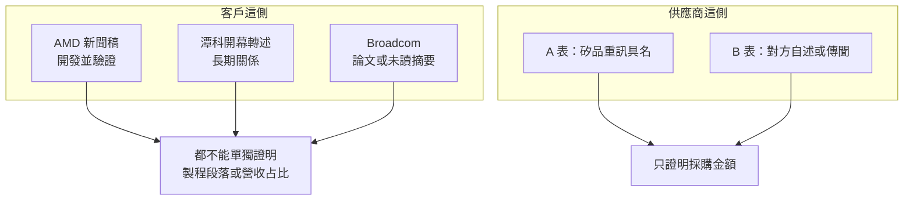

# 第 13 章：誰買矽品的服務，誰賣設備給矽品？

## 開場問題

「NVIDIA、AMD、Broadcom 都是矽品客戶」這種句子，把出席典禮、新聞稿動詞、論文合著和未具名訂單寫成同一種關係。設備端也一樣：重訊上的十億元採購，和供應商官網的客戶名單，不是同一種證明。

本章分兩半：**誰買矽品的服務**，以及 **誰賣設備或工程給矽品**。每一列只保留來源裡的公司名。未具名的 CSP 保持未具名。不寫投資建議，不把投資金額改寫成矽品的訂單金額。

查閱日：**2026-10-12**。段落仍未證實，見 [第 10 章](10-beside-tsmc.md)。廠房價金不是訂單，見 [第 12 章](12-capacity-and-plants.md)。

## 主體：客戶公告、買方重訊、供應商自述

| 文件長什麼樣 | 主體 | 能證明的角色 |
|---|---|---|
| 客戶新聞稿裡有矽品主管的具名引言 | 發布者是客戶；引言把矽品拉進來 | 雙方願意公開這段合作用語。本章把 AMD 這份標成 `[雙方公告]` |
| 報紙轉述兩邊高層在典禮上的話 | 記者是撰寫者 | 有這場公開活動與這些轉述，不是合約 |
| 矽品（投控代公告）的重大訊息點名交易相對人 | 買方是矽品 | 買了多少錢的設備或工程，不寫製程 |
| 供應商自己的官網或董事長受訪 | 說話的是供應商 | 供應商聲稱的客戶關係，矽品沒有在同一份文件裡確認 |

重訊是買方揭露。供應商有沒有再發一次自己的公告，本章沒有逐筆查。因此 A 表停在 `[公司自述]`，不升成 `[雙方公告]`。

## 口徑：動詞、公司層級、歷史時態

讀客戶與供應商只看四個詞：

- **開發並驗證（to develop and qualify）** 不是 **已經驗證（qualifying 已完成的里程碑）**。
- **合作多少年、業績變成幾倍** 不是營收占比，也不是 CoW 或 WoS。
- **論文合著** 不是量產客戶公告。
- **公司層級的客戶名單** 不是某一型號、某一年的出貨。

## 機制：怎樣才算「買服務」或「賣設備」

封測廠的客戶證據，最低限度要有客戶自己的句子，寫出合作對象與動詞。只有產業報導說「也服務某類客戶」，就還停在傳聞。

設備證據有兩條路，不能併成一張表：

- **A 表**：矽品的重大訊息寫出相對人與金額。這證明採購發生過。它不說明機台放進 CoW、測試還是廠務，也不說明交貨後有沒有量產。
- **B 表**：供應商或媒體說矽品是客戶。這證明「有人這樣講」。沒有型號、沒有年份出貨時，不能補上。

名字沒有出現，就放進待查，不為了供應鏈完整而寫成供應商。弘塑、辛耘、印能、致茂屬於這一類。

## 證據：客戶

### AMD：這份稿子要看動詞

2026-05-21，AMD 發布新聞稿，宣布在台灣生態系投入超過 100 億美元，以擴充策略夥伴並增加先進封裝製造能力。發布者是 AMD。稿內矽品業務副總 John Yu 具名發言，所以本章標 `[雙方公告]`：它不是兩家各發一份對等稿，寫作時也未查到矽品另發新聞稿。有具名引言，才高於客戶單方宣傳。

同一份稿子裡的動詞不同：

- **日月光與矽品**（以及 "other industry partners"）：AMD is collaborating with them **to develop and qualify** next-generation **wafer-based** 2.5D bridge interconnect technology（EFB，Elevated Fanout Bridge）。中文可寫「合作開發並驗證晶圓型 2.5D 橋接」，英文是不定詞，表示目標，不是「驗證已經完成」。
- **力成（PTI）**：AMD has achieved a major milestone with PTI **by qualifying** the industry’s first **2.5D panel-based** EFB。這是面板級，而且動詞是已達成的驗證里程碑。
- John Yu 的原句是："SPIL is proud to partner with AMD to bring innovative packaging solutions like EFB to market." 下一句談的是把先進封裝延伸到新應用、支持 AI 基礎建設的成長。沒有訂單金額，沒有驗證完成日。
- 日月光 Steven Tsai 的引言用了 industrialize（推動產業化）。這句話的主詞是日月光的主管，不要改寫成矽品已經產業化。

**超過 100 億美元是 AMD 對整個台灣生態系的投資說法，不是矽品收到的訂單金額。** 稿子沒有把這筆錢分給矽品、日月光、力成或基板廠。

第六代 EPYC、代號 Venice，寫在 AMD 新聞稿摘要，也寫在 EFB 那段（EFB 支持 Venice CPU）。Venice 不只出現在二手報導；產品代號就在 `[雙方公告]` 裡。即便如此，"supporting Venice" 仍然不是「矽品已取得 Venice 量產訂單」。把 Venice 和大量生產綁在一起的，是力成董事長談**面板級** EFB 的引言，不是 John Yu 那段。

新聞稿：https://ir.amd.com/news-events/press-releases/detail/1286/

### NVIDIA：典禮證明關係與建廠說法，不證明段落

2025-01-16，黃仁勳出席矽品台中潭科廠開幕，與董事長蔡祺文揭牌。報紙轉述：合作 27 年；業績是 10 年前的 10 倍；蔡祺文稱這座廠是為了 NVIDIA 的加速運算需求而建。出處包括 [工商時報](https://www.ctee.com.tw/news/20250116701840-430503) 與今周刊。等級是 `[媒體報導]`：兩邊高層的話經報紙轉述，寫作時未查到公司逐字新聞稿，不升成官方文件。

這組句子能支持的是：雙方願意公開長期關係，而且矽品董事長把建廠目的說成 NVIDIA 的加速運算需求。

不能支持的是：潭科做 CoW、oS、WoS 還是測試；NVIDIA 占矽品營收的比例；「10 倍」的分母是營收、出貨還是別的指標。報導沒有定義這個倍數。

隔日的市場解讀把黃仁勳「台積電訂單持續增加」，以及前一日法說上魏哲家稱砍單是謠言，收成「破除 CoWoS 砍單、矽品是封裝要角」。發言本身是 `[媒體報導]`。「破除砍單」是 `[推論]`。推論不證明矽品的製程段落。

### Broadcom：不要寫成量產客戶

三層分開：

| 說法 | 等級 | 能寫到哪 |
|---|---|---|
| 2023-05-22 DigiTimes：日月光與矽品加入 Broadcom 矽光子 CPO 晶片與模組供應鏈 | `[媒體報導]`，**未讀全文**（付費頁，只看到摘要） | 只能說有這則摘要。不能依摘要改寫成量產供貨 |
| 2024 年 ECTC：Broadcom 與 SPIL 合著 51.2T 共封裝光學原型 | `[論文]` | 研究合作與原型。見 [第 9 章](09-cpo.md)。不是客戶量產公告 |
| 2024–2026 矽品承接 Broadcom ASIC 的封測 | 未查到 | 2026-03 有報導把 Broadcom 封測鏈寫成投控、京元電等，沒有列矽品。Broadcom 與力成的新加坡面板級封裝是力成，不是矽品 |

本章**不把 Broadcom 寫成矽品的量產客戶**。

### 未具名 CSP：不補名字

2026-06-11 TrendForce 寫，矽品也服務 AMD 與數家 CSP 的 ASIC 訂單，產線滿載。等級 `[業界消息]`。原文沒有公司名。市場評論有時會補上名字；那些名字沒有這則報導的來源支持，本書不採用。

2024-08-06 同一則 CoW 傳聞還寫矽品已與 NVIDIA、AMD 合作先進封裝，並具 CoWoS-L 能力。那也是 `[業界消息]`，不能拿來加厚上面兩節。

## 證據：供應商 A 表

A 表是矽品重大訊息（多由投控代公告）點名的交易相對人。等級 `[公司自述]`。金額證明採購，不證明製程。

頁面編碼損壞，或相對人只出現在搜尋摘要時，金額旁註「頁面編碼損壞，待覆核」或「名稱經搜尋摘要，待覆核」。有這句註記的數字，不能再升成已核對的 MOPS 原文。Veeco 那一筆已核對轉載頁，本章仍不把它升成 `[官方文件]`。

| 公告日 | 相對人 | 標的 | 金額（新台幣） | 等級與限制 |
|---|---|---|---|---|
| 2025-03-27 | 盟立自動化 | 營業用機器設備 21 批（2024-07-09 至 2025-03-27） | 約 10.20 億元 | `[公司自述]`，Yahoo 股市轉載重訊。寫作時未回 MOPS 覆核 |
| 2026-01-16 | 聖暉 | 廠務工程（2026-01-12 至 2027-04-30） | 9.69 億元；報導稱聖暉年初至當日累計接矽品 15.65 億元 | `[公司自述]`，鉅亨轉述 |
| 2026-06 至 07 | 聖暉 | 多筆廠務工程 | 轉述約 6.62 億、約 20 億、約 10.7 億，合計逾 37 億元。頁面編碼損壞，待覆核 | `[公司自述]`，不可當已核金額 |
| 2026-06 至 07 | 朋億；中源機電顧問 | 廠務工程 | 約 5.08 億元；約 5.14 億元。頁面編碼損壞，待覆核 | `[公司自述]`。名字與金額都待覆核，不升等級 |
| 2026-07-15 | 愛德萬測試（Advantest） | 營業用機器設備 6 批 | 約 22.45 億元。金額在轉載頁可讀；相對人名稱經搜尋摘要，待覆核 | `[公司自述]` |
| 2026-07-16 | Veeco Process Equipment Inc. | 設備 4 批 | 約 10.89 億元 | `[公司自述]`。此筆已核對轉載頁 |
| 2026-07-16 | 樂鑫材料科技 | 設備 12 批 | 約 10.55 億元。名稱經搜尋摘要，待覆核 | `[公司自述]` |
| 2026-07-17 | 超慧科技 | 設備 10 批 | 約 10.06 億元。名稱經搜尋摘要，待覆核 | `[公司自述]` |
| 2026-07-17 | 鴻騏新技 | 設備 176 批 | 約 10.25 億元。名稱經搜尋摘要，待覆核 | `[公司自述]` |

2026 年 7 月另有數則「取得營業用機器設備達十億元」的標題，相對人未查到。那些金額不能配上上表的公司，以免一筆交易算兩次。

## 證據：供應商 B 表

B 表不是 A 表的補遺。等級不混用。

| 誰 | 說法 | 等級 | 能支持到哪 |
|---|---|---|---|
| 均華 | 官網「關於均華」列出台積電、矽品、日月光為客戶 | `[公司自述]`（均華的自述） | 公司層級具名，沒有機型。見 [均華書第 7 章](../../gmm/html/07-gmm-product-evidence.html)。不能寫成某一台 Chip Sorter 或 Die Bonder 賣給矽品 |
| 均豪 | 董事長陳政興 2024-08-18 受訪：「第一家半導體客戶是矽品」；並談矽品開發玻璃晶圓時需要檢驗設備，驗證約一個月後下單 | `[媒體報導]`（《財訊》經 NOWnews） | **歷史關係**。不證明 2024–2026 仍有出貨。玻璃晶圓在這段訪談裡是下單由來，不是矽品已量產玻璃核心基板的證據；該項公開資料寫作時未查到。見 [均豪書第 15 章](../../gpm/html/15-gpm-product-map.html)。該章的日月光高雄廠是日月光，不是矽品 |
| 志聖、竑騰、奇鋐、健策 | 2026-02-05 報導把他們放進矽品 CoWoP 的早期設備或散熱供應鏈 | `[業界消息]` | 與第 10 章的獨家試產是同一則傳聞，不是 A 表採購 |
| 萬潤 | 同一則裡被當成可能的噴塗、壓合設備廠，行文偏向竑騰 | `[業界消息]`，且非確定 | 不能寫成已經供貨 |
| 臻鼎-KY、欣興 | 同一則稱首波向矽品送樣 CoWoP 用 PCB | `[業界消息]` | 送樣傳聞，不是訂單公告 |

### 查過、但不能寫成矽品供應商

| 公司 | 公開說法停在哪 | 本章處理 |
|---|---|---|
| 弘塑 | 報導客戶為日月光、美光、Amkor、中系封測廠，未列矽品 | 待查。不是供應商 |
| 辛耘 | CoWoS 濕製程訂單的報導未點名矽品 | 待查。不是供應商 |
| 印能 | 客戶寫「多家國際半導體大廠」，未具名 | 待查。不代為補成矽品 |
| 致茂 | 未查到具名矽品 | 待查。不是供應商 |

## 讀完可以說的那一句

寫作時最硬的客戶證據是 AMD 新聞稿裡的動詞：矽品在晶圓型 EFB 上是「開發並驗證」，力成在面板級 EFB 上是「已驗證」。NVIDIA 潭科開幕是長期關係的公開說法。Broadcom 停在未讀完的舊摘要和一篇原型論文。設備端，A 表是矽品說自己向誰買了多少錢；B 表是別人說矽品是客戶。兩邊都還沒有製程段落。

## 理解檢查

??? question "同一份 AMD 新聞稿，為什麼不能把矽品和力成寫成同一種進度？"
    矽品（與日月光）的動詞是 to develop and qualify，對象是晶圓型 EFB。力成的動詞是 qualifying 已經達成的里程碑，對象是面板級 EFB。動詞和載體都不相同。

??? question "超過 100 億美元，為什麼不是矽品的訂單金額？"
    主詞是 AMD 對台灣生態系的投資。稿子沒有分給矽品的數字。John Yu 的引言也沒有金額。

??? question "黃仁勳說業績是十年前的十倍。這能證明 NVIDIA 占矽品營收的比重嗎？"
    不能。轉述沒有定義倍數的口徑，也沒有給營收占比。建廠目的的那句話同樣不能推出 CoW 或 WoS。

??? question "愛德萬約 22.45 億元這列，證據缺口在哪？"
    即使金額可讀，相對人名稱仍是搜尋摘要，待覆核；整表都還沒回 MOPS 對原文。重訊也不寫製程。所以它不能證明矽品買的是 CoW 設備，也不能在覆核前把名稱寫死。

??? question "均豪董事長說矽品是第一家半導體客戶。弘塑的報導沒寫矽品。兩句要怎麼放？"
    均豪這句是 2024-08-18 的歷史敘事，`[媒體報導]`，不證明 2024–2026 仍有出貨，也不是均豪書裡的日月光高雄廠。弘塑未具名矽品，放待查，不寫成供應商。

## 來源與待查

### 本章直接使用的來源

| 資料 | 日期 | 等級 |
|---|---|---|
| AMD 新聞稿 https://ir.amd.com/news-events/press-releases/detail/1286/ | 2026-05-21 | `[雙方公告]`（AMD 發布，內含 SPIL 具名引言） |
| 工商時報潭科開幕 https://www.ctee.com.tw/news/20250116701840-430503 | 2025-01-16 | `[媒體報導]` |
| 科技新報砍單解讀 https://technews.tw/2025/01/17/cowos-cancel-order-rumor/ | 2025-01-17 | 發言 `[媒體報導]`；「破除砍單」`[推論]` |
| DigiTimes 摘要 https://www.digitimes.com/news/a20230522PD201.html | 2023-05-22 | `[媒體報導]`，未讀全文 |
| ECTC 2024，51.2T CPO，DOI `10.1109/ectc51529.2024.00022` | 2024 | `[論文]` |
| TrendForce CSP 報導 https://www.trendforce.com/news/2026/06/11/news-ases-spil-acquires-nt2-8b-plant-amid-spillover-demand-from-tsmc-advanced-packaging-capacity-crunch/ | 2026-06-11 | `[業界消息]` |
| 均華官網關於我們（已收於均華書） | 頁面未標日期 | `[公司自述]` |
| 陳政興受訪，NOWnews https://www.nownews.com/news/6497539 | 2024-08-18 | `[媒體報導]` |
| 鉅亨 CoWoP 設備鏈 https://m.cnyes.com/news/id/6333131 | 2026-02-05 | `[業界消息]` |
| A 表各筆重訊轉載（Yahoo、鉅亨、富邦 e01） | 2025-03 至 2026-07 | `[公司自述]`；編碼損壞者待覆核 |

### 待查

1. 矽品有沒有就 EFB 另發新聞稿；EFB 何時驗證完成、有無量產訂單。
2. 潭科廠的製程段落，以及 NVIDIA 營收占比。
3. DigiTimes 2023 全文；2024–2026 有無 Broadcom ASIC 與矽品的封測公告。
4. CSP 的公司名：保持未具名，不另查傳聞來補。
5. A 表除已核對轉載頁的 Veeco 外，回 MOPS 覆核相對人與金額。供應商端是否另有公告：未逐筆查。
6. 7 月數則只見標題、沒有相對人的十億元設備公告。
7. 弘塑、辛耘、印能、致茂：未查到具名矽品，不要預先寫成供應商。
8. 均豪 2024 年以後是否仍出貨給矽品：未查到。
