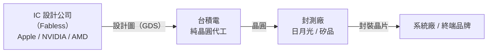
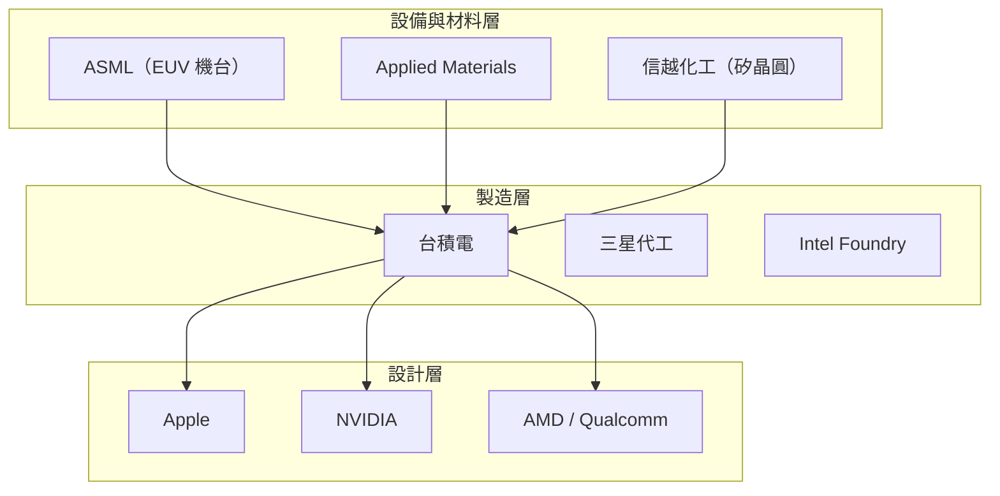

# 公司概覽

台積電（Taiwan Semiconductor Manufacturing Company，TSMC）是全球最大的**純晶圓代工廠**（Pure-play Foundry），總部位於台灣新竹科學園區。

---

## 核心定位

台積電的商業模式在 1987 年由張忠謀創立時即奠定：**只做代工，不做自有品牌晶片**。這個模式讓台積電得以服務全球所有 IC 設計公司，而不與客戶競爭。

---

## 關鍵數字（2025 年）

| 指標 | 數值 |
|------|------|
| 年營收 | 3.81 兆新台幣（1,224 億美元），年增 31.6% |
| 7 奈米以下占晶圓營收 | 74%（2024 年 69%） |
| 全職員工 | 90,557 人（2025 年底） |
| 前十大客戶占營收 | 78% |

市占見[地緣政治與全球化](11-geopolitics.md)，客戶見[客戶結構](08-customers.md)，財務見[財務表現](10-financials.md)。

---

## 為何台積電如此關鍵？

台積電的重要性來自三個相互強化的優勢：

**1. 技術領先**
2 奈米已於 2025 年量產；A16 預定 2026 年風險試產（20-F）。

**2. 規模**
2025 年資本支出約 409 億美元；2026 年指引為 600–640 億美元（2026 年 10 月法說會）。

**3. 客戶關係**
客戶為什麼留下、什麼時候離開，見[歷史沿革](02-history.md)的案例。

---

## 在全球半導體產業的位置

→ 延伸閱讀：[歷史沿革](02-history.md)、[技術製程](04-nodes.md)

## 資料來源

- 營收、7 奈米以下占比、員工、客戶集中度、A16 時程：[TSMC 2025 Form 20-F](https://www.sec.gov/Archives/edgar/data/1046179/000162828026025362/tsm-20251231.htm)
- 2025 年資本支出：[TSMC 2025 Q4 法說會（Fintool 整理）](https://fintool.com/news/tsmc-q4-record-capex-ai-boom)
- 2026 年資本支出指引：[Converge Digest（2026 Q3）](https://convergedigest.com/tsmc-q3-2026-capex-taiwan-arizona-japan/)
