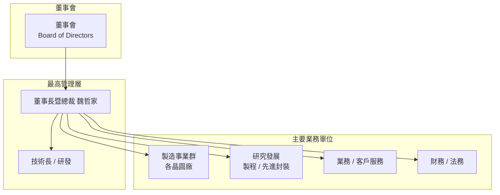

# 組織與治理

下圖是主要職能的示意，不是官方組織圖。

---

## 組織架構示意

---

## 獨特的企業文化

台積電以**誠信（Integrity）** 為核心價值，具體體現在：

- **不與客戶競爭**：台積電不自行設計或銷售晶片，確保客戶設計圖不外洩
- **研發投入**：研發支出占營收 2023 年 8.5%、2024 年 7.1%、2025 年 6.5%；金額持續增加，比例因營收成長更快而下降

---

## 股權結構

| 股東 | 比例 | 時點 |
|------|------|------|
| 國發基金 | 6.38% | 2026 年 2 月底（20-F） |
| 外資合計 | 約 69% | 2026 年 9 月（報導引述集保資料） |

兩個數字的時點不同，不能相減推算其他股東。

> 台積電為台灣上市公司（代號：2330），同時在紐約證交所以 ADR 方式掛牌（代號：TSM）。

---

→ 延伸閱讀：[財務表現](10-financials.md)、[客戶結構](08-customers.md)

## 資料來源

- 研發占比、國發基金持股：[TSMC 2025 Form 20-F](https://www.sec.gov/Archives/edgar/data/1046179/000162828026025362/tsm-20251231.htm)
- 外資持股：[EBC（2026-09）](https://www.ebc.com/zh/jinrong/312146.html)
