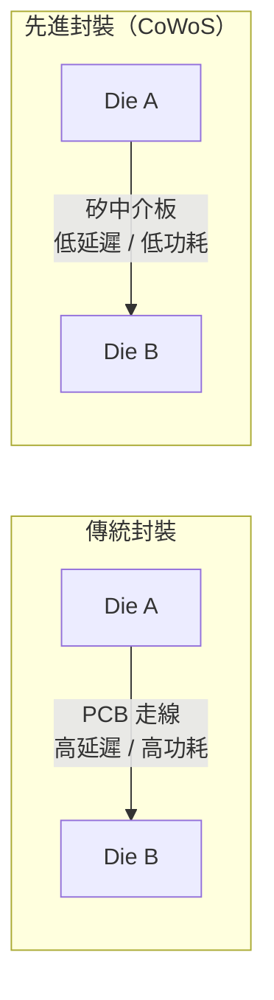
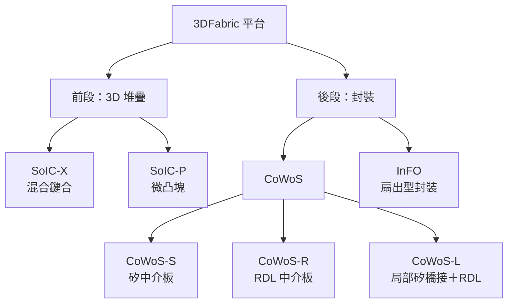
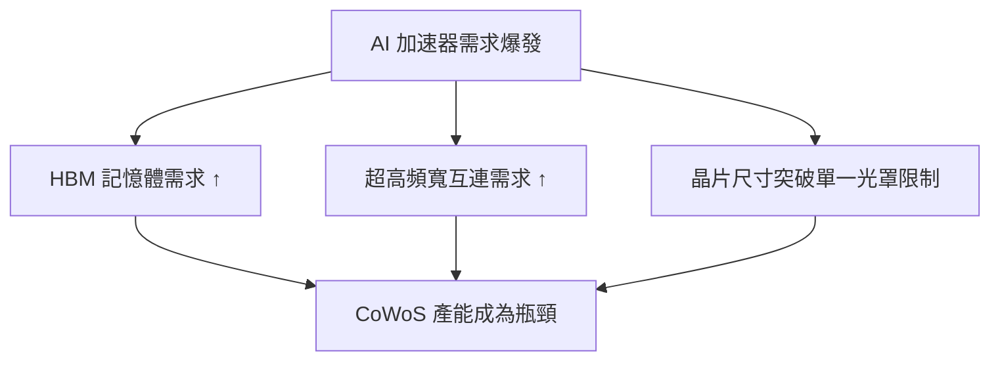

# 先進封裝：CoWoS 與 3DFabric

當製程微縮的物理極限越來越近，**先進封裝**成為提升效能的重要路徑。台積電的 3DFabric 平台整合了多種封裝技術。

---

## 為何先進封裝如此重要？

傳統封裝只是將晶片「裝進外殼」，現代先進封裝則是將多個晶片（Die）整合到一起，讓它們之間的連接密度接近單一晶片內部的等級。

---

## 3DFabric 平台架構

台積電將先進封裝技術統稱為 **3DFabric**，包含三個平台：前段的 SoIC（3D 堆疊），以及後段的 CoWoS 與 InFO（扇出型封裝）。

---

## CoWoS 系列詳解

### CoWoS-S（Silicon Interposer）

CoWoS 最早的版本，在「矽中介板」上同時放置運算晶片與 HBM 記憶體。

**主要應用**：NVIDIA H100、H200 與 AMD MI300 等 AI 加速器。黃仁勳表示 Blackwell 主要改用 CoWoS-L，Hopper 仍用 CoWoS-S。

### CoWoS-R（RDL Interposer）

以再佈線層（Redistribution Layer，RDL）取代矽中介板。

### CoWoS-L（Local Si Interconnect）

2020 年發表。以局部矽橋接晶片（Local Silicon Interconnect）搭配 RDL 中介板，保留 CoWoS-S 的矽穿孔，同時避開大面積矽中介板的良率問題。

---

## SoIC：3D 垂直堆疊

SoIC（System on Integrated Chips）把晶片垂直堆疊，有兩個版本：SoIC-X 使用**混合鍵合（Hybrid Bonding）**，以銅對銅直接接合，鎖定 HPC 與 AI；SoIC-P 使用微凸塊堆疊，鎖定手機等重視成本的產品。

**應用場景**：將邏輯晶片與快取/記憶體晶片垂直堆疊，顯著縮短存取延遲。

---

## AI 時代的封裝需求

---

各封裝廠的位置與用途見[廠區分布](07-fabs.md)。

→ 延伸閱讀：[技術路線圖](06-roadmap.md)、[客戶結構](08-customers.md)

---

## 資料來源

- 3DFabric 名稱與服務：[TSMC 2025 Form 20-F](https://www.sec.gov/Archives/edgar/data/1046179/000162828026025362/tsm-20251231.htm)
- 三個平台、前段與後段：[3D InCites](https://3dincites.com/?p=62893)
- SoIC-X 與 SoIC-P：[TrendForce](https://www.trendforce.com/news/?p=9959)
- CoWoS-L 於 2020 年發表：[AnandTech](https://www.anandtech.com/show/16031/tsmcs-version-of-emib-lsi-3dfabric)
- CoWoS-S 應用、CoWoS-L 結構、黃仁勳談 Blackwell：[TrendForce](https://www.trendforce.com/news/2024/03/21/news-blackwell-enters-the-scene-a-closer-look-at-tsmcs-cowos-branch/)
