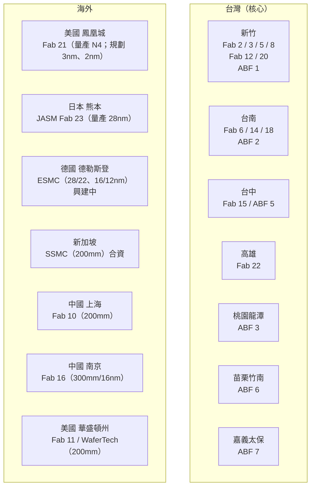
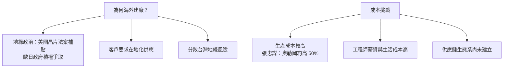

# 廠區分布

台積電擁有遍布全球的晶圓廠與先進封裝廠，主力仍在台灣，同時積極於美國、日本、德國、新加坡、中國布局。

---

## 全球廠區一覽圖

---

## 台灣廠區詳表

### 前段晶圓廠（Wafer Fab）

| 廠號 | 位置 | 晶圓尺寸 | 量產最先進製程（2025 年底，20-F）/ 備註 |
|------|------|---------|----------------|
| **Fab 2** | 新竹科學園區 | 150 mm | 450 nm；早期設施 |
| **Fab 3** | 新竹科學園區 | 200 mm | 150 nm |
| **Fab 5** | 新竹科學園區 | 200 mm | 150 nm |
| **Fab 6** | 南部科學園區 | 200 mm | 110 nm |
| **Fab 8** | 新竹科學園區 | 200 mm | 110 nm |
| **Fab 12** | 新竹科學園區 | 300 mm | 40 nm；總部與研發所在地 |
| **Fab 14** | 南部科學園區 | 300 mm | 16 nm |
| **Fab 15** | 中部科學園區 | 300 mm | 7 nm |
| **Fab 18** | 南部科學園區 | 300 mm | 3 nm |
| **Fab 20** | 新竹科學園區（寶山） | 300 mm | 2 nm；2025 年開始量產 |
| **Fab 22** | 高雄楠梓 | 300 mm | 2 nm；2025 年開始量產 |

### 後段先進封裝廠（Advanced Backend Fab，ABF）

台積電自建封裝廠以整合 CoWoS / SoIC 等先進封裝技術，不再完全依賴外部封測廠。

| 廠號 | 位置 | 狀態 | 備註 |
|------|------|------|------|
| **ABF 1** | 新竹科學園區 | 運作中 | CoWoS 先進封裝 |
| **ABF 2** | 台南善化 | AP2B & AP2C 運作中 | CoWoS 先進封裝 |
| **ABF 3** | 桃園龍潭 | 運作中 | 先進封裝 |
| **ABF 5** | 台中科學園區 | 運作中 | 先進封裝 |
| **ABF 6** | 苗栗竹南 | AP6A 運作中；Phase B & C 興建中 | 大幅擴充 CoWoS 產能 |
| **ABF 7** | 嘉義太保 | 規劃 2 期 | 新建封裝廠，擴充南部產能 |

---

## 海外廠區詳情

### 🇺🇸 美國 — Fab 21（鳳凰城，亞利桑那州）

| 項目 | 說明 |
|------|------|
| 位置 | 鳳凰城（Phoenix），亞利桑那州 |
| 晶圓尺寸 | 300 mm |
| 第一座廠 | N4，2024 年第四季量產 |
| 第二座廠 | 3 奈米，報導預定 2027 年下半年量產 |
| 第三座廠 | 報導規劃 2 奈米與 A16 |
| 投資與補助 | 見[地緣政治與全球化](11-geopolitics.md)〈海外布局〉 |
| 成本 | 張忠謀 2022 年表示，台積電奧勒岡廠生產同樣產品的成本比台灣高約 50% |

---

### 🇯🇵 日本 — JASM / Fab 23（熊本菊陽町）

| 項目 | 說明 |
|------|------|
| 正式名稱 | Japan Advanced Semiconductor Manufacturing（JASM） |
| 股權結構 | 台積電約 86.5%、Sony Semiconductor Solutions 6.0%、Denso 5.5%、Toyota 2.0%（2024 年 2 月第二座廠宣布後） |
| Phase 1 | 2024 年 12 月開始量產；規劃 12/16 與 22/28 nm，2025 年底量產最先進為 28 nm（20-F） |
| Phase 2 | 2024 年宣布時規劃 6/7 nm，預定 2027 年底前營運；之後有時程變動的報導 |
| 總投資 | 兩座廠合計超過 200 億美元 |
| 預計就業 | 兩座廠合計直接創造超過 3,400 個工作機會 |
| 戰略意義 | 供應 Sony 影像感測器、Denso 汽車晶片及其他日本電子廠商 |

---

### 🇩🇪 德國 — ESMC（德勒斯登，薩克森邦）

| 項目 | 說明 |
|------|------|
| 正式名稱 | European Semiconductor Manufacturing Company（ESMC） |
| 股權結構 | 台積電 70%、Bosch 10%、Infineon 10%、NXP 10% |
| 製程 | 28/22 nm、16/12 nm FinFET（汽車、工業應用） |
| 總投資 | 超過 100 億歐元（台積電出資 35 億歐元） |
| 政府補貼 | 德國政府補貼 50 億歐元 |
| 目標產能 | 每月 40,000 片 12 吋晶圓 |
| 時程 | 2024 年 8 月動工；2026 年 9 月上樑；首批製程設備預定 2027 年下半年進機。量產時間未公布（台積電官網早先的目標是 2027 年底） |

---

### 🇸🇬 新加坡 — SSMC

| 項目 | 說明 |
|------|------|
| 正式名稱 | Systems on Silicon Manufacturing Cooperation（SSMC） |
| 股權結構 | 台積電 38.8%、NXP Semiconductors 61.2% |
| 晶圓尺寸 | 200 mm |
| 製程 | 成熟製程（類比、混合訊號、電源管理） |
| 成立時間 | 1998 年，原為台積電、飛利浦、EDB 三方合資 |

---

### 🇨🇳 中國 — Fab 10 & Fab 16

| 廠號 | 位置 | 晶圓尺寸 | 製程 | 備註 |
|------|------|---------|------|------|
| **Fab 10** | 上海松江 | 200 mm | 成熟製程 | TSMC China Company Limited |
| **Fab 16** | 南京（江蘇） | 300 mm | 16 nm | TSMC Nanjing Company Limited；美方 VEU 授權 2025 年 12 月到期，改以年度出口許可維持設備供應（20-F） |

---

### 🇺🇸 美國華盛頓州 — Fab 11（WaferTech）

| 項目 | 說明 |
|------|------|
| 位置 | Camas，華盛頓州 |
| 晶圓尺寸 | 200 mm |
| 製程 | 成熟製程 |
| 歷史 | 原名 WaferTech，現更名為 TSMC Washington |

---

## 為何海外建廠如此挑戰？

台積電在 2026 年 1 月法說會預期，海外廠量產初期會稀釋毛利率約 2–3 個百分點（見[財務表現](10-financials.md)）。

---

→ 延伸閱讀：[地緣政治](11-geopolitics.md)、[上下游供應鏈](09-supply-chain.md)

## 資料來源

- 各廠量產最先進製程、Fab 16 出口許可：[TSMC 2025 Form 20-F](https://www.sec.gov/Archives/edgar/data/1046179/000162828026025362/tsm-20251231.htm)
- JASM 股權、投資與就業：[TSMC 新聞稿（2024-02）](https://pr.tsmc.com/japanese/news/3105)
- Arizona 第二座廠時程：[TrendForce 轉述 Nikkei（2025-12）](https://www.trendforce.com/news/2025/12/18/news-tsmc-reportedly-accelerates-arizona-2nd-fab-eyes-3q26-tool-install-2027-3nm-production/)
- 張忠謀談美國成本：[Taipei Times（2022-04）](https://www.taipeitimes.com/News/biz/archives/2022/04/22/2003776996)
