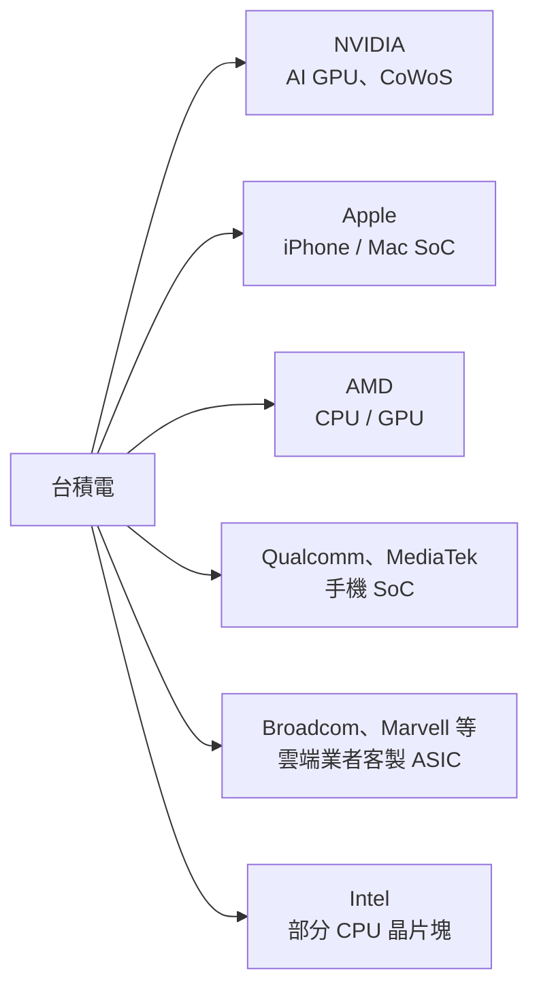

# 客戶結構

講到台積電的客戶，最常見的提問是：前兩大客戶加起來超過三分之一的營收，這不是很危險嗎？

這個問題預設了一般公司的處境：客戶越集中，議價權越在客戶手上，因為客戶可以走。但它跳過了最需要檢查的前提：**客戶走得了嗎？**集中度只告訴你誰付了多少錢，沒有告訴你誰離不開誰。

本章的「詮釋」框是根據公開數字所做的推論；正文是可查證的事實。

---

## 數字：AI 時代換了定錨客戶

| 平台 | 2024 年營收占比 | 2025 年營收占比 |
|------|----------------|----------------|
| 高效能運算（HPC，含 AI） | 51% | 58% |
| 智慧型手機 | 35% | 29% |
| 物聯網 | 6% | 5% |
| 車用 | 5% | 5% |
| 消費性電子 | 1% | 1% |
| 其他 | 2% | 2% |

台積電年報不公開客戶名稱，只以「客戶 A」「客戶 B」揭露。依報導與黃仁勳的公開說法，2025 年客戶 A 是 NVIDIA，占營收約 19%（2024 年約 12%）；客戶 B 是 Apple，約 17%（2024 年約 22%）。**Apple 第一次不是最大客戶。**

---

## 定錨客戶是什麼位置

每個新製程節點開出來的頭一兩年，產能貴、良率還在爬，需要一個願意先付錢、量又夠大的客戶，替所有後來者把學習曲線墊平。這個角色叫定錨客戶。

手機時代，這個位置屬於 Apple：每年秋天固定推出新 iPhone，需求可預測、量大、願意為首發付溢價。

<!-- mech: anchor_learning_curve -->
!!! example "示意場景"
    新節點開出來的第一年，兩家晶片公司拿到同一份報價：產能有限、價格偏高、良率還在爬。一家每年要在固定月份推出旗艦手機，晚一年就輸掉整個產品週期，於是付錢包下首批產能。另一家的產品可以等，於是第二年才進場，省下的錢，是用前者墊平的學習曲線換來的。

<!-- mech: anchor_learning_curve -->
!!! note "詮釋"
    所以「客戶集中風險」在台積電身上，比較準確的說法是互為人質：客戶沒有第二家能穩定量產的供應商，台積電也需要定錨客戶替每個新節點付學費。NVIDIA 取代 Apple 成為最大客戶，不是風險升高，只是人質換了人。如果三星或 Intel 在某一代最先進節點拿下定錨客戶的首發大單，鎖定就從雙向變成單向。

AI 改變的是定錨位置的歸屬。NVIDIA 的資料中心 GPU 不只要先進製程，還要 CoWoS 先進封裝，而 CoWoS 產能長期供不應求。需求最急、最肯付錢的客戶從手機換成了 AI 加速器，定錨的位置也跟著移動。

---

## 同一個「客戶集中」，兩種意思

| | 一般供應商 | 台積電（先進製程） |
|---|---|---|
| 大客戶占比高代表 | 客戶握有議價權 | 雙方互相依賴 |
| 客戶的退路 | 轉單給競爭者 | 短期內幾乎沒有 |
| 真正的風險在 | 客戶離開 | 某一類終端需求整體下滑 |

!!! note "詮釋"
    換句話說，台積電怕的不是 Apple 或 NVIDIA 轉單，而是手機或 AI 這一整類需求同時退潮。2025 年 HPC 占到 58%，風險的形狀因此從「單一客戶」變成「單一需求」。

---

## Intel：對手也是客戶

Intel 自 2021 年起經營晶圓代工業務，和台積電競爭；同時，它 2024 年推出的 Lunar Lake 處理器，運算晶片塊由台積電 N3B 生產，平台控制晶片塊用 N6，Intel 自己只做基底晶片塊與 Foveros 封裝。季辛格的說法是：在那個時間點，台積電是對的技術。

<!-- mech: neutral_supplier (weak support) -->
!!! note "詮釋"
    Intel 自己給的理由是技術，不是中立，所以這個案例證明不了中立承諾有效。它說明的是另一件事：在最先進製程上，連最大的對手都只能當客戶。推測：Intel 代工最難賣的不是製程，而是它自己正在示範的處境——把晶片交給一個同時在賣 CPU 的工廠。如果 Intel 代工不必分拆，就成為某家大型外部客戶旗艦晶片的主要供應者，這個推測就錯了。

---

## 資料來源

- 2025 年平台占比：台積電 2025 年第四季法說會逐字稿（[PDF](https://investor.tsmc.com/japanese/encrypt/files/encrypt_file/reports/2026-01/51d09df96cd89ac19d65af39032b038dc2896a24/TSMC%204Q25%20Transcript.pdf)）
- 客戶 A / B 占比：Taiwan News 報導台積電年報（[連結](https://www.taiwannews.com.tw/news/6310676)）

---

→ 延伸閱讀：[財務表現](10-financials.md)、[上下游供應鏈](09-supply-chain.md)
