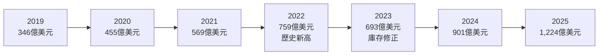
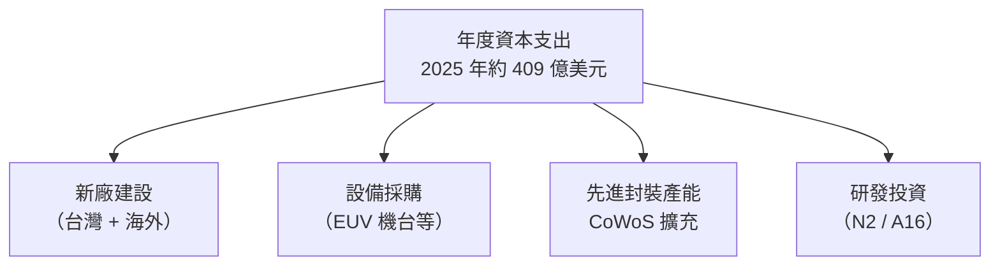

# 財務表現

本章數字以台積電年報（20-F）與法說會為準。

---

## 營收趨勢

---

## 關鍵財務指標（2025 年）

| 指標 | 數值 |
|------|------|
| 年營收 | 1,224 億美元（3.81 兆台幣） |
| 毛利率 | 59.9% |
| 資本支出 | 約 409 億美元 |
| 研發費用占營收 | 6.5% |

毛利率並非一直在 50% 以上：2019 年是 46.0%，2020 年 53.1%，2025 年 59.9%。2026 年第三季單季是 66.4%。公司在 2026 年 1 月表示長期毛利率目標為 56% 以上，並預期海外廠初期會稀釋毛利率約 2–3 個百分點。

---

## 資本支出策略

台積電每年投入龐大資本支出（CapEx）擴充產能與研發：

2026 年的資本支出指引在 2026 年 10 月法說會為 600–640 億美元。

---

## 如何閱讀台積電財報

每季法說會後，台積電公開：

1. **月營收** — 每月 10 日前公告上月合併營收
2. **季報** — 含各製程平台佔比（先進製程 vs. 成熟製程）
3. **年報** — 完整財務、技術、廠區、ESG 資訊

**重要觀察指標**：
- 先進製程（7nm 以下）佔營收比例趨勢
- 各終端市場佔比（手機 vs. HPC/AI）
- 資本支出指引（反映對未來需求的信心）
- 毛利率變化（反映海外建廠成本壓力）

---

→ 延伸閱讀：[客戶結構](08-customers.md)、[地緣政治](11-geopolitics.md)

## 資料來源

- 2019–2020 年營收與毛利率：[TSMC 2020 年報](https://investor.tsmc.com/static/annualReports/2020/english/index.html)
- 2025 年營收、研發占比：[TSMC 2025 Form 20-F](https://www.sec.gov/Archives/edgar/data/1046179/000162828026025362/tsm-20251231.htm)
- 2025 年毛利率、資本支出、長期毛利率目標：[Fintool（2025 Q4 法說會）](https://fintool.com/news/tsmc-q4-record-capex-ai-boom)
- 2026 Q3 毛利率：[TSMC 2026 Q3 新聞稿](https://pr.tsmc.com/english/news/3346)
- 2026 年資本支出指引：[Converge Digest](https://convergedigest.com/tsmc-q3-2026-capex-taiwan-arizona-japan/)
