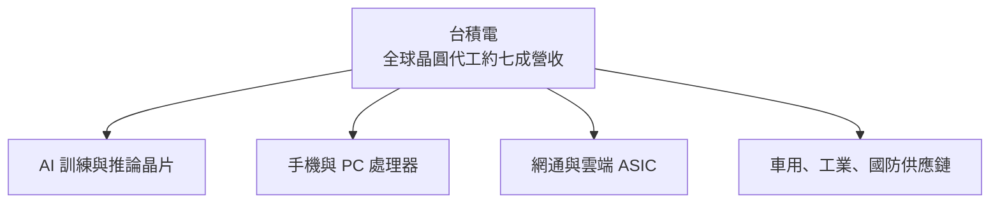

# 地緣政治與全球化

關於台積電和地緣政治，最常聽到的爭論是：「矽盾」到底有沒有用？

這個問題問得太早。它假設大家在算同一筆帳，只是答案不同。實際上，台灣、美國、中國、台積電的客戶，以及台積電自己，各自站在不同的位置，在算不同的帳。**同一個事實——台積電不可替代——在每個位置上都意味著不同的東西。**

---

## 事實：不可替代到什麼程度

依 TrendForce 統計，台積電在 2025 年拿下全球晶圓代工約 69.9% 的營收（2024 年為 64.4%），2026 年第二季達到 72.5%，第二名的三星只有 5.9%。在最先進的節點上，差距更大。

### 市占過半，為什麼十年前沒有人緊張？

依 Gartner 統計，台積電在 2014 年的代工市占是 53.7%，2015 年是 54.3%，同樣過半。但那時它還沒有被當成安全問題。

差別在兩個條件。第一，當時最先進的節點不是獨家：三星、格羅方德的 14 奈米還在和台積電的 16 奈米競爭。第二，美中的科技競爭還沒升溫。

<!-- mech: irreplaceability_dual, test: share_vs_exclusivity -->
!!! note "詮釋"
    被盯上的不是大，是獨家。2014 年市占同樣過半，但三星、格羅方德還能走同一條航道；等到最先進節點只剩台積電，商業上的成功就成了地緣政治問題。自由港一旦大到帝國離不開，就不再只是港口，而是要塞。

---

## 同一個「不可替代」，五種讀法

| 位置 | 「台積電不可替代」意味著 | 這個位置想要的 |
|------|------------------------|----------------|
| 台灣 | 國際社會不能坐視台灣出事（「矽盾」） | 先進製程留在台灣 |
| 美國政府 | 關鍵供應鏈集中在海峽一側 | 最先進製程也要在美國本土生產 |
| 中國 | 取得先進晶片要經過一個受美國管制的關口 | 自主製造能力 |
| 主要客戶 | 沒有第二供應商 | 產能保證與地理分散 |
| 台積電 | 議價籌碼，也是被各方要求的理由 | 不被迫選邊，維持全球客戶 |

「矽盾」一詞出自記者 Craig Addison 2001 年的書《Silicon Shield》，主張台灣在半導體供應鏈的地位能嚇阻攻擊。站在帝國那一側的人讀法不同：2021 年 12 月，Intel 執行長季辛格說「台灣不是一個穩定的地方」；2025 年 3 月，川普在白宮說晶片生意「現在幾乎全在台灣」，「他們從我們手上偷走的」。

<!-- frame: 不可替代 -->
!!! note "詮釋"
    Addison、季辛格、川普看的是同一個事實：最先進的晶片幾乎全在台灣。Addison 讀到嚇阻，季辛格讀到不穩定，川普讀到竊取。自由港越繁榮，帝國越會把它的繁榮讀成自己的損失，這就是收編的理由。所以矽盾越有效，美國越有理由把它拆掉。

---

## 中立位置被外部劃界

台積電的立足點是「不和客戶競爭」——它把自己放在一個中立的位置，所以每個人都能信任它（見[歷史沿革](02-history.md)）。地緣政治把這個中立位置擠掉了。

- **2020 年**：美國修訂「外國直接產品規則」，使用美國技術的晶圓廠不得為華為生產先進晶片，台積電停止供貨華為。
- **2024 年 10–11 月**：TechInsights 在華為的 AI 處理器中發現台積電生產的晶片，經查是透過中國設計公司算能（Sophgo）下單。台積電停止供貨算能；美國商務部隨後以「告知函」要求台積電停止為中國客戶出貨 7 奈米及以下的 AI 晶片，台積電自 11 月 11 日起執行。

<!-- mech: irreplaceability_dual -->
!!! example "示意場景"
    同一張 7 奈米訂單，代工廠業務看到的是一家合規的設計公司、一份正常的設計，照「不看客戶設計」的承諾接單；美國商務部看到的是一條可能通往華為的管道，照「為最終用途負責」的要求叫停。兩邊都照自己的規則做事，衝突的是規則本身。

<!-- mech: irreplaceability_dual -->
!!! note "詮釋"
    這是收編的第一步：港口的規則開始由帝國寫。「中立代工」原本是台積電給自己訂的規矩；2020 年後，誰能進港，華府說了算。算能的訂單從設計上看不出問題，一紙告知函就讓台積電停止為中國客戶出貨 7 奈米以下的 AI 晶片。

---

## 海外設廠：同一個動作，不同的名字

| 地點 | 實體 | 製程 | 狀態 |
|------|------|------|------|
| 美國亞利桑那 | TSMC Arizona | N4 起，後續 3 奈米、2 奈米 | 第一座廠 2024 年第四季量產；第二座廠 3 奈米預定 2027 年下半年量產 |
| 日本熊本 | JASM | 28–12 奈米 | 第一座廠 2024 年 12 月量產；第二座廠時程有變動的報導 |
| 德國德勒斯登 | ESMC | 28/22、16/12 奈米 | 2024 年動工，2026 年 9 月上樑；首批製程設備預定 2027 年下半年進機，量產時間未公布 |

美國這邊的帳：2022 年《晶片與科學法案》編列約 527 億美元；台積電在 2024 年 11 月與商務部定案最高 66 億美元的直接補助，另有最高約 50 億美元的貸款。2025 年 3 月，台積電宣布再增加 1,000 億美元，在美國的規劃投資總額約 1,650 億美元。這兩個數字一個是政府補助的上限，一個是公司的投資規劃，不能相加。

2022 年 4 月，張忠謀在 Brookings 與 CSIS 的 podcast 上說，在美國擴大晶片製造「會是一場非常昂貴、徒勞的嘗試」。同年 12 月，他在亞利桑那廠的移機典禮上說：「全球化幾乎已死，自由貿易幾乎已死。」

<!-- frame: 不可替代 -->
!!! note "詮釋"
    張忠謀的兩句話替這一節下了註腳。半年前他說在美國製造是徒勞，半年後他站在亞利桑那的典禮上宣告全球化已死。台積電是全球化的產物，自由港靠的就是自由貿易；創辦人親口說它死了，海外設廠就不再是生意判斷，而是向帝國繳的貢品。同一座廠，客戶叫它保險，美國叫它回流，台灣有人叫它去台化。對客戶越成功，對矽盾越不利。

---

## 收束

1987 年，台積電的問題是：怎樣讓別人敢依賴一個後來者？今天它的問題是：怎樣讓別人接受依賴一個不可替代者，同時不被任何一方完全拿走。

**前一個問題，靠自我約束就能解決。後一個問題的答案，已經不完全握在台積電自己手上。**

---

## 資料來源

- 市占：TrendForce 2026 年 9 月新聞稿（[連結](https://www.trendforce.com/presscenter/news/20260909-13225.html)）；2025 年全年：自由時報 / Taipei Times，2026 年 3 月 14 日（[連結](https://news.ltn.com.tw/news/focus/breakingnews/5369655)）
- 7 奈米 AI 晶片出貨限制：Korea Times 轉載路透社，2024 年 11 月 10 日（[連結](https://www.koreatimes.co.kr/amp/world/20241110/us-ordered-tsmc-to-halt-shipments-to-china-of-chips-used-in-ai-applications-source)）
- 美國投資與補助：Arizona Center for Investigative Reporting，2025 年 5 月 9 日（[連結](https://azcir.org/news/2025/05/09/has-a-taiwanese-chip-manufacturer-pledged-165-billion-in-arizona-investments-yes/)）
- 矽盾一詞：[USIP](https://www.usip.org/node/158641)
- 季辛格：[Taipei Times](https://taipeitimes.com/News/biz/archives/2021/12/04/2003768960)
- 川普：[Korea Times](https://www.koreatimes.co.kr/www/world/2025/03/501_393689.html)
- 張忠謀談美國製造：[Taipei Times](https://taipeitimes.com/News/biz/archives/2022/04/22/2003776996)；談全球化：[The Register](https://www.theregister.com/2022/12/08/tsmc_founder_globalization/)
- ESMC 時程：中央社 / Focus Taiwan，2026 年 9 月 15 日（[連結](https://focustaiwan.tw/business/202609150007)）

---

→ 延伸閱讀：[廠區分布](07-fabs.md)、[學習資源](13-resources.md)
