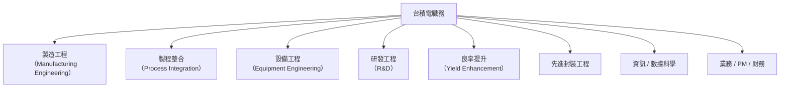

# 職涯指南

本章整理台積電的主要職類與求職資源。薪資與工作型態依職級、廠區差異很大，以官方職缺說明為準。

---

## 主要職類

---

## 各職類說明

### 製程整合工程師（Process Integration）

最具核心競爭力的職位，負責統整各道製程步驟，確保晶片製造流程順暢、良率達標。需要對整個製程有全面理解。

### 設備工程師（Equipment Engineer）

負責維護與優化特定製造設備（如曝光機、蝕刻機、薄膜沉積機）。與設備廠商緊密協作，需要強健的問題解決能力。

### 良率提升工程師（Yield Enhancement）

分析晶圓缺陷，找出良率損失根因並提出改善方案。大量使用統計分析與資料科學工具。

### 研發工程師（R&D）

參與下一世代製程節點的開發，工作內容接近學術研究，需要較深的材料科學或物理化學背景。

---

## 工作型態

晶圓廠 24 小時運作，部分職務需要輪班或待命；是否輪班依職類而定，應徵前以職缺說明為準。2025 年底全職員工 90,557 人，其中技術員 24,917 人（20-F）。

薪資沒有官方公開的起薪表；104 等求職平台的薪資資料是使用者自填，只能當參考。

---

## 求職資源

1. **台積電官方招募頁面**
   - [careers.tsmc.com](https://careers.tsmc.com)

2. **104 人力銀行**
   - 搜尋「台積電」查看完整 JD 與薪資水準

3. **PTT Semiconductor 版**
   - 大量工程師的面試心得與工作日常分享

4. **LinkedIn**
   - 了解台積電員工的職涯路徑與轉職去向

---

→ 延伸閱讀：[學習資源](13-resources.md)

## 資料來源

- 員工人數：[TSMC 2025 Form 20-F](https://www.sec.gov/Archives/edgar/data/1046179/000162828026025362/tsm-20251231.htm)
