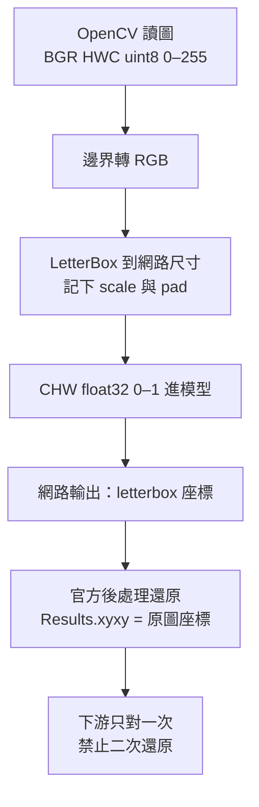

# 第 03 章：影像座標契約

要把偵測框畫對位置，先確認它使用哪一張圖的座標：原圖，還是縮放、補邊後送進模型的圖。兩張圖的尺寸不同，同一個物體就會有不同的座標數字。

本章把 Ultralytics YOLO 的影像處理分成兩項約定：

1. **像素資料怎麼放：**張量是存放像素的多維陣列。要記錄顏色順序、各維度的順序、資料型別和數值範圍。
2. **框的座標怎麼換：**letterbox 先等比縮放圖片，再補上邊框。要保留縮放比例與補邊量，才能把模型輸出的框還原到原圖。

如果顏色順序錯了，先修資料轉換；如果框整體偏移，先查補邊與座標還原。這兩類錯誤不能靠調整模型分數門檻修好。

## 本章頁面

- [影像張量契約：RGB／BGR、HWC／CHW、dtype 與數值範圍](image-contract.md)
- [Letterbox 與框座標往返](letterbox.md)
- 可執行檢查：[self_check.py](self_check.py)（標準庫 `assert`，不依賴 Ultralytics、不讀權重）

## 決策總圖

下圖以 OpenCV 讀圖為例。BGR／RGB 是三個顏色通道的順序；HWC 表示高、寬、通道，CHW 則把通道放前面。`uint8` 是整數像素，`float32` 是浮點數像素。下游若拿到已還原的 `Results.xyxy`，就不要再還原一次。

## 本章硬數字（平方輸入、等分 pad）

這是 1920×1080 原圖轉成 640×640 輸入的算例。`scale` 是縮放比例，`padding` 是補邊量；`xyxy` 依序表示左上角的 x、y 與右下角的 x、y。

| 項目 | 值 |
| --- | --- |
| 原圖寬×高 | 1920×1080 |
| 網路輸入 | 640×640 |
| scale | `min(640/1920, 640/1080) = 1/3` |
| 等比縮放後 | 640×360 |
| padding | 左右 0、上／下各 140 |
| 範例框原圖 `xyxy` | `(300, 150, 900, 750)` |
| 對應 letterbox `xyxy` | `(100, 190, 300, 390)` |

`rect` 或 `LetterBox(auto=True)` 走最小 padding 時，高邊對齊 stride 後**不是**上下各 140，不能套用上表。細節見 [letterbox.md](letterbox.md)。

## 官方來源

- [ultralytics.data.augment（LetterBox）](https://docs.ultralytics.com/reference/data/augment/)
- [ultralytics.engine.results（Results.xyxy）](https://docs.ultralytics.com/reference/engine/results/)
