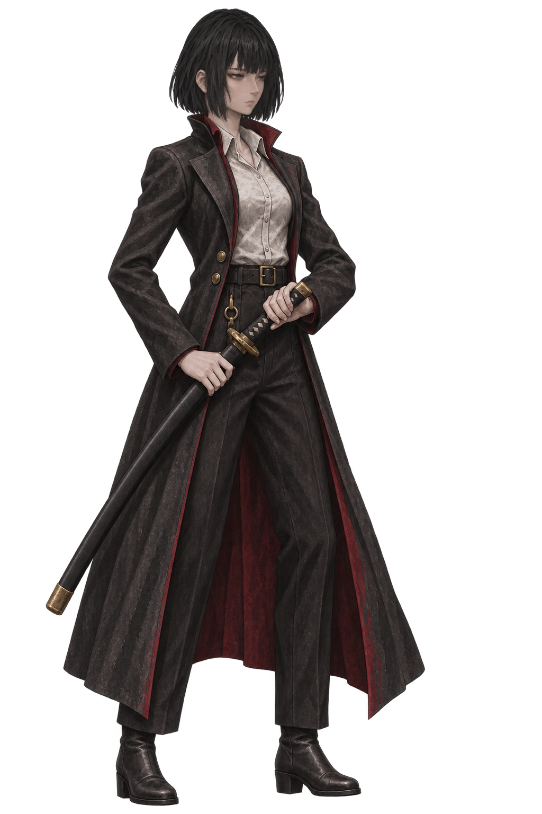
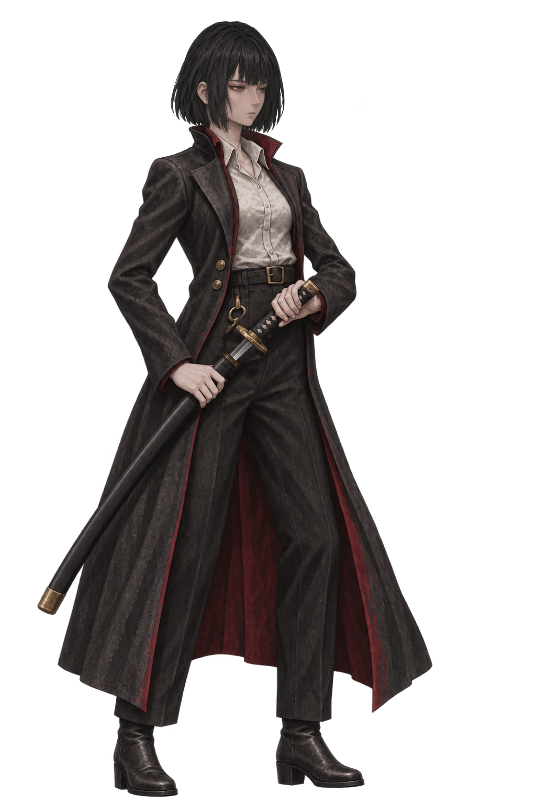
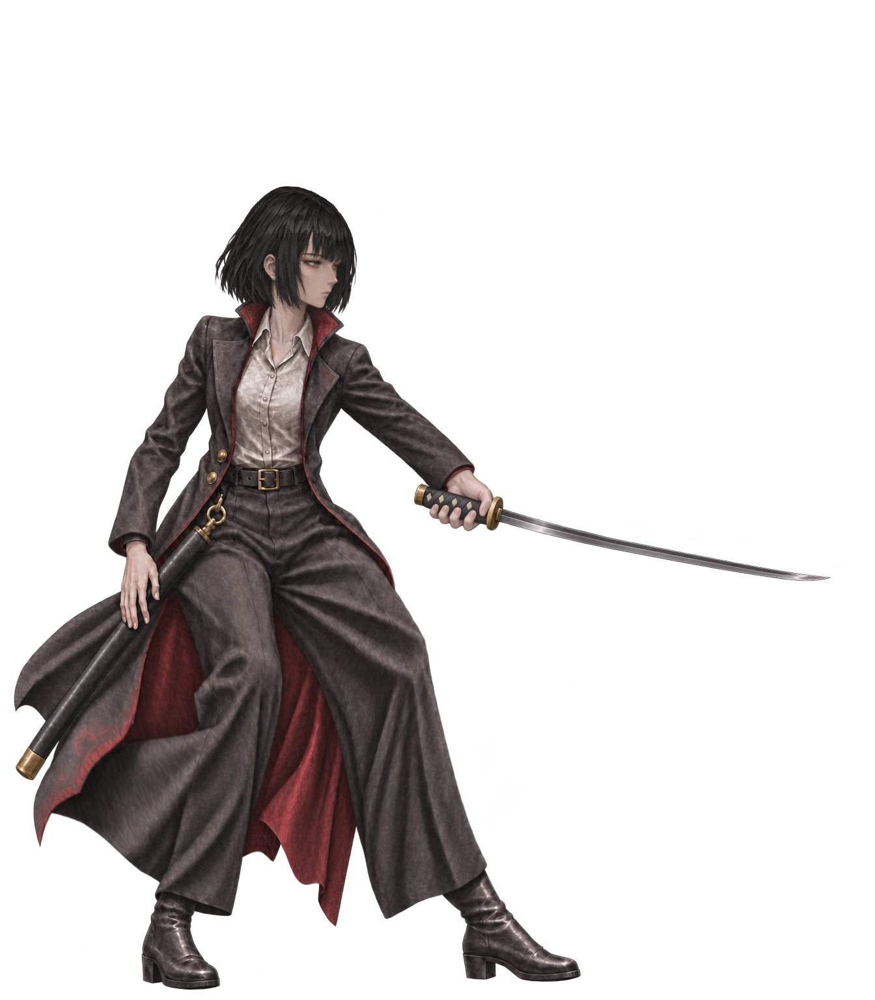

# Scarlet 首頁拔刀分鏡

點書後，Scarlet 從腰間握柄、露出一小段刀身，接到跨步出刀。首頁已接入三張透明 PNG。中間格在本機用握柄 v5 和出刀 v13 拆層製作。

| 起格 · 現有 v5 | 過渡格 · 本機拆層 v2 | 終格 · 出刀 v14 |
| --- | --- | --- |
|  |  |  |

## 書卡懸停與點書

在可懸停的裝置上，游標停在書卡或用 Tab 聚焦書卡時，Scarlet 顯示第二格（刀剛出鞘）。游標與鍵盤焦點都離開書卡後恢復待機。從第二格點書直接切到出刀 v14，停留 210 ms 後進書。角色縮到 88 px、開啟減少動態效果或第二格未就緒時，沿用原有顯示與導覽。

新版以靴底為基準。1024 × 1536 素材中，站姿、舊過渡格與新版的頭頂依序在 y=17、133、41，靴底在 y=1519、1520、1519（透明度大於 200）。新版頭頂下沉 24 px，約為站姿可見身高的 1.6%。握點和袖肘沿用站姿輪廓，鞘口與護手之間露出約 43 px 刀身。

## 出刀定格 v14

終格沿用 v13 的臉、握刀手與刀身，在本機調整腰線、膝和靴子的位置。以首頁靴底對齊比較，姿勢 2 的可見高度為 1,479 px，舊終格為 1,092 px，新終格為 1,234 px。以姿勢 2 為基準，出刀時的頭頂落差從 26.2% 收到 16.6%。腰帶相對舊終格上移 142 px。對照靴子下段的相同掃描線，畫面左靴的左緣與姿勢 2 同在 x=219，右靴則比舊終格往內收 99 px。

首頁依 1344 px 寬的出刀畫布預留空間，三格共用水平原點與靴底線。Chrome 已驗證三種桌面視窗，刀尖均留在海報內。390 × 844 與 320 × 620 的手機模擬也已驗證刀尖、靴底和點書導覽，實機觀感待確認。

## 出鞘反光與出刀殘影

姿勢 2 在護手與鞘口之間閃一次暖白反光，320 ms 內淡去。姿勢 3 出現時，朱紅殘影沿刀刃下方掃向刀尖，190 ms 內收掉，接著依原時序進書。兩個效果共用出刀圖的 1344 × 1536 座標。支援同源跨頁轉場時，書卡切線從刀尖（1273, 887）接出，朝被選書卡的中心延伸。

## 從待機直接點書的 350 毫秒

首頁三格轉場實作如下，總長 350 ms。前兩格的手、袖和臉取自同一張 v5。中間格分為身體與鞘、短刀身、持刀手與袖口三個製作圖層；短刀身取自 v13。可開啟[分層 PSD](scarlet-draw-v2-layers.psd)核對。

| 時間 | 讀者看到的動作 | 用法 |
| --- | --- | --- |
| 0–60 ms | 原本的站姿短停，雙手和鞘口的位置清楚。 | 直接顯示 v5。 |
| 60–140 ms | 重心開始下降，持刀手與留在腰側的手第一次分開。 | 顯示新過渡格。 |
| 140–350 ms | 切到 v14，雙腳已拉開，刀尖抵達畫面右側。 | 顯示 v14，排定在點書後 350 ms 導覽。支援同源跨頁轉場的瀏覽器可在切頁時接續書卡刀光。 |

## 修改過渡格

在 PSD 調整後，匯出同尺寸 1024 × 1536 的透明 PNG。三個圖層由底到頂如下。

| PSD 圖層 | 內容與調整重點 |
| --- | --- |
| `Body and scabbard` | 身體、持鞘手、刀鞘及衣襬來自 v5。臉、脖子和衣領一起保留。改姿勢時，用畫面左側靴底檢查是否滑步，用腰帶扣比較重心高度。 |
| `Visible blade` | 取自 v13 的一小段刀身。調長度時，兩端分別與鞘口、護手保持重疊。 |
| `Sleeve hand and grip` | 握刀手、袖口、刀柄及護手一起移動。v2 保留原袖子的彎折，縮小握點位移。 |

## 驗證紀錄

- Chrome 已測桌面與模擬手機的三格播放，並確認點書後抵達目的頁。角色寬度 ≤ 88 CSS px 或中間格未就緒時，回到握柄 90 ms、出刀 260 ms。開啟減少動態效果或隱藏角色時，直接導覽。
- 已逐像素核對 PSD 疊合結果與首頁過渡格 PNG。調整後可在 book 根目錄執行 `node tools/check-book-transition.cjs` 檢查時序和中斷清理，再按實際速度點書，並以書卡懸停檢查肩肘輪廓和鞘口接縫。

## 姿勢 1、2 的眨眼與衣襬

Scarlet 站立時，左外襬先擺，右外襬跟上，最後才看見兩腿之間的紅色內襯起落。三片布在站姿以 5.4 秒走完一輪。滑入書卡後，微蹲姿勢用自己的衣服裁片，週期縮短為 4.7 秒。兩套裁片都固定在上緣，內襯疊在褲管後方。

兩個姿勢共用五格眨眼，從原圖的上、下眼瞼位置取樣。出鞘格的眼睛比站姿向右 7 px、向下 24 px，眼部圖層跟著移到相同位置。睜眼時直接露出底圖。調整動作可對照[眼部影格](../docs/assets/characters/scarlet-slash/eye-blink.webp)和[首頁動畫樣式](../css/samurai.css)。

點書時結束待機，從書卡懸停直接接到出刀定格。兩個姿勢各自等待圖層解碼，缺少一張就顯示該姿勢的原畫。角色寬度 ≤ 88 CSS px 或系統開啟減少動態效果時，顯示靜態圖。Chrome 已驗證眨眼只改變眼部區域、三片衣料都會移動，以及懸停、鍵盤點書、缺圖和縮小版的切換。手機實機觀感待確認。

[首頁角色位置](../index.html) · [現行點書時序](../js/book-transition.js) · [大小與位移](../css/samurai.css) · [關鍵圖及既有素材說明](../docs/assets/characters/scarlet-slash/README.md)
